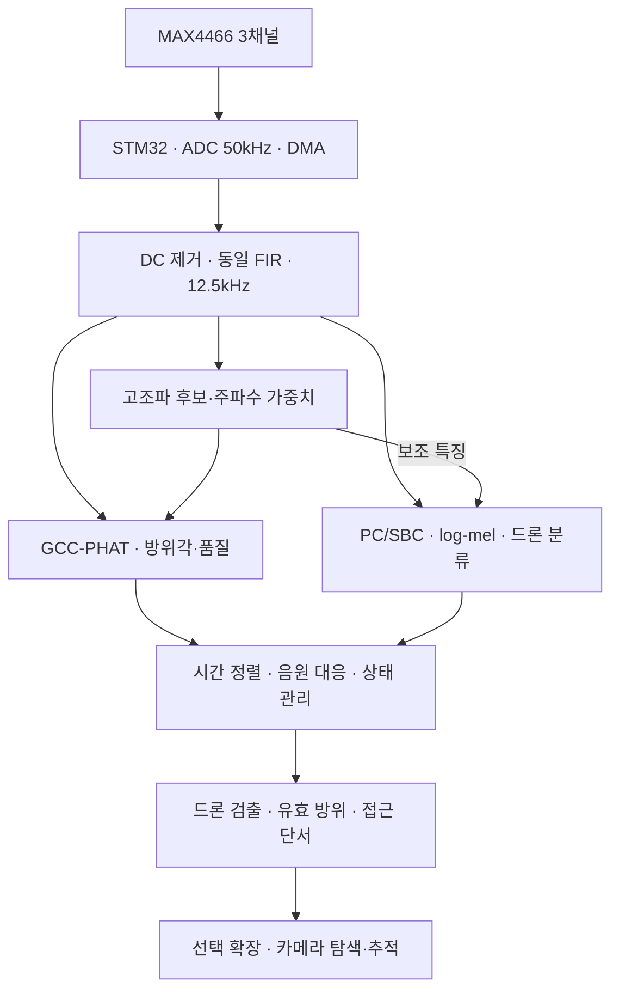

# FPV 드론 접근 인식을 위한 MAX4466 3-MIC 음향 검출·방위각 추정기

> 작성: 2026-10-14 · 버전: v1.0
> 대상: MAX4466 마이크 모듈 3개 + STM32F446RE + 개발용 PC, 필요 시 SBC
> 목적: 기존 ADC·DMA·GCC-PHAT 결과를 실제 FPV 소리 분류와 연결하는 실행 계획
> 근거: 첨부 Step1~4 및 TDOA 튜닝 문서. 펌웨어 소스·원시 녹음·학습 모델을 이번 작성에서 실행하거나 검증한 것은 아니다.
> 이 문서의 성능 목표·데이터 수량·일정은 **초기 계획값**이다. 기존 실측과 구분해 사용한다.

## 1. 최종 목표와 완료 범위

**MAX4466 3채널로 연속 수음하여 FPV 드론의 존재와 수평 방위를 추정하고, 실제 접근 상황에서 이를 검증한다.** 카메라 회전은 이 결과를 활용하는 후속 단계다.

핵심 기능은 세 가지다.

| 기능 | 질문 | 출력 | 주의점 |
| --- | --- | --- | --- |
| 드론 검출 | 드론 소리가 포함되어 있는가? | 분류 점수, 검출 상태 | 일반 멀티로터 데이터만으로 FPV 성능을 보장할 수 없음 |
| 방위각 추정 | 선택한 음원은 수평으로 어느 방향인가? | 방위각, 유효 여부, 품질 지표 | 혼합음에서 가장 강한 음원이 드론이라는 보장은 없음 |
| 접근 판단 | 그 드론이 실제로 가까워지는가? | 접근 단서, 접근 점수 또는 판단 불가 | 음량·주파수 상승만으로 확정할 수 없음 |

### 1.1 완료를 두 단계로 나눈다

- **MVP-A: 접근하는 FPV를 검출하고 그 방위각을 출력한다.** 접근 여부는 비행 경로·영상·위치 로그를 통해 정답으로 확인한다. 장치가 접근/이탈을 구분한다고 주장하지 않는다.
- **MVP-B: 접근/정지·횡단/이탈을 구별한다.** 실제 거리 변화가 라벨링된 데이터로 별도 검증한다. 성능이 부족하면 `APPROACH_UNKNOWN`을 출력하고 MVP-A 기능을 유지한다.

사용자의 최종 목표는 MVP-B까지 포함한다. 다만 음향만으로 확실히 관측되지 않는 조건에서는 판단을 보류해야 한다. 정확한 거리·속도·3차원 좌표는 기본 완료 범위에 포함하지 않는다.

### 1.2 첫 시험 범위

- 고정된 마이크 배열, 주된 FPV 한 대, 정해진 시험 장소에서 시작한다.
- 5m·10m·20m 등을 **측정 지점의 예시**로 사용한다. 탐지 가능 거리의 보장값이 아니다.
- 선풍기·음성·음악·차량·바람·카메라 모터를 방해음으로 시험한다.
- 강한 동시 음원 및 여러 드론은 별도 시험 항목으로 기록한다. 단일 음원 성능에 섞어 감추지 않는다.
- 비행 시험은 조종 담당자가 분리된 통제된 장소에서 진행한다. 수음 담당자가 장비를 들고 비행체를 따라다니는 방식은 사용하지 않는다.

## 2. 기존 구현에서 유지할 것과 바꿀 것

| 항목 | 첨부 문서의 상태 | 이번 계획 |
| --- | --- | --- |
| ADC | 3개 ADC 동시 변환, 50kHz | 유지 |
| DMA | 3ch × 1024샘플 반버퍼, 20.48ms 주기 | 유지, 누락·오버런 확인 추가 |
| 기존 TDOA | 스냅·박수 중심, 5ms 분석, FFT 512 | 회귀시험용으로 유지 |
| 기존 계산 시간 | GCC-PHAT 약 3.3ms, `-Ofast` | 기존 조건의 실측일 뿐 새 경로 성능으로 사용하지 않음 |
| 기존 반복 정밀도 | 같은 자리 스냅 표준편차 약 1.3° | 실제 드론 절대각 오차와 구분 |
| 기존 메모리 | `-O2`에서 RAM 약 50.7KB, Flash 약 143.8KB | 현재 빌드에서 다시 측정 |
| 샘플링 이후 처리 | Step4에서 FIR + ↓4 제안 | 먼저 구현·검증 |
| 마이크 간격 | 코드 기준 7cm, Step4에 14cm 변경안 | **실물 좌표를 측정해 하나로 확정** |
| 고조파 검출 | 합성음 중심 검증, 음성·음악 오탐 관찰 | 후보 특징으로 사용, 단독 드론 확정 금지 |
| FPV 실측 데이터 | 문서상 미확보 | 최우선 의존성 |

MAX4466 모듈의 마이크 중심 좌표와 방향을 기록한다. PCB 가장자리 간격으로 배열을 정의하지 않는다. 이미 14cm로 제작했다면 7cm로 되돌리기보다 실제 좌표에 코드·도구를 맞춘다.

## 3. 권장 전체 파이프라인



### 3.1 필수 설계 원칙

1. **수음은 항상 연속 동작한다.** 검출이 안 되어도 데이터를 받는다.
2. **학습 분류와 방향 추정은 병렬이다.** 고조파 확정 뒤에 분류를 시작하면 미탐과 지연이 누적된다.
3. **분류기는 고조파만 남긴 신호가 아닌 대역 내 전체 파형을 본다.** 광대역 성분과 시간 변화도 구분에 필요하다.
4. **드론 점수와 방향 품질은 별도 값이다.** 두 값을 곱했다고 드론 방향이 증명되는 것은 아니다.
5. **접근 단서는 원래 음량을 보존한 별도 경로에서 계산한다.** 분류용 정규화된 파형으로 음량 증가를 계산하지 않는다.
6. **고조파 게이트는 첫 버전에서 사용하지 않는다.** 추후 전력 최적화 시 낮은 주기의 우회 분류를 유지하고 미탐 증가를 시험한다.
7. **학습은 PC, 추론은 PC/SBC 또는 MCU다.** 현장 잡음 바닥의 적응 갱신과 신경망 재학습을 구분한다.

### 3.2 처리 주기의 시작값

| 경로 | 시작값 | 목적 |
| --- | --- | --- |
| 원본 수음 | 50kHz, 3ch, DMA 반버퍼 1024 | 기존 동시성 유지 |
| 연속 저속 파형 | FIR 후 12.5kHz, 반버퍼당 256 | 통신·메모리·연산 절약 |
| 방향 추정 | N=1024, hop=512 | 약 81.92ms 관측, 40.96ms마다 갱신 |
| 고조파 후보 | 방향 FFT 재사용 | 추가 FFT 절약 |
| 분류 특징 | 312샘플 창, hop=125, FFT=512, mel 40 | 약 24.96ms 창, 10ms마다 특징 |
| 분류 관측 | 최근 6250샘플, 약 0.5초 | 시간 패턴 관측 |
| 분류 갱신 | 100ms | 초기 추론 주기 |
| 접근 단서 | 최근 1~2초의 유효 후보 이력 | 별도 검증 후 조정 |

분류 입력은 위 정의에서 약 `40 × 48`이며, 패딩 규칙에 따라 달라질 수 있다. 학습·실시간 구현에서 동일한 규칙을 고정한다. FFT 제로패딩은 표시 bin을 늘릴 뿐 관측 시간의 주파수 분해능을 늘리지 않는다.

분류의 0.5초 관측과 접근 판단의 1~2초 관측은 지연의 원인이다. 빠른 검출 출력을 접근 확정까지 막아 두지 않는다. 지연이 길면 0.25초·0.5초·1초 창을 같은 시험셋에서 비교한다.

## 4. 하드웨어와 MAX4466 검증

### 4.1 가장 먼저 확인할 항목

- 마이크 모듈 3개의 제조 형태, 전원, 게인 설정, 캡슐 방향을 기록한다.
- STM32 ADC의 입력 범위와 모듈 출력 범위가 맞는지 확인한다. 3.3V ADC에 5V 범위 출력을 직접 넣지 않는다.
- 세 모듈에 안정적인 공통 전원·접지 기준을 제공하고 모터 전류 경로와 신호 배선을 분리한다.
- 같은 종류의 방풍재를 세 캡슐에 적용한다. 적용 전후 응답도 비교한다.
- 마이크는 고정 베이스, 카메라 모터는 가능한 한 진동이 덜 전달되는 위치에 둔다.
- 스피커를 배열 중심 정면에 두고 세 채널의 DC 평균·RMS·클리핑·스펙트럼·상대 지연을 기록한다.
- 포텐셔미터 각도가 같다는 이유만으로 실제 게인이 같다고 가정하지 않는다.

### 4.2 게인을 최대로 올리면 안 되는 이유

MAX4466 IC의 gain-bandwidth product는 600kHz다.[S1] 단일 지배극 근사에서 폐루프 대역폭은 대략 `GBW / noise gain`에 따라 달라진다. 게인을 올리면 고주파 응답과 위상도 달라질 수 있다.

Adafruit의 특정 MAX4466 보드는 조절 범위가 25~125배지만, 사용 중인 모든 모듈이 같은 회로라는 뜻은 아니다.[S2]

**실행:** 목표 사용 거리에서 가장 큰 소리에도 클리핑이 없도록 게인을 정한 뒤 고정한다. 서로 다른 게인으로 녹음했다면 메타데이터에 남긴다. 단순 크기 보정만으로 주파수별 위상 편차까지 해결되는 것은 아니다.

### 4.3 전기적 동시성과 음향 편차를 분리한다

| 시험 | 확인하는 것 | 실행 |
| --- | --- | --- |
| 동일 전기 신호 입력 | ADC·DMA 채널 간 지연·매핑 | 마이크 출력을 분리하고 ADC 허용 범위의 같은 바이어스 신호를 입력 |
| 같은 스피커 음 수음 | 캡슐·앰프·배치 차이 | 같은 위치에서 스윕·대역 잡음 반복 녹음 |
| 여러 실제 방향 수음 | 좌표·각도 부호·절대 오차 | 배열을 고정하고 스피커를 알려진 각도로 이동 |

장비가 없어 전기 시험을 생략하면 `미검증`으로 남긴다. 서로 다른 앰프의 출력을 직접 묶어 시험하지 않는다. 캡슐을 나란히 둔 시험도 완전히 동일한 음압·위상을 보장하지 않으므로 정밀 보정에는 한계가 있다.

## 5. 데이터 전략

### 5.1 데이터의 역할을 구분한다

| 자료 | 사용 목적 | 할 수 없는 주장 |
| --- | --- | --- |
| 공개 원음 | 초기 특징 분석·사전 실험 | 현재 MAX4466 장치의 실환경 성능 보장 |
| 스피커 재생을 3-MIC로 녹음 | 펌웨어·전송·분류·방위 연결 검증 | 실제 FPV 비행 탐지 거리·접근 판별 성능 |
| 실제 FPV 비행을 3-MIC로 녹음 | 최종 학습 보완·검증·접근 라벨 | 시험하지 않은 기체·장소까지의 보장 |
| 실제 현장 배경음 | 오탐 학습·시간당 오탐 평가 | 다른 환경의 모든 방해음 대표 |

공개 자료는 원본 녹음 위치, 편집·해설·음악 여부, 라이선스, 기체 종류를 확인한 뒤 사용한다. DroneAudioset은 드론 탑재 마이크로 사람 소리를 찾는 연구용이므로 지상 원거리 FPV 검출 데이터와 구별한다.[S6] 32종 드론 데이터 연구는 후보 자료이지만 파일 접근·라이선스·FPV 포함 여부를 직접 확인하기 전에는 확보된 데이터로 계산하지 않는다.[S7]

### 5.2 첫 데이터 수집량

아래는 **시작 목표량이며 충분한 일반화를 보장하는 최소 표본 수가 아니다.** 겹친 창 개수보다 서로 다른 녹음 세션의 수가 중요하다.

| 항목 | 시작 목표 | 구성 |
| --- | --- | --- |
| 개발용 드론 원음 | 누적 20~40분 | 여러 스로틀·거리·방위, 별도 날짜/세션 |
| 개발용 비드론 배경 | 누적 2시간 이상 | 조용함·바람·음성·음악·선풍기·차량·자기 소음 |
| 어려운 혼합음 | 누적 20~30분 | 드론+선풍기, 드론+음성, 드론+바람 |
| 튜닝에 쓰지 않을 최종 드론 시험 | 실제 비행 사건 30회 목표 | 접근·정지/횡단·이탈을 각각 포함 |
| 최종 드론 없는 시험 | 별도 세션 2시간부터 | 운용 장소에서 연속 녹음, 사건 단위 오탐 평가 |

드론 존재 라벨은 `drone_present`를 사용한다. 사람 목소리는 비드론 방해음이며, 드론과 동시에 녹음되면 혼합음으로 표시한다.

실제 FPV 확보가 어렵다면 공개음·재생음으로 개발을 먼저 진행하되, 실제 비행 완료 기준은 미충족으로 남긴다. 한 기체만 확보하면 기체 미관측 일반화는 시험하지 못했다고 명시한다.

### 5.3 반드시 넣을 비드론 데이터

| 종류 | 이유 | 수집 방법 |
| --- | --- | --- |
| 선풍기·환풍기 | 드론과 비슷한 회전 고조파 | 풍속 단계·거리·방향 변경 |
| 남녀 음성·음악 | 주기성과 고조파 구조 | 여러 화자·장르, 해설 포함 자료도 음성만 따로 라벨 |
| 차량·오토바이·전동 공구 | 모터·엔진 소음 혼동 | 실제 사용 환경에서 독립 세션 확보 |
| 바람·옷 스침·충격 | 포화·저주파·순간 잡음 | 정상 상태와 포화 상태 모두 기록 |
| SBC 팬·카메라 모터 | 장치가 스스로 내는 소리 | 정지·회전·팬 속도 조건별 수집 |
| 드론 없는 긴 무음 구간 | 연속 운용 오탐 측정 | 이벤트 중심 녹음 외에 상시 녹음 |

### 5.4 저장 및 라벨 규칙

3채널을 같은 WAV에 저장하거나 공통 시작 샘플 번호가 있는 형식으로 저장한다. 세 개의 독립 녹음기로 녹음한 파일은 현재 TDOA의 정답 데이터로 취급하지 않는다.

필수 메타데이터:

```text
session_id, source_recording_id, recorded_at, site_id
source_type = real_flight / playback / synthetic / background
drone_id, drone_model, mic_module_ids, geometry_id, gain_id
sample_rate_hz, firmware_commit, filter_version
start_sample, duration_s, drop_count, clip_ratio_ch0/ch1/ch2
wind_note, motor_active, background_tags
label_quality, split = train / validation / test
```

사건 라벨:

```text
event_id, session_id, start_s, end_s
drone_present = 0 / 1 / uncertain
motion = approaching / receding / hovering / crossing / unknown
azimuth_gt_deg, azimuth_gt_source, azimuth_gt_uncertainty_deg
range_gt_m, range_gt_source, sync_uncertainty_ms
```

확실히 들리지 않는 먼 구간을 억지로 0/1로 라벨링하지 않는다. 물리적으로 드론이 있었는지와 음향적으로 식별 가능한지를 별도 기록한다. 정답 영상·비행 로그를 동기화할 때는 시작·종료 동기 이벤트 또는 공통 시간 기준으로 시간 오차를 추정한다.

### 5.5 분할 후에 창을 자른다

1. 원본 녹음 단위로 train/validation/test를 정한다. 시작 비율은 60/20/20을 참고하되 사건 수와 환경 구성을 우선한다.
2. 같은 비행·원본 영상·그 재생 녹음·증강 복제본은 같은 split에 둔다.
3. 그다음 0.5초 창을 자른다. 인접하고 겹친 창을 서로 다른 split에 섞지 않는다.
4. 정규화 통계·특징 선택은 train에서만 계산한다.
5. 임계값·지속 조건은 validation에서 고른다.
6. test는 마지막 평가에 사용한다. 실패를 보고 모델을 수정했다면 새 시험 세트를 확보한다.

여러 기체가 있으면 한 기체를 통째로 제외한 평가를 추가한다. 장소·날짜 분리 시험도 별도로 기록한다.

## 6. 학습 전략

### 6.1 단계별 비교 모델

| 순서 | 모델 | 입력 | 얻고 싶은 답 |
| --- | --- | --- | --- |
| B0 | 고조파 임계값 | SNR 대비 고조파 점수 | 물리 규칙만으로 어디서 실패하는가? |
| B1 | 로지스틱 회귀 또는 작은 트리 모델 | MFCC 통계·스펙트럼 특징·고조파 특징 | 저비용 분류로 충분한가? |
| B2 | 작은 CNN/DS-CNN | log-mel 시간×주파수 배열 | 시간 패턴이 오탐을 줄이는가? |
| B3, 선택 | YAMNet 특징 + 작은 분류기 | 16kHz 모노 | 사전학습 특징이 현장 데이터 부족을 보완하는가? |

첫 학습은 `drone_present` 이진 분류로 시작한다. 방해음 태그는 오류 분석용으로 유지한다. 드론과 음성이 동시에 있을 수 있으므로 배타적인 ‘드론/음성/팬’ softmax만으로 혼합음의 정답을 강제하지 않는다. 필요하면 독립 출력의 다중 라벨 모델로 확장한다.

YAMNet은 일반 오디오 특징의 전이학습 기준선이다.[S5] 현재 12.5kHz 파형을 16kHz로 리샘플링할 수 있으나 이미 제거된 대역을 복원하지는 못한다. YAMNet용 관측 길이는 자체 0.5초 모델과 다르므로 지연도 함께 비교한다.

### 6.2 B2 전처리와 모델 시작안

1. 고정 기준 채널 하나를 선택한다. 순간마다 ‘가장 큰 채널’로 바꾸면 입력 분포가 흔들릴 수 있다.
2. DC 제거 후 학습과 실시간에서 같은 FIR·샘플링 조건을 적용한다.
3. STFT → power spectrum → mel filter bank → `log(power + epsilon)`을 계산한다.
4. train에서 계산한 대역별 평균·표준편차로 정규화한다. 해당 수치를 모델과 함께 저장한다.
5. 작은 Conv 블록 2~3개 → global average pooling → 단일 드론 출력으로 시작한다.
6. 데이터가 적을 때 큰 모델을 먼저 늘리지 않는다. 잘못 분류한 실제 녹음을 먼저 보강한다.

FPV의 고조파가 어디까지 의미 있는지 확인하기 전에는 12.5kHz·5kHz 이하 대역이 충분하다고 확정하지 않는다. 상위 대역을 잃어 구분이 안 되는 증거가 나오면 원본 50kHz 캡처로 비교하고 통신·처리 속도를 재설계한다.

### 6.3 구체적인 학습 실행

- [ ] B1을 먼저 학습하고 validation의 precision-recall 곡선과 혼동 사례를 저장한다.
- [ ] B2는 binary cross entropy, Adam, 초기 학습률 `1e-3`, batch 32, 최대 50 epoch, 조기 종료 patience 5를 출발점으로 사용한다. 이는 튜닝 시작값이다.
- [ ] 긴 한 세션이 배치를 지배하지 않도록 세션별 샘플링을 적용한다. 클래스 가중치 또는 균형 배치를 비교한다.
- [ ] validation loss와 사건 단위 검출 성능을 함께 본다. 창 정확도만으로 모델을 고르지 않는다.
- [ ] 동일 split과 전처리로 3개 seed를 비교해 결과의 변동을 기록한다.
- [ ] 모델 파일, 전처리 설정, split 목록, 학습 seed, 코드 버전, 선택 임계값을 묶어 저장한다.
- [ ] inference score를 검증 없이 ‘실제 확률’로 표시하지 않는다. 필요하면 validation에서 calibration을 수행한다.

### 6.4 증강 규칙

| 증강 | 적용 | 제한 |
| --- | --- | --- |
| 실제 배경음 혼합 | train의 배경으로 다양한 SNR 생성 | 동일 파일이 test에 있으면 안 됨 |
| gain 변화 | 녹음 레벨 편차에 대한 강건성 | 접근 학습에서 원래 음량 기울기와 라벨을 깨지 않도록 별도 관리 |
| 작은 시간 이동 | 창 경계 의존성 감소 | 사건 라벨도 맞춰 이동 |
| 시간·주파수 마스킹 | log-mel 과적합 완화 | 너무 강하게 하여 드론 특징 전체를 지우지 않음 |
| 완만한 피치·속도 변화 | 기체·회전수 변동 보완 | 실제 기체 다양성을 대체하지 않음 |

합성 혼합의 초기 SNR 범위는 -10~+10dB를 비교하되 실제 녹음의 분포에 맞춘다. 합성 혼합의 SNR과 현장에서 추정한 SNR은 같은 정답값이 아니다.

분류용 모노 증강과 TDOA용 다채널 증강을 분리한다. 다채널에 서로 다른 임의 시간 이동을 주면 방향 정답이 바뀐다. 다채널 합성은 음원별 기하 지연을 먼저 적용한 뒤 채널별로 합쳐야 한다.

### 6.5 드론으로 오인한 비드론 소리를 반복 수집한다

이러한 사례를 hard negative라고 부른다.

1. 실제 현장에서 모델을 연속 실행한다.
2. 잘못 검출한 사건의 앞뒤 구간을 저장한다. 정상 비검출 구간도 일부 무작위 저장해 선택 편향을 줄인다.
3. 사람이 소리와 영상을 확인해 태그를 붙인다.
4. 새 학습 세션으로 추가하고 모델을 다시 학습한다.
5. 별도의 고정 시험셋에서 기존 드론 검출률이 떨어지지 않는지 확인한다.

한 가지 선풍기 소리를 외우는 식으로 해결하지 않는다. 새로운 팬·거리·속도 조건에서 다시 시험한다.

## 7. 방향 추정과 분류 결과의 결합

### 7.1 신호처리 경로

- 세 채널에 동일 FIR 계수, 독립적인 채널 상태, 동일 데시메이션 위상을 적용한다.
- FIR 상태를 DMA 반버퍼 경계에서 초기화하지 않는다.
- 12.5kHz에서 5kHz까지 사용한다면 전이 대역을 포함한 필터를 설계하고 실제 응답으로 확인한다. Step4의 탭 수는 시작 예시이지 보편적인 확정값이 아니다.
- 전체 12.5kHz 분류 대역을 쓰려면 그 전체 대역의 접힘을 고려한다. 2.5kHz TDOA만 보호하는 느슨한 필터를 분류기 전체 대역 보호용으로 그대로 쓰지 않는다.
- 50kHz ADC에서 이미 접힌 신호는 디지털 FIR로 복구할 수 없다. 모터 연결 후 아날로그 입력의 고주파 잡음도 재점검한다.

### 7.2 같은 녹음으로 비교할 세 방법

| 방법 | 설명 | 역할 |
| --- | --- | --- |
| D0 | 기존 고정 대역 GCC-PHAT | 회귀 기준 |
| D1 | 드론 후보 고조파 주변 가중 GCC-PHAT | 후보 성분에 집중 |
| D2 | SNR 가중 또는 완만한 주파수 가중 | 고조파가 흐려진 구간의 대안 |

D0/D1/D2의 가중치 효과를 비교할 때는 샘플링 속도·관측 길이·hop을 같게 둔다. 기존 5ms 스냅 경로와 새 81.92ms 경로의 비교는 별도 회귀시험으로 표시한다. 샘플링 속도가 바뀌면 같은 Hz 대역에 해당하는 FFT bin도 다시 계산한다.

기본주파수는 여러 로터 때문에 하나로 정해지지 않을 수 있다. f0/2·2f0 오류와 급격한 RPM 변화도 기록한다. 처음부터 한 f0의 좁은 마스크만 강제하지 않는다.

Step4의 ‘f0 < c/(2d)이면 고주파 고조파를 함께 쓸 수 있다’는 논의는 이상적인 고조파 구조를 전제로 한다. 누락된 고조파, 여러 로터, 반사에서 자동으로 유효하지 않다. 고주파 사용 여부는 **실측 절대 오차와 잘못된 피크 비율**로 결정한다.

### 7.3 기하와 품질

마이크 위치를 `p_i`, 음원 쪽 단위 방향을 `u`로 잡으면 원거리 모델에서 `t_j - t_i ≈ -(p_j - p_i)·u / c`다. GCC 구현의 부호와 일치하는지는 알려진 방향의 녹음으로 검증한다.

최대 지연은 각 쌍별 실제 거리 `d_ij`로 계산한다.

```text
max_delay_s = d_ij / c
max_lag_samples = ceil(d_ij * fs / c) + 보간·오차 여유
```

기존 ±13샘플을 샘플링 속도·간격 변경 후 그대로 사용하지 않는다.

품질 로그는 피크/주변 대비, 두 번째 피크와의 경쟁, 물리 범위, 세 지연의 closure, LSE 잔차, 방향의 시간 연속성, norm, 클리핑·유실을 포함한다. 각 지표를 단순히 하나의 ‘확률’로 부르지 않는다.

평면 배열에서 음원이 위에 있으면 수평 방향 벡터의 norm이 작아질 수 있다. `norm≈1`을 강제하면 실제 공중 드론을 버릴 수 있다. norm이 작은 구간은 방위 추정이 불안정하므로 검출은 유지하면서 `AZIMUTH_UNRELIABLE`을 출력한다. 3마이크 평면 배열은 위/아래 대칭 모호성이 있고, 거리 추정은 기본 기능이 아니다.

### 7.4 음원 대응의 핵심 한계

왼쪽 팬 + 오른쪽 드론 상황에서 분류기는 드론을 찾고 TDOA는 팬을 찾을 수 있다. 같은 시간 구간이라는 사실만으로 같은 음원이라는 뜻은 아니다.

**첫 구현:** 단일 지배 음원 가정을 명시하고, 복수 피크·방위 급변·낮은 품질이면 각도 출력을 보류한다. 이 검사만으로 모든 오지향을 막는 것은 아니다.

**실패 시 확장:** SBC에서 복수 방향 후보를 구하고, 후보 방향별 지연 보상 합산(빔포밍) 신호를 분류한다. 동일 시간의 여러 후보를 비교하고 지속적으로 지지되는 방향을 선택한다. 이 입력에 맞춘 학습·검증이 필요하다. 3개 마이크로 가까운 음원을 항상 분리할 수 있다고 가정하지 않는다.

## 8. 접근 인식: 검출과 분리해서 검증

### 8.1 단순 음량 증가가 접근의 정답이 아닌 이유

이상적인 자유음장에서 같은 음원 출력이라면 수음 진폭은 대략 거리에 반비례한다. 하지만 실제 FPV는 스로틀·방향·높이·프로펠러 상태·바람에 따라 소리 자체가 변한다. 정지한 드론의 스로틀 상승도 음량 증가를 만든다. f0 상승 역시 RPM 변화와 도플러가 섞이므로 단독으로 접근을 확정할 수 없다.

따라서 첫 버전은 다음을 출력한다.

```text
drone_detected
azimuth_deg, azimuth_valid
approach_state = UNKNOWN / CANDIDATE / APPROACHING / NOT_APPROACHING
```

`APPROACHING`은 별도 접근 판별기가 실제 비행 평가를 통과한 후에만 사용한다. 학습하지 않았거나 신뢰도가 부족하면 `UNKNOWN`이다. `NOT_APPROACHING`은 드론 없음과 다른 상태다.

### 8.2 접근 라벨 만들기

1. 접근·이탈·횡단·제자리 비행 사건을 별도로 촬영하고 거리 변화의 정답을 기록한다.
2. 정답 거리는 비행 로그/위치 측정 또는 위치가 표시된 시험 경로를 이용한다. 오차가 큰 수단은 그 오차를 기록한다.
3. 시간에 따른 거리 `r(t)`가 유의하게 줄어드는 구간을 접근으로 라벨링한다. 거리 측정 오차보다 작은 변화는 `unknown` 처리한다.
4. 제자리 스로틀 상승과 실제 접근을 반드시 별도 수집한다. 접근 방향의 외형을 외우지 않도록 여러 방위를 사용한다.
5. 처음에는 통제된 경로의 사건 수준 라벨로 시작한다. 연속 속도 추정은 후속 범위다.

음향은 발생 후 `r/c`만큼 늦게 도착한다. 예를 들어 20m에서 약 58ms다. 고속 이동 각도를 비교할 때는 수음 시각과 음원 발생 시각의 차이를 고려하거나, ‘지연 포함 현재 방향 오차’로 평가한다고 명시한다.

### 8.3 접근 판별의 실행 순서

- 기준선 A0: 드론으로 연결된 후보의 고정 게인 대역 에너지, 배경 대비 SNR, 증가 기울기를 1~2초 단위로 기록한다. 후보 연결이 불확실하면 계산 결과도 보류한다.
- A1: 에너지 기울기·주파수 변화·검출 지속성·각도 변화·자기 소음 상태 등을 입력으로 작은 로지스틱 회귀/트리 모델을 비교한다.
- A2, 조건부: 충분한 실제 사건이 쌓이고 A1의 한계가 확인되면 시간 모델을 검토한다. 처음부터 큰 RNN을 만들지 않는다.
- 접근/횡단/이탈 혼동표, 접근 오판 사건 수, 판정 지연을 따로 평가한다.
- 정지 스로틀 상승과 접근을 구별하지 못하면 접근 확정 출력을 비활성화한다. 필요 시 카메라/외부 거리 정보와 결합한다.

검출·방위 추정에 성공해도 접근 판별에 실패할 수 있다. 이 경우 최종 목표의 어느 부분이 미충족인지 명확히 보고한다.

## 9. MCU·PC·SBC 분담과 통신

### 9.1 개발은 PC 연결로 시작한다

| 장치 | 개발 초반 | 기본 운용 |
| --- | --- | --- |
| STM32 | 수음·전처리·기존 TDOA·전송 | 연속 TDOA·품질·고조파 특징·모터 제어 |
| PC | 데이터 저장·학습·오프라인 평가·실시간 분류 | 모델 학습·분석·배포 준비 |
| SBC | PC 버전 검증 후 이식 | 음향 분류·상태 관리·선택적 영상 처리 |

처음부터 SBC와 MCU를 동시에 디버깅하지 않는다. PC에서 동일 녹음에 대한 결과를 확보한 뒤 SBC로 옮긴다. 보유 SBC의 종류·메모리는 아직 확정 정보가 아니므로 특정 보드 성능을 전제로 하지 않는다.

### 9.2 UART 대역폭

921600bps, 8N1 기준의 이상적인 바이트 한계는 92,160B/s다.

| 데이터 | 계산 | 파형만의 전송량 | 결정 |
| --- | --- | ---: | --- |
| 50kHz, 3ch, int16 | 50000×3×2 | 300,000B/s | 연속 UART 불가, 짧은 캡처용 |
| 12.5kHz, 3ch, int16 | 12500×3×2 | 75,000B/s | 개발·다중 음원용, 부하 실측 필요 |
| 12.5kHz, 1ch, int16 | 12500×1×2 | 25,000B/s | 기본 SBC 분류용 |

파형은 바이너리로 전송한다. 텍스트 CSV/JSON에 샘플을 담지 않는다. 예를 들어 20.48ms마다 40B 헤더를 추가하면 약 1,953B/s가 더 필요하다. 방향 결과·상태 패킷까지 포함해 시험한다.

**개발 모드:** 3ch 연속 파형 + 방향 결과를 PC에 저장한다. **운용 모드:** 기준 1ch + 방향 결과를 보낸다. SBC에서 방향별 빔포밍을 수행하려면 3ch 운용을 유지하거나 통신을 바꿔야 한다.

### 9.3 패킷과 시간 기준

파형 패킷 필드 제안:

```text
magic, protocol_version, packet_type, payload_length, sequence
stream_epoch, first_sample_index_50k, output_sample_count
sample_rate_hz, channel_mask, filter_version, flags
PCM payload, CRC
```

방향·분류 메시지 필드 제안:

```text
measurement_id, stream_epoch, window_start_sample, window_end_sample
azimuth_deg, doa_valid, peak_quality, closure_error, norm
harmonic_score, f0_candidates, clip_ratio, drop_count, motor_active
```

ADC 원본 샘플 번호를 공통 시간축으로 사용한다. 다운샘플링 시작 위상과 FIR 군지연을 메타데이터에 기록하고 PC에서 시간 대응을 계산한다. 재부팅 시 `stream_epoch`를 바꾸어 이전 결과와 혼합되지 않게 한다.

분류는 관측 구간을, 방향은 관측 구간과 대표 시각을 함께 갖는다. 같은 구간의 결과로 후보를 연결하고 현재 출력에는 유효한 최신 각도를 사용한다. 데이터 수신 시각을 음향 측정 시각으로 대체하지 않는다.

CRC 오류·샘플 누락·순서 역전이 발생하면 해당 구간의 분류/TDOA를 무효화하고 연속 창을 다시 채운다. 누락을 0으로 채워 정상 신호처럼 판단하지 않는다. 통신 큐는 크기를 제한하고 오래된 관측을 버린다. 진단 덤프 때문에 ADC나 제어를 막지 않는다.

### 9.4 실시간 실행 구조

- ADC ISR: 반버퍼 식별·샘플 번호·상태 플래그만 갱신한다.
- 높은 우선순위 처리: 완료 반버퍼를 안전하게 소비하고 전처리한다.
- 주기 처리: 충분한 새 샘플이 쌓이면 고조파·TDOA를 수행한다.
- 송신: TX DMA와 제한된 큐로 전송한다.
- SBC: 수신·링버퍼, 특징·추론, 상태 판단, 기록을 분리한다.

긴 신경망 추론을 메인 루프에서 한 번에 호출하면 평균 CPU 부하가 낮아도 20.48ms 반버퍼 마감을 놓칠 수 있다. MCU 이식 시 최악 실행 시간과 선점/분할 실행 구조를 확인한다. RTOS를 쓰지 않아도 되지만 마감 위반을 숨기는 큰 버퍼만 추가하지 않는다.

### 9.5 MCU 이식의 조건

F446RE의 SRAM은 128KB, Flash는 512KB다.[S3] CMSIS-NN은 Cortex-M4 및 INT8 추론의 후보 도구다.[S4]

메모리 계획 시 최소한 다음을 합산한다.

| 항목 | 예시 크기 또는 확인 방법 |
| --- | --- |
| 기존 ADC DMA 배열 | 6144×2 = 12,288B |
| 3ch × 2048샘플 int16 링버퍼 | 12,288B |
| 3ch × 1초 12.5kHz int16 원음 | 75,000B, MCU에 무심코 보관하면 부담 |
| 40×48 특징 입력 | int8 1,920B / float32 7,680B |
| FFT·IFFT·FIR 상태·송신 큐 | 현재 구현의 실제 크기 측정 |
| 신경망 activation·scratch arena | 모델 변환·실행 후 측정 |
| stack·heap·기타 전역 | map 파일과 최대 사용량 계측 |

위 값은 각 후보 배열의 크기이며 기존 구현에 모두 추가되는 것으로 합산하지 않는다. 재사용·공유 여부를 메모리 지도로 표시한다. 가중치가 작아도 activation이 커서 실패할 수 있다.

이식 순서: 작은 모델 선정 → 대표 train 데이터로 INT8 보정 → PC에서 float/INT8 비교 → MCU에 올려 같은 입력 비교 → DSP와 동시 실행 → 유실·최대 지연·메모리 확인. 양자화 보정에 test 데이터를 사용하지 않는다.

초기 내부 목표는 전체 CPU 이용률 70% 이하와 충분한 stack 여유다. 이것만으로 실시간성을 증명하지 않으므로 반버퍼 마감과 추론 최악 시간도 통과해야 한다. 실패하면 SBC 추론을 유지한다.

## 10. 상태 관리와 카메라 확장

### 10.1 기본 검출기 상태

| 상태 | 진입 조건 | 동작/해제 |
| --- | --- | --- |
| INIT | 부팅·수신 재시작 | 창·필터 안정화, 드론 없음으로 단정하지 않음 |
| MONITOR | 정상 연속 수음 | 분류·방위 지속 계산 |
| CANDIDATE | 분류 점수 상승 | 최근 결과와 방향 품질 확인 |
| DRONE_CONFIRMED | 시간 누적 기준 충족 | 드론 존재 출력, 유효할 때만 각도 출력 |
| DEGRADED | 클리핑·유실·오버런·강한 자기 소음 | 원인 플래그와 마지막 유효 시각 보고 |
| LOST | 점수·관측 소실 | 제한 시간만 후보 유지 후 감시 복귀 |

접근 상태는 이 상태와 별도 필드로 둔다. 드론이 확정되어도 접근 여부는 unknown일 수 있다.

진입 임계값을 해제 임계값보다 높게 둔다. 예를 들어 100ms 간격의 최근 3회 중 2회 충족을 실험 시작안으로 삼을 수 있지만 수치는 validation에서 정한다. 겹친 창은 독립 표본이 아니므로 단순 확률 곱셈으로 오탐 감소율을 주장하지 않는다.

한 번의 사건으로 묶을 최소 검출 지속 시간과 해제 후 병합 간격도 고정한다. 이 정의가 바뀌면 시간당 오탐 횟수도 바뀐다.

기존 문서의 JAM 플래그는 실제 원인이 확인되기 전에는 `HIGH_NOISE/CLIP/DEGRADED`로 해석한다. 큰 소음만으로 의도적 방해를 판정하지 않는다.

### 10.2 카메라 연결은 각도 추정기 검증 이후

1. 마이크 좌표와 카메라 0°의 오프셋·회전 부호·기구 한계를 보정한다.
2. 품질·유효 시각·음원 대응 조건을 통과한 각도만 목표로 보낸다.
3. 모터 구동 중 음향 관측은 품질을 낮추거나 무효화한다. 원시 데이터는 가능하면 계속 저장한다.
4. 영상에서 확인되면 화면 중심 오차에 따라 시각 추적한다.
5. 영상에서 놓치면 최신 음향 후보를 이용해 재탐색한다. 오래된 각도로 계속 회전하지 않는다.

수평 배열은 안정적인 수직 조준까지 보장하지 않는다. 첫 카메라 버전은 고정 틸트 또는 제한된 수직 탐색을 사용한다. 모터 회전 중 감시 공백과 정착 시간은 전체 지연에 포함한다.

## 11. 단계별 액션플랜

작업 시간은 구현·분석에 쓰는 **능동 작업 시간의 추정치**다. 비행 장소 확보·조종 협조·날씨 대기·배터리 교체는 별도다. 각 단계는 산출물과 통과 기준이 충족되어야 완료로 표시한다.

### P0. 범위·기준선 고정 — 2시간

**작업**

- [ ] 현재 펌웨어와 설정을 태그/커밋으로 고정한다.
- [ ] 실물 마이크 간격·좌표·모듈·게인·전원을 측정한다.
- [ ] 실제 FPV 녹음 가능 여부와 조종 협조자를 확인한다.
- [ ] 시험 방위 8개, 시험 거리 지점, 사용할 정답 측정 방법을 정한다.
- [ ] 드론 존재·방위·접근의 출력 정의를 1절 기준으로 확정한다.

**산출물:** `baseline_manifest.yaml`, `geometry.json`, `test_conditions.md`.

**통과:** 코드·실물 좌표가 일치하고 재현 가능한 설정이 남는다.

**막히면:** 기체가 없어도 P1~P6의 재생음 개발은 진행한다. 실제 비행 성능은 미검증으로 남긴다.

### P1. 3채널 수음 품질 점검 — 6~10시간

**작업**

- [ ] 채널별 평균·RMS·클리핑 수·drop·OVR 카운터를 추가한다.
- [ ] 조용한 환경, 스피커, 모터/팬 동작을 각각 1~2분 녹음한다.
- [ ] 세 채널 매핑·동시성·게인·주파수 응답을 점검한다.
- [ ] 알려진 방향 8개에서 스피커 신호를 각 10초씩 반복 기록한다.
- [ ] 마이크 교체가 의심되면 동일 위치에서 모듈을 바꾸어 오류가 모듈을 따라가는지 확인한다.

**산출물:** `hardware_check.csv`, 3ch WAV, 채널별 스펙트럼·상대 지연 플롯.

**통과:** 정상 시험 레벨에서 클리핑·프레임 유실이 없고 각도 부호와 채널 순서가 맞는다. 미수행 동시성 시험은 명시한다.

**실패 시:** 모델 작업을 미루고 게인·전원·배선·불량 모듈부터 해결한다.

### P2. FIR·다운샘플링·연속 기록 — 6~10시간

**작업**

- [ ] PC에서 FIR 계수를 만들고 통과/저지 응답을 저장한다.
- [ ] 세 채널 FIR 상태를 분리하고 같은 샘플 위상으로 ↓4 한다.
- [ ] 12.5kHz 3ch 바이너리 연속 송신과 PC 수신기를 구현한다.
- [ ] sequence·CRC·원본 샘플 번호·유실 로그를 추가한다.
- [ ] 동일한 짧은 50kHz 캡처를 PC에서 다운샘플링한 결과와 MCU 결과를 비교한다.
- [ ] 경계마다 가짜 주기 성분이 생기지 않는지 확인한다.
- [ ] 송신 포함 10분 연속 시험을 한다.

**산출물:** `stream_capture.py`, `frontend_config.json`, 연속 녹음, 처리시간·통신 로그.

**통과:** 10분 시험에서 설명되지 않은 drop/CRC 오류가 없고, PC/MCU 전처리 차이를 수치로 설명할 수 있다.

**실패 시:** 패킷·큐·DMA를 수정한다. 운용 분류는 1ch 전송으로 줄일 수 있지만 3ch 동시 녹음 검증을 완료했다고 표시하지 않는다.

### P3. 데이터셋 v0 확보·분할 — 8~12시간 + 현장 대기

**작업**

- [ ] 5절의 배경음과 드론 자료를 확보한다.
- [ ] 우선 실제 장치로 배경 2시간, 재생음 양성 20~40분을 기록해 수집 파이프라인을 확인한다.
- [ ] 실제 FPV 비행도 가능한 첫 시점부터 별도 세션으로 녹음한다.
- [ ] 모든 파일에 session/source/geometry/gain 정보를 기록한다.
- [ ] 확실하지 않은 구간을 uncertain으로 표시한다.
- [ ] 원본 단위로 split을 잠근 다음 학습 창을 생성한다.

**산출물:** `dataset_manifest.csv`, `events.csv`, `splits.json`, 클래스·세션 분포표.

**통과:** train/validation/test 사이에 같은 원본·재생 파생본이 섞이지 않고 실제음/재생음 구분이 유지된다.

**실패 시:** 녹음 수를 겹친 창으로 부풀리지 않는다. 부족한 환경·실제 FPV 세션을 먼저 추가한다.

### P4. 고조파·학습 분류 기준선 — 8~12시간

**작업**

- [ ] 같은 split으로 B0, B1, B2를 학습·평가한다.
- [ ] 고조파 점수 분포를 드론·팬·음성·음악별로 비교한다.
- [ ] 연속 validation 녹음에 모델을 재생 실행한다.
- [ ] 임계값과 지속 조건을 바꾸며 시간당 오탐과 사건 검출률을 비교한다.
- [ ] 오탐 20건, 미탐 20건까지 원음을 듣고 원인을 태그한다. 사건이 더 적으면 전부 검토한다.
- [ ] 초기 데이터 부족이 보이면 B3를 선택적으로 추가한다.

**산출물:** 모델 v0, `preprocess.json`, `classification_report.md`, 오류 사례 목록.

**통과:** 단순 정확도 대신 validation에서 검출률·오탐/시간·지연을 비교해 한 모델을 선택한다. 고조파 단독보다 학습 모델이 나은지 근거를 남긴다.

**실패 시:** 모델 크기를 늘리기 전에 실제 장치의 hard negative와 낮은 SNR 드론을 추가한다. 데이터 누수도 재검사한다.

### P5. 드론 방위 추정 검증 — 8~12시간

**작업**

- [ ] 같은 3ch 녹음에 D0/D1/D2를 실행한다.
- [ ] N=512/1024/2048을 하나씩 바꾸며 오차·유효율·지연을 비교한다.
- [ ] 먼저 알려진 8방위의 스피커 재생으로 부호·편향을 확인한다.
- [ ] 실제 FPV에서 방위·높이·배경 조건별 오차를 계산한다.
- [ ] 팬과 드론을 다른 방향에서 동시에 내는 시험을 별도로 수행한다.
- [ ] 고주파 고조파를 추가했을 때 튐이 늘어나는지 확인한다.

**산출물:** `doa_report.csv`, 각도별 편향 플롯, 오차 누적분포, 조건별 무효율.

**통과:** 유효 각도의 절대 오차와 각도 출력 유효율을 함께 보고한다. ‘거의 모두 버려서 오차만 낮은’ 설정은 선택하지 않는다.

**실패 시:** 순서대로 좌표·부호 → 채널 응답 → 반사/높이 → 대역/마스크 → 다중 음원을 확인한다. 분류 점수 임계값만 올려 방향 오류를 덮지 않는다.

### P6. PC 실시간 분류·방위 결합 — 6~10시간

**작업**

- [ ] 수신 파형으로 0.5초 링버퍼를 만들고 100ms마다 추론한다.
- [ ] 샘플 시간축으로 분류 구간과 MCU 방향 구간을 대응시킨다.
- [ ] 상태 전이·진입/해제 기준·각도 유효 시각을 구현한다.
- [ ] 드론 검출, 각도 품질, 접근 상태를 별도로 표시한다.
- [ ] 통신 단절·클리핑·모터 동작에서 DEGRADED가 나오는지 확인한다.
- [ ] 최소 30분 연속 실행하고 큐 누적·메모리 증가·지연을 확인한다.

**산출물:** `realtime_pipeline.py`, 타임라인 로그, 입력 녹음으로 재현 가능한 실행 설정.

**통과:** 동일 입력을 오프라인/실시간 처리한 결과가 허용 수치 오차 내에서 맞고, 누락·오래된 각도를 정상 결과로 사용하지 않는다.

**실패 시:** 추론·통신·시간 정렬 문제를 분리한다. 현재 단계에서는 SBC 이식이나 카메라 연결을 추가하지 않는다.

### P7. 접근 라벨·판별 기준선 — 6~10시간 + 현장 대기

**작업**

- [ ] 실제 접근·이탈·횡단·제자리 사건을 별도로 수집한다.
- [ ] 원음과 정답 거리/영상의 시간 대응 오차를 기록한다.
- [ ] 고정 게인의 에너지 기울기 A0를 먼저 평가한다.
- [ ] 제자리 스로틀 증가를 반드시 반례로 넣는다.
- [ ] A1을 학습하되 녹음 세션 단위 분할을 유지한다.
- [ ] 점수 신뢰도가 낮거나 후보가 바뀐 구간은 UNKNOWN을 출력한다.

**산출물:** `approach_events.csv`, 접근/비접근 혼동표, 판정 지연·보류율.

**통과:** 실제 접근 시험에서 접근 검출과 오판을 각각 보고한다. A0보다 개선이 없으면 접근 확정 기능은 미완료로 남긴다.

**실패 시:** 더 많은 실제 운동 조건을 수집한다. 음향 관측만으로 구별이 어려우면 영상/외부 거리 입력을 추가하는 방향을 검토한다.

### P8. SBC 배치·현장 최종 시험 — 8~12시간 + 현장 대기

**작업**

- [ ] PC에서 고른 모델·전처리·임계값을 고정해 SBC로 이식한다.
- [ ] 동일 녹음에서 PC/SBC 결과와 추론 지연 p50/p95/max를 비교한다.
- [ ] 실제 부착 위치에서 SBC 팬·전원 노이즈를 다시 녹음한다.
- [ ] 학습에 쓰지 않은 비행 사건과 긴 비드론 세션으로 평가한다.
- [ ] 실제 통신·저장·선택적 영상 부하를 켜고 발열·유실·오탐을 기록한다.
- [ ] 12절의 결과표를 채워 MVP-A와 MVP-B의 충족 여부를 나눠 판정한다.

**산출물:** 고정 모델/설정, `final_evaluation.md`, 데모 영상, 원시 시험 로그.

**통과:** 검증된 조건·거리·기체 범위와 실패 조건을 명시해 재현할 수 있다.

**실패 시:** PC에서는 되는데 SBC에서만 실패하면 실행·부하·전처리 문제를 우선 확인한다. 두 환경 모두 실패하면 데이터·음향 경로 문제로 돌아간다.

### P9. 선택 확장 — MCU 단독 추론 8~16시간 / 카메라 연결 4~8시간

**MCU 이식 작업**

- [ ] B1 또는 작은 B2를 INT8로 변환한다.
- [ ] 대표 입력에서 float/INT8/MCU 출력 오차를 비교한다.
- [ ] 실제 activation·stack·FFT 공존 메모리를 측정한다.
- [ ] ADC 마감을 보장하며 추론할 수 있는지 측정한다.
- [ ] 연속 운용 후 SBC 버전과 검출·지연·유실을 비교한다.

**카메라 작업**

- [ ] 각도 부호·영점·최대 회전 범위를 보정한다.
- [ ] 먼저 스피커로 방향 이동을 확인한다.
- [ ] 모터 구동 시 음향 신뢰도 처리와 정지 후 복귀를 시험한다.
- [ ] 실제 FPV에 대해 검출부터 영상 확보까지 지연과 실패율을 기록한다.

**완료 기준:** 각각 기본 기능보다 성능이 나빠지지 않았다는 수치가 있다. MCU 단독 동작은 필수 최종 조건이 아니므로 무리하게 모델을 줄여 오탐·미탐을 늘리지 않는다.

## 12. 시험 지표와 임시 합격선

### 12.1 정의부터 고정한다

| 지표 | 계산/정의 |
| --- | --- |
| 사건 검출률 | 검출된 드론 사건 / 전체 라벨된 드론 사건 |
| 오탐/시간 | 드론 없는 구간의 거짓 검출 사건 / 관측 시간 |
| 오지향률 | 검출된 사건 중 드론과 다른 음원 방향을 선택한 사건 비율 |
| 각도 오차 | `abs(wrap_to_180(estimated - ground_truth))` |
| 방향 유효율 | 유효 각도를 낸 관측 수 / 평가 대상 관측 수 |
| 검출 지연 | 정의된 사건 시작부터 최초 확정까지, 중앙값·p95·최대 |
| 접근 판정 | 접근 recall, 비접근 오판, UNKNOWN 비율, 판정 지연 |
| 종단 지연 | 수음·창 누적·계산·통신·상태 확정·선택적 모터/영상 지연 |
| 실시간 품질 | drop·OVR·CRC·최대 처리시간·메모리·큐 깊이 |

사건 시작은 ‘정해진 구역 진입’, ‘정답 로그의 접근 시작’, ‘사람이 식별 가능한 음향 시작’ 중 무엇인지 기록한다. 서로 다른 정의의 지연을 같은 표에서 비교하지 않는다. 거리별 recall을 함께 제공하고 먼 미탐을 임의로 시험에서 제외하지 않는다.

### 12.2 개발용 임시 기준

아래 수치는 제품 성능 약속이 아니다. 첫 실측 이후 사용 목적에 맞게 변경하고 변경 이유를 기록한다.

| 항목 | 초기 목표 | 평가 제한 |
| --- | --- | --- |
| 기본 사건 검출률 | 지정 조건에서 90% 이상 | 사건 수·기체·거리·날씨 함께 표시 |
| 비드론 오탐 | 시간당 1회 이하 | 최소 2시간 예비 관측, 더 긴 반복 시험 필요 |
| 방위 절대 오차 | 중앙값 5° 이하, p95 10° 이하 | 정답 측정 오차·무효율 함께 표시 |
| 방향 유효율 | 단일 음원 지정 조건에서 80% 이상 | 드론 검출 조건과 구분 |
| 최초 검출 지연 | p95 1초 이하 | 사건 시작 정의 고정 |
| 접근 판단 | 접근 recall 80% 이상, 비접근 오판 10% 이하 | 예비 기준, UNKNOWN 포함 전체 분모로 보고 |
| 연속 수음 | 기본 30분 시험에서 유실·OVR 없음 | 최종은 실제 전체 부하에서 반복 |

접근에서 UNKNOWN을 제외하고 정확도를 계산하면 보류를 많이 할수록 성능이 좋아 보인다. 전체 사건 기준 성능과 보류율을 함께 보고한다. 사건 30회 정도는 초기 확인용이며 세부 조건별 신뢰성 주장에는 부족하다.

2시간 무오탐만으로 1회/시간 이하를 강하게 증명할 수는 없다. 일정한 발생률의 Poisson 가정에서도 0회 관측의 95% 상한은 대략 `3/T시간`이다. 실제 방해음은 시간적으로 몰릴 수 있으므로 여러 날·환경에서 반복한다.

### 12.3 최종 결과표 양식

| 조건 | 실제/재생 | 기체·거리 | 사건 수/시간 | 검출률 | 오탐/시간 | 각도 중앙값/p95 | 유효율 | 오지향 | 접근/보류 | 지연 p95 |
| --- | --- | --- | --- | --- | --- | --- | --- | --- | --- | --- |
| 조용함 | 미측정 | 미측정 | 미측정 | 미측정 | 미측정 | 미측정 | 미측정 | 미측정 | 미측정 | 미측정 |
| 바람 | 미측정 | 미측정 | 미측정 | 미측정 | 미측정 | 미측정 | 미측정 | 미측정 | 미측정 | 미측정 |
| 팬 동시 | 미측정 | 미측정 | 미측정 | 미측정 | 미측정 | 미측정 | 미측정 | 미측정 | 미측정 | 미측정 |
| 모터 구동 | 미측정 | 미측정 | 미측정 | 미측정 | 미측정 | 미측정 | 미측정 | 미측정 | 미측정 | 미측정 |

## 13. 일정과 우선순위

기본 P0~P8의 능동 작업량은 약 **58~90시간**으로 잡는다. 현장 조건·기존 코드 상태에 따라 늘어난다. 주 15~20시간 기준 4~6주를 첫 계획으로 두며, 비행 협조가 늦어지면 최종 검증도 늦어진다.

| 주차 | 우선 작업 | 주말까지 남길 결과 |
| --- | --- | --- |
| 1 | P0~P2 | 실제 좌표·채널 검증·연속 녹음 |
| 2 | P3~P4 | 데이터 v0·고조파/학습 비교 |
| 3 | P5~P6 | 드론 소리 방향 평가·PC 실시간 통합 |
| 4 | P7 | 실제 접근 라벨·접근 판별 기준선 |
| 5 | P8 | SBC 현장 평가·실패 사례 보강 |
| 6, 필요 시 | 재검증·P9 선택 | 최종 결과표·카메라 또는 MCU 확장 |

한 주에 모든 항목을 끝내는 것이 완료 기준은 아니다. 앞 단계의 데이터·계측이 없으면 뒤 단계의 모델 튜닝 시간을 늘리지 않는다.

### 바로 시작할 첫 작업 6개

1. 마이크 3개의 중심 좌표를 재고 `geometry.json`을 만든다.
2. 현재 게인·전원·모듈 사진을 기록하고 임의로 바꾸지 않는다.
3. drop·OVR·클리핑을 한 로그에서 확인할 수 있게 한다.
4. 12.5kHz 3ch 연속 녹음을 10분 수행한다.
5. 팬·음성·드론 재생음을 같은 장치로 각각 녹음한다.
6. 실제 FPV 녹음 일정을 확보하고 접근·이탈·제자리 시험을 준비한다.

## 14. 구현 산출물 구조 제안

아래는 **앞으로 만들 파일의 목록**이다. 이 Markdown 작성과 함께 스크립트나 모델이 구현된 것은 아니다.

| 위치 | 파일/내용 |
| --- | --- |
| `config/` | geometry, FIR, 전처리, 모델, 임계값, 펌웨어 설정 |
| `data/raw/` | 수정하지 않은 원시 녹음과 메타데이터 |
| `data/labels/` | 사건·방위·접근·정답 불확실성 라벨 |
| `data/splits/` | 원본 세션 단위 분할 목록 |
| `tools/` | capture, frontend check, dataset build, train, evaluate, realtime |
| `models/` | float/INT8 모델·입력 규약·전처리 통계·버전 |
| `firmware/` | 기존 수음, decimator, harmonic, DOA, transport, 상태 |
| `reports/` | 실험 비교·오류 사례·최종 평가 |

추천 도구 작성 순서는 `stream_capture.py` → `check_frontend.py` → `build_dataset.py` → `train_baselines.py` → `evaluate_events.py` → `evaluate_doa.py` → `realtime_pipeline.py`다. 각 도구는 같은 설정 파일과 split을 읽도록 한다.

실험 기록 양식:

```text
experiment_id:
date:
firmware_commit / code_commit / model_version:
dataset_manifest / split_version / geometry_id / gain_id:
변경한 한 가지:
비교 기준선:
평가 조건·사건 수·관측 시간:
검출률 / 오탐·시간 / 각도 오차 / 유효율 / 지연:
접근 판정 / 보류율:
최대 처리 시간 / 메모리 / drop / OVR:
판정: 유지 / 원복 / 추가 측정
다음 작업:
```

## 15. 중단·변경 판단표

| 관찰된 문제 | 먼저 할 일 | 다음 선택 |
| --- | --- | --- |
| 드론 소리가 원음에서 거의 안 보임 | 게인·바람·자기 소음·거리별 스펙트럼 확인 | 센서/기구 개선 또는 검증 가능한 거리 범위 축소 |
| 팬을 드론으로 분류 | 새로운 팬·거리·속도 데이터 보강 | 시간 특징·전이학습 비교 |
| 드론 검출은 맞지만 방향은 팬 | 동시 음원 평가와 원음 대응 분석 | 방향별 빔포밍·분류 또는 오지향 시 보류 |
| 높은 각도에서 norm이 작음 | 실제 고도각·좌표·지연 확인 | 검출 유지, 수평각 신뢰도 저하 표시 |
| MCU 추론 시 drop 발생 | 최악 시간·큐·버퍼·우선순위 계측 | SBC 유지 또는 작은 모델로 변경 |
| 음량 상승을 접근으로 오인 | 제자리 스로틀 반례 추가 | 접근 UNKNOWN 유지, 외부 관측 결합 |
| 새 장소에서 성능 급락 | 데이터 분포·게인·전처리 차이 확인 | 새 장소 데이터 수집 후 별도 시험 |
| 높은 주파수를 넣자 각도 튐 증가 | 고조파 누락·복수 f0·반사 검사 | 대역/가중치 재선정, 간격 변경은 이후 검토 |
| 실제 FPV를 확보하지 못함 | 재생음 통합 시험까지 수행 | 실비행 접근 인식 완료라고 표시하지 않음 |

## 16. 참고 근거

### 첨부 자료

- `Step1_ADC_DMA_DoubleBuffer_MicCheck.md`: 수음·DMA 구조, 시간 예산, 채널 검증 상태.
- `Step2_UART_Dump_Capture_SignalCheck.md`: 921600bps 전송과 원파형 덤프.
- `Step3_GCC_PHAT_Python_MCU_DOA.md`: 기존 스냅 기준선, 계산 시간, 메모리, norm 해석.
- `Step4_드론음향_탐지추정_설계.md`: 다운샘플링, 고조파 후보, 설계 미결 사항.
- `TDOA_튜닝_배경지식.md`: 기하·위상·보간·튜닝의 배경.

### 공식 문서·원문

- [S1: Analog Devices MAX4466 — 전원·GBW·증폭기 특성](https://www.analog.com/en/products/max4466.html)
- [S2: Adafruit MAX4466 모듈 — 해당 보드의 게인 조절 범위](https://www.adafruit.com/product/1063)
- [S3: ST STM32F446RE — 메모리·코어·주변장치](https://www.st.com/en/microcontrollers-microprocessors/stm32f446re.html)
- [S4: Arm CMSIS-NN — Cortex-M 및 정수 추론](https://arm-software.github.io/CMSIS-NN/latest/)
- [S5: TensorFlow YAMNet 전이학습 예제](https://www.tensorflow.org/tutorials/audio/transfer_learning_audio)
- [S6: DroneAudioset 원문 — 드론 탑재 음향의 사람 존재 인식 목적](https://arxiv.org/abs/2510.15383)
- [S7: 32종 드론 음향 데이터 연구 — 후보 자료](https://arxiv.org/abs/2509.04715)

외부 자료 확인일: 2026-10-14. 모델 선택·초기 수치·일정·합격선은 위 자료가 보장하는 성능이 아니라 본 프로젝트를 위한 제안이다.

