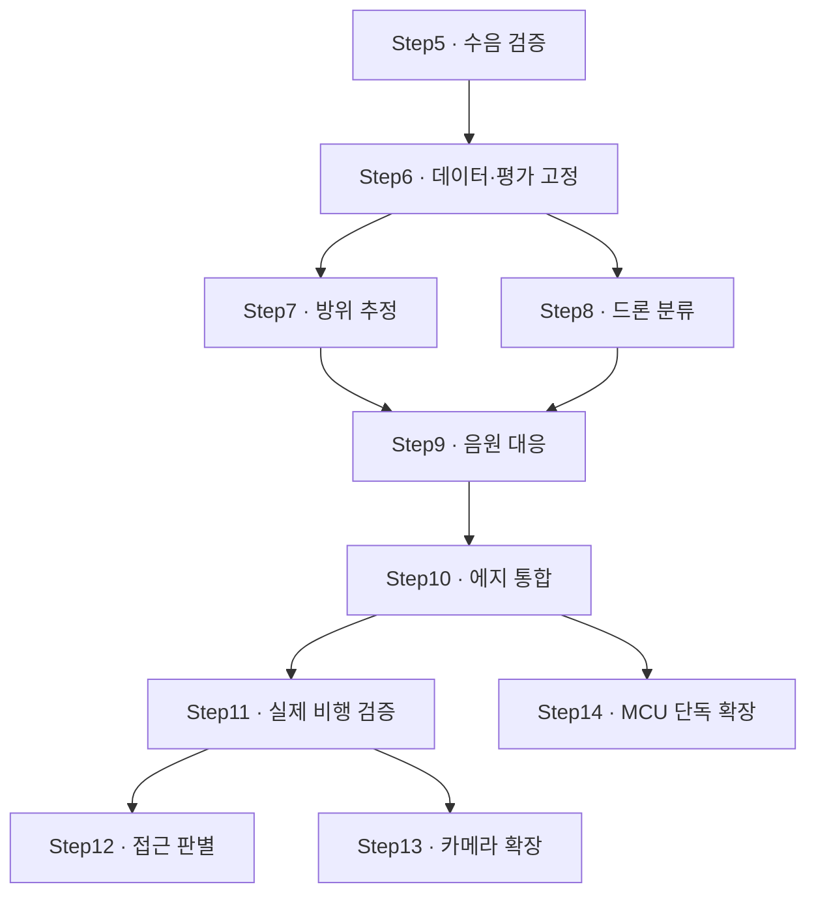

# FPV 음향 각도추정기 — Step5~14 실험·구현·통과 기준

> 작성일: 2026-10-15 · 버전: v1.0
> 대상: MAX4466 마이크 3개 + STM32F446RE + PC/SBC
> 최종 목표: 실제 FPV 드론의 존재와 방위각을 추정하고, 접근 여부를 별도 검증한다.
> 범위: 기존 Step1~4 이후의 실행 계획. 카메라 연결과 MCU 단독 분류는 확장 단계다.
> 상태: 모든 단계는 **계획**이며, 이 문서 작성으로 실험·구현이 완료된 것은 아니다.

## 1. 변경 방향

**알고리즘을 하나씩 추가하는 순서가 아니라, 검증할 문제를 하나씩 해결하는 순서로 진행한다.**

- 결과를 측정하거나 비교표를 만들었다는 사실만으로 다음 단계로 넘어가지 않는다.
- 측정 결과가 미리 정한 조건을 충족해야 통과한다.
- SRP-PHAT이나 CNN을 반드시 채택하지 않는다. 기존 방식이 요구사항을 만족하면 유지할 수 있다.
- 드론 검출, 방위 추정, 두 결과의 음원 대응, 접근 판별을 각각 검증한다.
- 실제 비행과 스피커 재생 시험을 구분한다.

**이 문서의 수치는 프로젝트용 초기 제안값이다. 논문이 보장하는 성능이 아니다.** 시험을 시작하기 전에 적용 조건과 수치를 고정한다. 변경이 필요하면 이유와 버전을 남기고 동일 조건의 기준선부터 다시 평가한다.

### 기존 자료와의 관계

| 자료 | 유지할 역할 | 이번 계획과의 관계 |
| --- | --- | --- |
| Step1 | ADC·DMA·마이크 기본 검증 | 미검증 항목은 Step5에서 보완 |
| Step2 | UART 덤프·원파형 확인 | Step5에서 연속 기록으로 확장 |
| Step3 | 스냅 기반 GCC-PHAT·LSE 기준선 | Step7의 비교 기준으로 보존 |
| Step4 | 드론 음향 특성·고조파·다운샘플링 설계 | Step5 이후에서 실험으로 채택 여부 결정 |
| 학습·파이프라인 실행계획 | 전체 학습 전략과 구조 | 본 문서는 단계별 진입·완료 판정에 집중 |

Step4의 과제를 이미 구현했다면 Step5에서 다시 만들지 않는다. 같은 구현으로 통과 시험을 수행한다. Step3 내부의 코드 로드맵 번호와 본 문서의 Step 문서 번호는 구분한다.

## 2. 공통 운영 규칙

### 2.1 각 Step의 고정 형식

| 항목 | 내용 |
| --- | --- |
| 검증 질문 | 이번 단계에서 해결할 문제 하나 |
| 입력·선행 조건 | 하드웨어·데이터·설정·이전 단계 산출물 |
| 실험·구현 과제 | 실제 수행할 작업 |
| 측정 지표 | 계산 방법과 분모 |
| 통과 기준 | 수치 또는 명확한 참/거짓 조건 |
| 산출물 | 재현에 필요한 코드·설정·데이터·결과 |
| 실패 시 조치 | 수정할 부분과 되돌아갈 단계 |

### 2.2 판정 상태

| 상태 | 의미 | 다음 단계 처리 |
| --- | --- | --- |
| 미착수 | 시험을 시작하지 않음 | 필요한 선행 작업 수행 |
| 진행 중 | 구현 또는 측정 중 | 해당 실험 계속 |
| 실험 완료·미통과 | 결과는 있지만 기준 미달 | 원인 수정·재시험 |
| 통과 | 사전에 정한 조건에서 모든 필수 기준 충족 | 해당 결과를 요구하는 다음 단계 진입 |
| 범위 변경 | 조건·목표를 변경함 | 새 버전으로 시험하고 이전 실패도 보존 |

미측정 항목은 0이나 통과로 표시하지 않는다. 한 조건에서의 통과를 다른 거리·기체·환경의 통과로 확대하지 않는다. 통과 기준을 만족하지 못한 채 다음 단계의 독립적인 개발을 할 수는 있지만, 통합 완료로 판정할 수는 없다.

### 2.3 시험 전 고정할 조건

- 마이크 중심 좌표, 채널 순서, 게인, 전원, 방풍재, 장착 위치.
- ADC 속도, FIR 계수·상태 처리, 다운샘플링 위상, 분석 창·hop.
- 모델·전처리 버전, 점수 임계값, 검출 지속·해제 조건.
- 거리·방위·높이·배경음·음원 수·모터/팬 동작 상태.
- 사건 시작·종료 정의, 정답 측정 방법과 오차, 관측 유효기간.
- 평가 데이터 목록과 split 버전. 최종 시험셋은 튜닝에 사용하지 않는다.

12.5kHz 처리는 현재 제안 기준이다. 해당 대역으로 드론 분류가 충분한지는 별도 확인한다. 샘플링 속도나 마이크 간격을 바꾸면 지연 탐색 범위와 주파수 bin을 다시 계산한다.

## 3. 전체 단계와 의존성

| Step | 해결할 문제 | 선행 조건 | 통과 후 확보되는 기능 |
| --- | --- | --- | --- |
| 5 | 데이터가 믿을 만한가? | Step1~4 구현·설정 확인 | 검증된 3ch 연속 기록 |
| 6 | 비교할 데이터와 정답이 있는가? | Step5 | 고정 데이터셋·평가 규칙 |
| 7 | 어디서 오는 소리인가? | Step6의 방위 시험 데이터 | 단일 음원 방위 추정 |
| 8 | 드론 소리인가? | Step6의 분류 데이터 | 사건 단위 드론 검출 |
| 9 | 그 드론이 그 방향에 있는가? | Step7·8 | 분류와 방향의 대응 |
| 10 | 에지에서 마감을 지키는가? | Step9 | 실시간 통합 실행 |
| 11 | 실제 FPV에서도 되는가? | Step10·독립 비행 시험셋 | 실비행 검출·방위 성능 |
| 12 | 접근을 구별하는가? | Step11·거리 변화 정답 | 접근/비접근/판단 불가 |
| 13, 선택 | 카메라가 영상을 확보하는가? | Step11 | 음향 안내 기반 영상 확보 |
| 14, 선택 | MCU 단독 분류가 가능한가? | Step10·고정 평가셋 | 단독 실행 및 재검증 |



Step7과 Step8은 독립적으로 진행할 수 있다. Step13은 Step12 완료를 기다릴 필요가 없다. Step14로 실행 구성을 바꾸면 실제 운용 완료를 주장하기 전에 Step11도 새 구성으로 재검증한다.

## Step5. 연속 수음·전처리·기록 경로 검증

### 검증 질문

**이후 알고리즘을 비교할 만큼 믿을 수 있는 3채널 데이터를 얻고 있는가?**

### 입력·선행 조건

기존 동시 ADC·DMA 구현, 마이크 3개, PC 연결. 실물 좌표와 코드 설정을 확인한다. 실제 마이크 중심 간격이 7cm인지 14cm인지 먼저 확정한다.

### 실험·구현 과제

- [ ] 마이크 좌표·채널 순서·게인·전원·방풍재를 기록한다.
- [ ] FIR + 다운샘플링 + 3채널 연속 저장을 구현한다.
- [ ] 샘플 번호, CRC, DMA 유실, ADC overrun, 클리핑을 기록한다.
- [ ] 세 채널의 필터 상태는 분리하고 계수·데시메이션 위상은 동일하게 적용한다.
- [ ] 동일한 저장 디지털 입력을 PC와 MCU 전처리에 넣어 출력을 비교한다. 서로 다른 시각에 녹음한 파형을 직접 비교하지 않는다.
- [ ] 무음·스피커 재생·팬 동작 조건에서 연속 기록한다.
- [ ] DMA 경계에서 FIR 상태가 초기화되지 않는지 확인한다.

### 측정 지표·통과 기준

| 지표 | 초기 통과 기준 |
| --- | --- |
| 연속 기록 | 지정한 정상 입력 조건의 10분 시험에서 유실·OVR·CRC 오류 0 |
| 클리핑 | 위 정상 입력 시험에서 세 채널 모두 0. 별도의 과입력 시험은 구분 |
| 채널 대응 | 채널 순서와 데시메이션 위상이 명시된 설정과 일치 |
| 전처리 일치 | 동일 입력·동일 계수·초기 상태에서, 같은 int16 스케일의 최종 PCM 최대 차이 ≤ 2 LSB |
| 시간 복원 | 샘플 번호로 모든 저장 구간과 누락 여부를 복원 가능 |

2 LSB는 저장 PCM의 구현 허용오차 제안값이다. 마이크 간 아날로그 편차나 ADC 자체 정확도 기준이 아니다. 정수 스케일·반올림·FIR 지연 정렬 규칙을 비교 전에 고정한다.

### 산출물

`geometry.json`, `frontend_config.json`, 연속 기록 도구, 시험 WAV, 유실·클리핑·PC/MCU 차이 로그.

### 실패 시 조치

버퍼 안전 복사·FIR 상태·전송 큐·게인을 먼저 수정한다. 원음 품질 문제가 남아 있으면 분류 모델 튜닝으로 넘어가지 않는다.

## Step6. 평가 데이터셋과 시험 규칙 고정

### 검증 질문

**이후의 개선을 공정하게 비교할 데이터와 정답이 있는가?**

### 입력·선행 조건

Step5 통과, 수음 설정 고정, 녹음 세션을 구별할 메타데이터.

### 실험·구현 과제

- [ ] 드론 재생음·실제 FPV·팬·음성·음악·차량·바람·장치 자기 소음을 구분해 수집한다.
- [ ] 방위 시험용으로 8방위 × 2개 높이 조건 × 3회 반복, 총 48회 기록을 만든다. 배열은 고정한다.
- [ ] 높이만 적지 말고 음원과 배열의 상대 위치·고도각 또는 이를 계산할 정보를 기록한다.
- [ ] 드론 존재 구간과 방위 정답을 라벨링하고 불확실한 구간은 별도 표시한다.
- [ ] 원본 녹음 세션 단위로 train/validation/test를 먼저 나눈 뒤 창을 자른다.
- [ ] 같은 원본·재생 파생본·증강본을 같은 split에 둔다.
- [ ] 오탐 사건 병합 규칙과 검출 지연 시작 시점을 고정한다.

### 측정 지표·통과 기준

| 항목 | 초기 통과 기준 |
| --- | --- |
| 개발용 드론 녹음 | 20분 이상, 독립 세션·음원 출처 목록 포함 |
| 개발용 비드론 녹음 | 2시간 이상, 필수 방해음 종류 포함 |
| 메타데이터 | 모든 파일에 세션·원본·실제/재생·게인·배열 정보 존재 |
| 데이터 누수 | split 사이 동일 원본과 파생본 중복 0 |
| 방위 정답 | 측정 불확실성 2° 이내를 목표로 확인. 달성 못 하면 목표 정확도 평가에 사용하지 않음 |
| 최종 시험 | 개발 데이터와 분리한 수집·보관 계획 및 목록 존재 |

데이터량은 개발 시작 기준이지 일반화 성능 보장이 아니다. 겹친 창 수를 독립 사건 수로 계산하지 않는다. Step7과 Step8에 필요한 검증 사건·환경이 부족하면 해당 단계 시험 전에 추가 확보한다.

### 산출물

`dataset_manifest.csv`, `events.csv`, `splits.json`, `evaluation_protocol.md`.

### 실패 시 조치

누락된 환경·정답·독립 세션을 추가한다. 실제 FPV가 없어도 재생음으로 개발할 수 있지만 Step11은 실제 비행 없이는 통과할 수 없다.

## Step7. 방향 추정 알고리즘 선정

### 검증 질문

**현재 3마이크에서 어떤 방식이 필요한 정확도와 유효율을 만족하는가?**

### 입력·선행 조건

Step6의 고정 방위 평가 데이터, 실제 배열 좌표, 기존 GCC-PHAT·LSE 기준선.

### 실험·구현 과제

| 비교군 | 방식 |
| --- | --- |
| D0 | 기존 고정 대역 GCC-PHAT + LSE |
| D1 | 주파수 가중 GCC-PHAT + LSE |
| D2 | 동일 상관함수를 사용하는 SRP-PHAT |

- [ ] 같은 녹음에 세 방법을 적용한다.
- [ ] 먼저 관측 길이·대역·hop을 같게 두고 알고리즘만 비교한다.
- [ ] 이후 선택한 방식에서 창 길이와 대역을 한 번에 하나씩 변경한다.
- [ ] SRP-PHAT은 후보 방향의 예상 지연을 미리 계산하고 거친 탐색 후 주변을 세밀하게 탐색한다.
- [ ] 고도각을 무조건 0°로 고정하지 않는다. 평면 배열의 위/아래 모호성과 머리 위 음원의 불안정성을 기록한다.
- [ ] 무효 출력도 저장하고, 특정 방향에서만 실패하는지 확인한다.

### 측정 지표·통과 기준

지정된 **단일 음원** 시험 조건에서 다음을 모두 만족한다.

| 지표 | 초기 통과 기준 |
| --- | --- |
| 유효 출력의 방위 절대오차 | 중앙값 ≤ 5°, p95 ≤ 10° |
| 방위 유효율 | 전체 사전 지정 평가 구간 중 ≥ 80% |
| 좌표 규약 | 알려진 방향에서 회전 부호·채널 순서·좌표 변환 일치 |
| 재현성 | 동일 데이터·설정에서 동일 판정 재현 |

유효한 결과만의 오차와 전체 유효율을 반드시 함께 계산한다. 정확한 음원 위치·정답 오차·거리·고도각을 결과표에 붙인다.

### 산출물

알고리즘 비교표, 각도별 편향·오차 누적분포·유효율, 선택 설정과 코드 버전.

### 실패 시 조치

| 실패 양상 | 우선 확인 |
| --- | --- |
| 일정하게 틀림 | 실제 좌표·각도 부호·채널 고정 지연·위상 응답 |
| 가끔 크게 튐 | 가짜 피크·반사·주파수 가중·복수 음원 |
| 높은 위치에서 실패 | 고도각 모델·norm 처리·방위 관측 가능성 |

다른 방법보다 좋아졌어도 기준을 못 넘으면 미통과다. 기존 D0가 기준을 충족하면 유지할 수 있다. SRP-PHAT 채택 자체가 완료 조건은 아니다.

## Step8. 드론 분류기 선정

### 검증 질문

**팬·음성·음악을 억제하면서 드론 사건을 충분히 검출하는가?**

### 입력·선행 조건

Step6 분류 데이터와 세션 단위 split. Step7과 독립적으로 진행 가능하다.

### 실험·구현 과제

| 비교군 | 방식 |
| --- | --- |
| B0 | 고조파 점수 단독 |
| B1 | MFCC·스펙트럼 특징 + 작은 분류기 |
| B2 | log-mel + 작은 CNN |

- [ ] 학습·검증의 파형 전처리와 실시간 전처리를 일치시킨다.
- [ ] 같은 연속 검증 녹음에서 임계값·검출 지속 조건을 비교한다.
- [ ] 고조파 통과 여부로 학습 분류기 실행을 차단하지 않는 기준선을 만든다.
- [ ] 고조파 마스크를 적용하지 않은 분류 입력을 기준으로 사용한다.
- [ ] 창 정확도 대신 사건 검출률·오탐/시간·확정 지연을 계산한다.
- [ ] 오탐·미탐 원음을 검토해 오류 원인을 태그한다.

### 측정 지표·통과 기준

| 지표 | 초기 통과 기준 |
| --- | --- |
| 검증 사건 수 | 독립 드론 사건 30건 이상 |
| 사건 검출률 | ≥ 90% |
| 비드론 관측 | 2시간 이상에서 오탐 ≤ 1회/시간 |
| 최초 검출 지연 | p95 ≤ 1초 |
| 설정 일관성 | 동일 임계값·지속 조건으로 위 성능을 동시에 충족 |
| 최종 시험셋 보호 | 모델·임계값 선택에 사용하지 않음 |

지연은 검출된 사건에 대해 계산하고 미탐 수를 함께 보고한다. 성공 사건만으로 검출률 분모를 줄이지 않는다. 짧은 무오탐 기록만으로 장기 신뢰성이 증명되지는 않는다.

### 산출물

선정 모델, 전처리 통계·입력 규약, 임계값, 연속 검증 결과, 오류 사례.

### 실패 시 조치

헷갈리는 실제 비드론과 약한 드론 세션을 추가한다. 오탐 감소와 미탐 증가를 함께 확인한다. 모델 크기를 늘리기 전에 데이터 누수·수음 차이를 점검한다.

## Step9. 드론 분류와 방향의 대응 검증

### 검증 질문

**출력한 각도가 정말 분류한 드론의 방향인가?**

분류기는 드론을 찾고 방향 추정기는 팬을 찾는 상황을 검증한다. 같은 시간에 계산했다는 이유만으로 같은 음원이라고 간주하지 않는다.

### 입력·선행 조건

Step7·8 통과, 같은 시간축의 3ch 녹음과 분류·방향 결과.

### 실험·구현 과제

- [ ] 드론 재생음과 팬을 다른 방향에 배치한다.
- [ ] 드론이 더 큰 조건·비슷한 조건·팬이 더 큰 조건을 구성한다.
- [ ] 음성·음악을 방해음으로 바꿔 반복한다.
- [ ] 처음에는 음원 간 각도 차 60° 이상에서 시작한다. 가까운 방향은 별도 조건으로 둔다.
- [ ] 음원별 단독 녹음도 남겨 기준 마이크에서 사용 대역 에너지비를 확인한다. 소리 크기를 청감만으로 정의하지 않는다.
- [ ] 분류 구간과 방향 구간을 샘플 번호로 정렬한다.
- [ ] 단순 결합이 실패하면 SBC의 후보 방향별 빔포밍·분류를 비교한다.

### 측정 지표·통과 기준

시험 전에 드론/방해음 종류·레벨·각도·거리와 평가 시점을 고정한다. 비교군 사이 평가 간격을 동일하게 둔다.

| 지표 | 초기 통과 기준 |
| --- | --- |
| 공동 성공률 | 드론 존재 평가 시점의 ≥ 80%에서 드론 검출과 정답 방위 ±10° 이내 유효 출력을 동시에 달성 |
| 방해음 오지향률 | 드론 방향으로 발행한 유효 출력 중 방해음 방향으로 잘못 연결한 비율 ≤ 5% |
| 보류 처리 | 공동 성공률에서 무효·판단 불가는 실패로 계산 |
| 조건별 평가 | 사전 지정 필수 조건별로 기준 충족, 전체 평균으로 실패 조건을 감추지 않음 |

방해음 방향의 판정 허용각도도 시험 전에 정한다. 제안값은 ±10°다. 두 음원과 모두 맞지 않는 방향 오류는 공동 성공 실패로 집계하고 별도로 보고한다.

### 산출물

혼합음 시험표, 실제 드론·방해음 방향과 출력의 타임라인, 결합 규칙·모델 버전.

### 실패 시 조치

방향별 분류를 검토한다. 3마이크의 공간 분리 한계가 확인되면 하드웨어 변경 또는 운용 조건 변경을 별도 결정한다. 단일 음원으로 범위를 줄일 경우 혼합음 기준의 통과로 표시하지 않는다.

## Step10. 에지 실시간 실행 검증

### 검증 질문

**선택한 알고리즘이 실제 장치에서 수음 마감과 지연 조건을 지키는가?**

### 입력·선행 조건

Step9에서 선택한 구성, PC 기준 출력, 실제 배치할 MCU/SBC.

### 실험·구현 과제

- [ ] MCU에서 수음·전처리·선정 방향 추정을 실행한다.
- [ ] SBC에서 선정 분류기·결합 판단을 실행한다.
- [ ] 같은 저장 입력의 PC 오프라인 결과와 에지 결과를 비교한다.
- [ ] 기록·통신을 포함한 전체 부하로 30분 연속 운용한다.
- [ ] 최대 처리 시간·메모리·큐 깊이·샘플 age를 기록한다.
- [ ] 통신 단절·CRC 오류·클리핑을 발생시켜 무효화·복귀를 확인한다.

### 측정 지표·통과 기준

| 지표 | 초기 통과 기준 |
| --- | --- |
| 수음 안정성 | 30분 정상 운용에서 ADC/DMA 유실·OVR 0 |
| 입력 처리 마감 | 원본 1024샘플 반버퍼를 다음 덮어쓰기 전, 20.48ms 이내 안전하게 소비 |
| 방향 계산 마감 | 설정한 방향 갱신 주기 내 완료, 처리 지연 누적 없음 |
| 분류 마감 | 100ms 갱신 구성이라면 특징 처리·추론 경로의 관측 최악 시간이 100ms 미만, 큐 누적 없음 |
| CPU 여유 | 이용률 ≤ 70%를 목표 여유값으로 기록. 평균값만으로 마감 통과를 대체하지 않음 |
| PC/에지 일치 | 같은 입력의 검출 사건 판정 일치, 유효 방향 차이 ≤ 1° |
| 관측 무효화 | 정한 유효기간이 지나면 오래된 각도 무효화, 새 정상 창 확보 후 복귀 |
| 오류 주입 | 모든 주입 오류가 검출되고 해당 구간을 정상 관측으로 사용하지 않음 |

오류를 의도적으로 주입한 구간은 정상 운용의 유실 0 시험과 분리한다. 검출 사건의 타이밍 일치는 출력 갱신 간격 이내를 구현 허용범위로 정한다. 수치 오차로 임계값 근처 판정이 달라지면 사례를 검토하고 재시험하며 자동 허용하지 않는다.

### 산출물

에지 실행 버전, 처리시간 p50/p95/max, 메모리·큐·유실 로그, 오류 주입 결과.

### 실패 시 조치

추론·통신·버퍼·스케줄링을 분리해 진단한다. 우선 SBC 분류를 유지하고 MCU 단독 이식을 강제하지 않는다.

## Step11. 실제 FPV 검출·방위 추정 최종 검증

### 검증 질문

**재생음에서 만든 시스템이 실제 비행에서도 작동하는가?**

### 입력·선행 조건

Step10 통과, 학습·튜닝에 쓰지 않은 실제 FPV 비행과 비드론 현장 시험 자료.

### 실험·구현 과제

- [ ] 모델·임계값·배열·전처리 설정을 고정한다.
- [ ] 거리·방위·높이·바람·기체 종류를 기록한다.
- [ ] 정답 영상 또는 위치 로그와 음향의 시간 대응 오차를 측정한다.
- [ ] 접근·횡단·이탈을 포함하되 이 단계에서는 검출과 방위를 평가한다.
- [ ] 거리별 결과를 계산하고 먼 미탐 구간을 임의로 제외하지 않는다.
- [ ] 소리의 전파 지연을 보정할지, 지연 포함 현재 방향 오차로 볼지 평가 규칙에 명시한다.

### 측정 지표·통과 기준

| 지표 | 초기 통과 기준 |
| --- | --- |
| 실제 비행 표본 | 독립 사건 30건 이상 |
| 현장 비드론 표본 | 별도 녹음 2시간 이상 |
| 검출 | Step8의 검출률·오탐·지연 기준 충족 |
| 방위 | Step7의 오차·유효율 기준 충족 |
| 혼합음 범위 | 혼합음 대응을 주장한다면 실제 운용 시험에서도 Step9 지표 확인 |
| 시험 독립성 | 시험 결과를 보고 튜닝했다면 새로운 독립 시험으로 재평가 |

실제 평가 거리는 시험 전에 고정한다. 5m·10m·20m 등은 측정 지점의 예시일 뿐 보장 거리가 아니다. 정답 측정 오차가 목표 각도 오차보다 커지면 해당 조건의 정확도 통과를 판정하지 않는다.

### 산출물

기체·거리·환경별 성능표, 고정 모델/설정, 정답·출력 로그, 데모 기록.

### 실패 시 조치

- 분류 실패: Step8로 돌아가 수음 분포와 학습 데이터를 보완한다.
- 각도 실패: Step7로 돌아가 기하·채널·대역·고도각을 확인한다.
- 잘못된 음원 선택: Step9로 돌아간다.
- 운용 중 유실·지연: Step10으로 돌아간다.

## Step12. 접근·비접근 판별 검증

### 검증 질문

**드론 존재뿐 아니라 가까워지는 상황을 구별하는가?**

### 입력·선행 조건

Step11 통과, 실제 거리 변화의 정답과 동기화된 음향 기록. 음량 증가를 접근 정답으로 라벨링하지 않는다.

### 실험·구현 과제

- [ ] 접근·이탈·횡단·제자리 비행을 따로 라벨링한다.
- [ ] 제자리에서 스로틀만 올리는 조건을 반례로 넣는다.
- [ ] 고정 게인의 원래 음량을 보존한 경로에서 특징을 계산한다.
- [ ] 음량 기울기 기준선과 여러 특징을 쓰는 작은 판별기를 비교한다.
- [ ] 후보 음원이 바뀌거나 정답이 불확실하면 UNKNOWN을 사용한다.
- [ ] 접근 사건 시작과 판정 지연의 기준 시점을 미리 정한다.

### 측정 지표·통과 기준

| 지표 | 초기 통과 기준 |
| --- | --- |
| 예비 표본 | 접근·비접근 각각 최소 20사건 |
| 접근 사건 검출 | 전체 실제 접근 사건 중 접근 판정 비율 ≥ 80% |
| 비접근 오판 | 전체 비접근 사건 중 접근으로 잘못 판정한 비율 ≤ 10% |
| 보류 | UNKNOWN을 분모에서 제외하지 않고 보류율 별도 보고 |
| 판정 지연 | 성공적으로 판정한 접근 사건의 지연 p95 ≤ 2초, 미탐 수 병기 |

거리 측정 오차보다 작은 변화는 정답 단계에서 uncertain으로 구분한다. 확실한 정답 사건에서 모델이 UNKNOWN을 내는 경우와 혼동하지 않는다. 표본 수는 예비 확인 기준이며 광범위한 일반화 보장은 아니다.

### 산출물

접근 판별기 또는 기준 규칙, 접근/비접근 혼동표, 보류율·지연, 제자리 스로틀 반례 결과.

### 실패 시 조치

드론 검출·각도 출력은 유지하되 접근 확정은 미완료로 둔다. 음향만으로 구별이 부족하면 영상·외부 거리 정보 결합을 별도 검토한다.

## Step13. 카메라 연결 — 선택 확장

### 검증 질문

**유효한 음향 방향을 받아 카메라가 실제 드론 영상을 확보하는가?**

### 입력·선행 조건

Step11 통과, 카메라·구동부. Step12 완료는 필요하지 않다.

### 실험·구현 과제

- [ ] 마이크 좌표와 카메라 영점·회전 부호·기구 범위를 보정한다.
- [ ] 처음에는 스피커로 방향 전환을 검증한다.
- [ ] 오래된 각도와 낮은 품질 관측은 명령에서 제외한다.
- [ ] 모터 구동 중 음향 오염 처리와 정지 후 복귀를 구현한다.
- [ ] 수직 조준을 고정 틸트로 할지 제한 탐색으로 할지 명시한다.
- [ ] 실제 비행에서 검출부터 영상 확보까지 측정한다.

### 측정 지표·통과 기준

- 사전 지정 조건의 독립 20사건에서 영상 확보율 ≥ 90%.
- 영상 확보 지연 p95 ≤ 2초. 시작점은 음향 확정 시각 등 하나로 고정한다.
- 모터만 동작하는 비드론 시험에서 거짓 검출로 반복 회전하는 사건 0. 시험 동작·횟수는 사전 기록한다.
- 실패 사건을 영상 확보 지연 계산에서 숨기지 않고 확보 실패율로 함께 보고한다.

영상 확보는 예를 들어 정답 드론이 화면 안에 연속 0.5초 이상 들어온 상태로 정의한다. 별도의 영상 검출 모델 성공 여부와 구분하고, 기준은 시험 전에 고정한다.

### 산출물·실패 시 조치

카메라 보정값, 상태 제어 코드, 영상 확보 성공/실패·지연 기록. 실패 시 각도 오차·시간 지연·기구 범위·시야각·모터 자기 소음을 분리해 확인한다.

## Step14. MCU 단독 분류 — 선택 확장

### 검증 질문

**분류기를 MCU로 옮겨도 전체 성능과 수음 마감이 유지되는가?**

### 입력·선행 조건

Step10의 통합 기준선, 고정 평가 데이터와 모델. MCU 단독 실행은 기본 완료의 필수 조건이 아니다.

### 실험·구현 과제

- [ ] 작은 분류기 또는 CNN을 INT8로 변환한다.
- [ ] 가중치뿐 아니라 특징·activation·FFT·FIR·스택·송신 버퍼를 함께 계산한다.
- [ ] 같은 입력의 float·양자화·MCU 출력을 비교한다.
- [ ] DSP와 추론을 함께 실행하고 최악 처리 시간과 유실을 기록한다.
- [ ] 양자화 보정 데이터는 train에서 선택하며 최종 시험 데이터를 사용하지 않는다.

### 측정 지표·통과 기준

- 기존 검출률·오탐 기준을 모두 유지한다.
- 동일 평가셋에서 사건 검출률 감소 ≤ 2%p. 상대 감소율이 아니라 퍼센트포인트 차이다.
- 전체 메모리가 실제 장치에 수용되고 스택 최대 사용량과 여유가 확인된다.
- Step10 실시간·유실·관측 무효화 기준을 모두 통과한다.
- 새로운 MCU 단독 구성의 실제 운용 성능은 Step11에서 재검증한다.

30사건에서는 한 건이 약 3.3%p이므로 2%p 기준을 해석하기에 거칠다. 더 많은 독립 사건과 성공/실패 개수를 함께 사용한다. 같은 사건을 겹치는 창으로 늘려 표본 수를 부풀리지 않는다.

### 산출물·실패 시 조치

양자화 모델, 메모리 지도·최대 처리시간, SBC/MCU 성능 비교표. 미달이면 SBC 분류를 유지하거나 더 작은 모델을 평가한다.

## 4. 공통 지표 정의

| 지표 | 계산·분모 |
| --- | --- |
| 사건 검출률 | 검출한 드론 사건 수 / 전체 정답 드론 사건 수 |
| 오탐/시간 | 드론 없는 구간의 거짓 검출 사건 수 / 비드론 관측 시간 |
| 각도 절대오차 | `abs(wrap_to_180(추정각 - 정답각))` |
| 방위 유효율 | 유효 각도를 출력한 평가 시점 수 / 전체 사전 지정 평가 시점 수 |
| 공동 성공률 | 드론 검출과 허용 오차 내 각도를 함께 낸 시점 수 / 전체 드론 존재 평가 시점 수 |
| 방해음 오지향률 | 방해음 방향으로 잘못 연결한 유효 출력 수 / 드론 방향으로 발행한 전체 유효 출력 수 |
| 검출 지연 | 사건 시작 시각부터 최초 확정까지. 시작 정의 고정 |
| 접근 검출률 | 접근으로 판정한 실제 접근 사건 수 / 전체 실제 접근 사건 수 |
| 비접근 오판율 | 접근으로 판정한 비접근 사건 수 / 전체 비접근 사건 수 |

같은 점수라도 사건 병합·해제 규칙에 따라 오탐 횟수가 달라진다. 모든 비교군에 동일 평가 규칙을 적용한다. 지연 통계는 성공 사건의 지연과 전체 실패율을 같이 제시한다.

## 5. Step 문서 작성 템플릿

```markdown
# StepN — 단계 이름

## 검증 질문
이번 단계에서 답할 질문 하나.

## 입력·선행 조건
- 이전 단계 판정:
- 하드웨어·설정 버전:
- 데이터·split 버전:
- 필수 시험 조건:

## 실험·구현 과제
- [ ] 작업 1
- [ ] 작업 2

## 측정 지표·통과 기준
| 지표 | 계산 방법 | 통과 기준 | 실측 결과 | 판정 |
| --- | --- | --- | --- | --- |
| 지표 1 | 분모 포함 | 사전 고정값 | 미측정 | 미판정 |

## 산출물
- 코드/커밋:
- 설정/모델:
- 데이터/라벨:
- 로그/플롯:

## 실패 시 조치
- 실패 양상:
- 원인 가설:
- 다음에 바꿀 한 가지:
- 돌아갈 Step:

## 최종 판정
- 상태: 미착수 / 진행 중 / 실험 완료·미통과 / 통과 / 범위 변경
- 통과한 조건과 제외된 조건:
- 미측정 항목:
- 다음 단계 진입 가능 여부:
```

## 6. 바로 시작할 작업

1. 현재 배열의 마이크 중심 좌표·채널 순서·게인을 기록한다.
2. Step5의 정상 시험 입력 레벨과 클리핑 판정 규칙을 정한다.
3. 유실·OVR·CRC·클리핑·샘플 번호를 하나의 로그로 모은다.
4. 동일 입력의 PC/MCU 전처리 차이를 확인한다.
5. 10분 연속 기록 시험을 수행하고 Step5 판정표를 채운다.

## 7. 설계 참고 자료

아래 연구는 방식 선정의 참고 근거이며, 본 문서의 합격 수치 출처는 아니다.

- [Stevens 드론 음향 시스템: SRP-PHAT 및 4/7마이크 실험](https://researchwith.stevens.edu/en/publications/improvements-to-the-stevens-drone-acoustic-detection-system/)
- [Neural Drone Localization Exploiting Signal Synthesis of Real-World Audio Data, EUSIPCO 2025](https://eurasip.org/Proceedings/Eusipco/Eusipco2025/pdfs/0000256.pdf)
- [Deep Learning-based drone acoustic event detection system for microphone arrays](https://link.springer.com/article/10.1007/s11042-023-17477-1)

핵심 검증 순서는 **Step7 ‘어디인가’ → Step8 ‘드론인가’의 독립 검증 → Step9 ‘그 드론이 그 방향에 있는가’의 통합 검증**이다. Step7과 Step8의 실제 작업 순서는 바꿀 수 있다.
