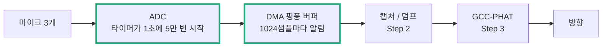

# Step 1 — 3채널 ADC-DMA 더블 버퍼링 & 마이크 신호 검증

> 프로젝트: 3-MIC TDOA(GCC-PHAT) 기반 음원 방향 추정 터렛 / STM32F446 (Nucleo)
> 기간: 2026-10-07 ~ 2026-10-08
> 갱신: 2026-10-11 — 배경(0절), 핑퐁 버퍼 설명(3.1), 확인 방법(5.1) 보충
> 갱신: 2026-10-12 — 방향 계산의 원리(0.5~0.9) 보충: DFT와 주파수 칸, GCC-PHAT, 정밀도와 신뢰도, 공간 앨리어싱, Far-field와 최소제곱
> 더 깊은 유도: [TDOA*튜닝*배경지식.md](TDOA_튜닝_배경지식.md)
> 그림으로 보기: [Step1_helper.html](Step1_helper.html)

## 0. 배경 — 재는 일과 방향 계산의 원리

0.1 ~ 0.4는 왜 지금처럼 재는지, 0.5~0.9는 잰 값으로 방향을 구하는 원리. 그림은 [Step1_helper.html](Step1_helper.html)에 같은 순서로 있음.

### 0.1 전체에서 맡은 일



### 0.2 소리의 도착 시각 차이로 방향을 안다 (TDoA)

- 소리는 1ms에 약 34cm를 감. 마이크 사이 7cm를 지나는 데는 길어야 **204µs** (0.2ms).
- 소리가 옆에서 오면 한쪽 마이크가 204µs 늦게 듣고, 정면에서 오면 둘이 동시에 들음. 그 사이는 각도에 따라 정해짐.

```
늦는 시간 = 간격 × sin(각도) ÷ 음속          (각도: 마이크 한 쌍의 정면 기준)
```

- **정면 근처에서는 1°가 약 3.6µs.** ADC가 다뤄야 하는 시간의 크기가 µs 단위라는 뜻.
- 정면은 민감하고 옆은 둔함 (60°→90°는 30° 차이인데 1.4샘플뿐). 그래서 마이크 3개를 정삼각형으로 두어 서로 보완 → Step3.

### 0.3 그래서 ADC가 지켜야 할 네 가지

| 지켜야 할 것              | 왜                                                         | 이 프로젝트의 답                                                      | 어기면                                                                         |
| ------------------------- | ---------------------------------------------------------- | --------------------------------------------------------------------- | ------------------------------------------------------------------------------ |
| 세 채널을 **같은 순간에** | 채널마다 재는 시각이 다르면 그 차이가 그대로 지연에 더해짐 | ADC 3개 동시 변환                                                     | ADC 1개로 차례로 재면 채널마다 1.78µs씩 늦음 → 방향이 최대 약 1° 치우침 (계산) |
| **일정한 간격으로**       | 간격이 흔들리면 파형이 일그러짐                            | 타이머(TIM2)가 하드웨어로 ADC를 직접 시작. CPU가 바빠도 간격은 그대로 | 소프트웨어로 시작하면 인터럽트가 늦는 만큼 흔들림                              |
| **충분히 빠르게**         | 느리게 재면 높은 주파수가 낮은 주파수로 둔갑 (0.4)         | 50kHz                                                                 | 가짜 소리가 분석 대역에 섞임                                                   |
| **끊김 없이**             | 소리가 언제 날지 모름                                      | DMA 순환 + 핑퐁 버퍼 (3.1)                                            | 프레임을 놓침                                                                  |

### 0.4 왜 50kHz인가 — 샘플링, 나이퀴스트 주파수, 앨리어싱

- ADC는 일정한 간격으로 점만 찍음. 그래서 **49kHz는 1kHz와 똑같은 점을 남김** (샘플마다 352.8° 도는 것과 −7.2° 도는 것은 찍힌 자리가 같음).
- 구분되는 것은 **재는 속도의 절반까지.** 이 절반을 **나이퀴스트 주파수**, 그 위의 주파수가 낮은 주파수로 둔갑하는 것을 **앨리어싱**이라 함. 따져야 할 것은 "보고 싶은 주파수"가 아니라 **ADC 핀에 실제로 들어오는 가장 높은 주파수.**
  - 분석에는 2kHz까지만 쓰지만 마이크 앰프는 약 20kHz까지 내보냄 → 절반이 25kHz가 되도록 50kHz. (앰프 대역은 팀 배경지식 문서의 값. 직접 재지는 않음)

- **Fs를 높여도 추정 성능이 높아지지 않는걸 실험을 통해 확인함.** 샘플 사이를 읽는 보간(Step3)이 정확할 만큼만 빠르면 됨:

| 재는 속도        | 8kHz    | 20kHz    | 50kHz     |
| ---------------- | ------- | -------- | --------- |
| 보간 오차 (각도) | 약 0.9° | 약 0.05° | 약 0.003° |

### 0.5 대역을 고르는 두 기준 — 정밀도와 신뢰도

- **정밀도**: 맞게 추정했지만 각도가 조금씩 흔들리는 정도.
- **신뢰도**: 틀리게 추정한 정도.

지연은 "주파수별 위상 차이가 그리는 직선의 기울기". 그 기울기를 얼마나 단단히 고정하느냐가 정밀도.

```
시간의 흔들림 = 위상의 흔들림 ÷ (2π × β × √K)

K = 대역 안의 칸 수
β = 대역 안 주파수들을 제곱해 평균 낸 뒤 제곱근 (대략 "대역의 평균 주파수")
```

| 바꾸는 것            | 일어나는 일                         | 이유                                                                                                                        |
| -------------------- | ----------------------------------- | --------------------------------------------------------------------------------------------------------------------------- |
| **상한(HI)을 올림**  | 봉우리가 뾰족해지고 흩어짐이 줄어듦 | 원점에서 먼 점일수록 기울기를 강하게 고정 (지렛대). 기여가 주파수의 제곱에 비례 → 2000Hz 한 칸이 200Hz 한 칸보다 100배 강함 |
| **상한을 너무 올림** | 가끔 엉뚱한 값 (신뢰도 하락)        | 2450Hz를 넘으면 가짜 봉우리 (0.8). 신호가 없는 칸이 들어와도 같음                                                           |
| **하한(LO)을 올림**  | 흩어짐이 조금 늘어남                | 투표하는 칸의 수가 줄어듦. 낮은 주파수는 원래 기여가 작아 손해는 크지 않음                                                  |
| **하한을 내림**      | 칸은 늘지만 나빠질 수 있음          | 전원 잡음(60Hz), 바람, 진동이 있는 칸이 들어오면 PHAT에서는 그것도 한 표                                                    |

| 대역              | K   | β      | 이론상 흩어짐 (150~2000Hz = 1) |
| ----------------- | --- | ------ | ------------------------------ |
| 150~2000Hz (지금) | 19  | 1200Hz | 1                              |
| 500~3000Hz        | 25  | 1894Hz | 0.55                           |
| 1000~2000Hz       | 10  | 1539Hz | 1.07                           |

- 독립된 측정 K개를 평균하면 흔들림이 1/√K로 준다는 통계의 기본과, 지렛대가 길수록 기울기가 단단하다는 것을 합친 식.
- **주의**: 이 식은 오차가 잡음에서만 온다고 가정. 실제 스냅 측정에서는 150 ~ 2000Hz의 흩어짐(0.77°)이 500~3000Hz(1.38°)보다 작았음. 반사와 마이크 특성의 영향이 더 컸기 때문으로 보임 → Step3 5.2.

### 0.6 공간 앨리어싱 — 주파수가 높으면 방향이 여러 개로 보인다

- 0.4절에서 시간을 듬성듬성 재면 주파수가 둔갑했음. 공간에서도 같은 일이 생김: 마이크 두 개는 공간을 "두 점"에서만 잼.
- 파장의 절반이 마이크 간격보다 짧으면, 방향에 따른 위상 차이가 한 바퀴를 넘어가서 **서로 다른 방향이 똑같은 위상 차이**를 만듦.

```
한계 주파수 = 음속 ÷ (2 × 간격) = 343 ÷ 0.14 ≈ 2450Hz        (같은 말: 간격 < 파장의 절반)
```

- 간격을 넓히면 지연이 커져 정밀해지지만 이 한계가 내려감.
- 판단 기준: 가장 좋은 간격 ≈ 음속 ÷ (2 × 소리의 쓸 만한 최고 주파수). 단, 최고 주파수는 **간격과 무관하게 스펙트럼에서 잰 값**이어야 함.
- **7cm는 이 식으로 정한 값이 아님.** 간격이 먼저 있었고, 한계 2450Hz와 대역 상한 2000Hz가 거기서 나옴 (decisions 3-1). 거꾸로 풀면 "최고 주파수가 약 2.4kHz인 소리에 맞는 간격"이라는 뜻일 뿐.
- 7cm가 적절한지는 대상(비행체) 소리의 스펙트럼을 재야 알 수 있음 — 아직 재지 않음. 지금까지 잰 스냅은 에너지 대부분이 2~6kHz (Step2 7.2).

---

## 1. 이 단계의 목표

- 3개 마이크를 **동시 샘플링**해서 DMA 버퍼로 끊김 없이 받기
- 핑퐁(더블) 버퍼로 한 절반을 처리하는 동안 다른 절반을 채우는 구조 만들기
- STM32CubeMonitor로 각 마이크가 정상 출력하는지 확인

---

## 2. 하드웨어 / 클럭 / 주변장치 설정

| 항목          | 설정                                                                                       | 비고                                                |
| ------------- | ------------------------------------------------------------------------------------------ | --------------------------------------------------- |
| SYSCLK        | HSI 16MHz → PLL (M=8, N=180, P=2) = **180MHz**                                             | Over-drive ON, Flash latency 5                      |
| APB1 / APB2   | 45MHz / 90MHz                                                                              | TIM2 클럭 = 45×2 = **90MHz**                        |
| 샘플링 트리거 | TIM2, PSC=0, ARR=1799 → **50kHz** TRGO(Update)                                             | ADC1 외부 트리거, Rising                            |
| ADC 모드      | **3개 ADC 동시 변환(Triple regular simultaneous)**                                         | ADC1=마스터, ADC2/3=슬레이브                        |
| 채널          | ADC1=PA0(IN0), ADC2=PA1(IN1), ADC3=PC0(IN10)                                               |                                                     |
| ADC 클럭      | PCLK2/4 = 22.5MHz                                                                          | 28+12 = 40 cycles ≈ **1.78µs/변환**                 |
| DMA           | DMA2 Stream0 Ch0, P→M, half-word ↔ half-word, **Circular**                                 | 다중모드 **DMA mode 1** (요청당 16bit, ADC1→2→3 순) |
| DDS           | `DMAContinuousRequests = ENABLE` → 공통 CCR.DDS=1                                          | 순환 DMA가 계속 요청받기 위해 필요                  |
| 시작 순서     | 슬레이브 `HAL_ADC_Start` ×2 → 마스터 `HAL_ADCEx_MultiModeStart_DMA` → `HAL_TIM_Base_Start` | 타이머를 마지막에 켜서 **buffer[0]=ADC1 보장**      |

---

## 3. 버퍼 구조와 타이밍

```
adc_buffer[6144] (uint16_t)
[ A 절반: 3072 = 1024샘플 × 3ch ][ B 절반: 3072 ]
 인터리브: [0]=ADC1 [1]=ADC2 [2]=ADC3 [3]=ADC1 ...
```

**설정에서 계산한 값** (측정한 값이 아님)

| 값                         | 계산             | 결과                  | 쓰이는 곳                                                                                               |
| -------------------------- | ---------------- | --------------------- | ------------------------------------------------------------------------------------------------------- |
| 프레임(절반) 길이          | 1024 / 50kHz     | **20.48ms**           | 처리 마감 시간                                                                                          |
| 프레임당 CPU 사이클        | 180MHz × 20.48ms | **3,686,400 cycles**  | 계산이 이 안에 끝나야 프레임을 놓치지 않음. DWT로 잰 처리 시간과 비교 (Step3: 3.3ms ≈ 59만 cycles, 16%) |
| 1샘플 시간 / 음속 이동거리 | 1/50kHz, 343m/s  | 20µs / **6.86mm**     | 지연 1샘플 ≈ 5.6° 환산. 보간이 필요한 이유                                                              |
| 마이크 7cm 간격 최대 지연  | 0.07 / 343       | ≈204µs ≈ **10.2샘플** | 상관 곡선 탐색 범위 `TDOA_MAX_LAG` (여유 포함 13)                                                       |

---

### 3.1 핑퐁 버퍼를 직관적으로

- 버퍼를 A, B 두 칸으로 나눔. **DMA가 A를 채우는 동안 CPU는 방금 다 찬 B를 가져감.** 다음에는 반대.
- 한 칸이 차면 인터럽트가 옴: 절반 참(HT) → A 준비, 끝까지 참(TC) → B 준비.
- **마감은 한 칸이 차는 시간 20.48ms.** 그 안에 처리를 끝내지 못하면 뒤로 밀리다가 프레임을 놓침.
- ADC 변환(1.78µs)과 DMA 전송은 하드웨어가 CPU와 **동시에** 함 → CPU가 쓸 수 있는 시간은 20.48ms 전체.

| 처리 내용                       | 걸린 시간            | 마감 대비 |
| ------------------------------- | -------------------- | --------- |
| GCC-PHAT, `-Ofast` (Step3 실측) | 3.3ms                | 16%       |
| GCC-PHAT, `-O0` (Step3 실측)    | 18.6ms (최대 19.8ms) | 91%       |

- 위 값은 트리거된 프레임에서만 드는 시간. 평소 프레임은 RMS 계산뿐.

---

## 4. 이중 버퍼 구현 (`Core/Src/adc.c`, `Core/Src/app.c`)

### 구조

- **ISR(콜백)**: `HAL_ADC_ConvHalfCpltCallback` / `HAL_ADC_ConvCpltCallback` 에서 "어느 절반이 준비됐는지"만 표시 (`readyHalf`, `frameSeq++`).
  - 다중모드 DMA도 HAL이 weak 콜백을 호출함 (`stm32f4xx_hal_adc_ex.c` 의 `ADC_MultiModeDMAConvCplt` / `HalfConvCplt`).
- **메인 루프**: `adc_get_frame(frame)` 로 준비된 절반을 **채널별로 분리 복사** → `frame[3][1024]`.

### 설계 포인트

1. `readyHalf` 는 `const uint16_t * volatile` — *포인터 변수 자체*가 volatile (ISR이 바꿈).
2. `readyHalf`/`frameSeq` 를 읽고 지우는 구간은 `__disable_irq()` 로 짧게 보호 (ISR과 경쟁 방지).
3. **복사 후 검증**: 복사 중 `frameSeq` 가 바뀌었으면 DMA가 src 절반을 다시 덮어쓰기 시작한 것 → 프레임 폐기 + `dropCnt++`.
4. 콜백 시점에 이전 프레임이 아직 소비되지 않았으면 `dropCnt++` (처리 속도 부족).
5. **처리 시간 한도 = 20.48ms/프레임**. 넘으면 drop 발생.
6. F446(Cortex-M4)은 D-Cache가 없어서 DMA 캐시 일관성 문제 없음.
7. 콜백 지터는 TDOA 정확도와 무관 — 샘플링 시점은 TIM2(하드웨어)가 결정하므로 샘플 간격 자체엔 지터가 없음. 콜백 지터는 처리 마감 시간에만 영향.

---

## 5. STM32CubeMonitor로 확인하기

### 왜 통계값을 보는가

CubeMonitor는 ST-LINK로 메모리를 읽는 방식이라 갱신 속도가 수십~수백 Hz → **50kHz 파형은 직접 못 봄**.
→ 펌웨어에서 프레임마다 채널별 통계를 계산해 **전역 volatile 변수**에 넣고 그 값을 그래프로 봄.

### 측정 결과 (채널 0 = PA0)

| 관찰                                 | 해석                                                         |
| ------------------------------------ | ------------------------------------------------------------ |
| mean ≈ 2048, 평평함                  | 바이어스 정상 (VCC/2 타입 모듈)                              |
| 조용할 때 p2p ≈ 50~100               | 잡음 바닥 정상 (≈40~80mV)                                    |
| 소리 시 **p2p ≈ 4000~4095**          | ⚠️ **포화(클리핑)** — 0과 4095에 닿음                        |
| 소리 시 rms ≈ 300~900, rms/p2p ≈ 0.2 | 박수/두드림 같은 **충격성 신호** (사인보다 크레스트 팩터 큼) |
| 계단 모양                            | 한 계단 = 1프레임(20.48ms) 갱신, 정상                        |
| p2p가 −100 근처로 찍힘               | 차트 보간 그림. `uint16_t`라 음수 불가                       |
| drop_cnt = 0                         | 현재 처리량(통계 계산)은 여유 있음                           |

**결론**: 채널 0 경로(TIM2→ADC→DMA→이중버퍼→처리)는 정상. 단 **클리핑은 GCC-PHAT 위상 정보를 왜곡**하므로 해결 필요.

### 5.1 CubeMonitor로는 볼 수 없는 것 — 타이밍과 동시성

0.3절의 네 가지가 실제로 지켜지는지는 따로 재야 함.

| 확인할 것            | 방법                                                                            | 상태                      |
| -------------------- | ------------------------------------------------------------------------------- | ------------------------- |
| 실제 샘플링 속도     | TIM2의 남는 채널을 PWM으로 핀에 내보내 로직분석기나 오실로스코프로 측정         | 안 함                     |
| 프레임 주기와 흔들림 | 콜백에서 GPIO를 토글하거나, DWT 사이클 카운터 차이의 최소/최대 (기대 3,686,400) | 안 함                     |
| 처리 시간            | DWT로 측정. **평균이 아니라 최댓값**으로 판정                                   | GCC-PHAT만 측정함 (Step3) |
| 채널 사이의 동시성   | 같은 신호를 PA0·PA1·PC0에 동시에 넣어 지연이 0인지                              | 안 함                     |
| 25kHz 위의 잡음      | 앰프 출력을 오실로스코프로. 모터를 붙인 뒤 다시                                 | 안 함                     |
| 프레임 유실          | `dropCnt`                                                                       | 통계 계산만 할 때 0       |

---

## 6. 남은 이슈 / 다음 할 일

### 즉시

- [x] **클리핑 해결**: 모듈 게인 낮추기 → 실제 사용 거리에서 큰 소리 시 p2p ≲ 3000 목표
- [x] 채널 1, 2도 차트에 추가 → **마이크 하나씩 두드려** 해당 채널만 반응하는지(채널 매핑) 확인
  - 박수는 세 채널 모두 오르는 게 정상. 세 채널 값이 *숫자까지 동일*하면 배선/설정 의심
- [ ] (안전장치) ADC OVR 인터럽트가 NVIC에 등록되어 있지 않음 → overrun 시 DMA가 조용히 멈추고 복구 불가

### 이 단계에서 추가로 측정할 플랏 (우선순위 순)

1. **클리핑 카운터** `mon_clip[ch]` (샘플 ≤8 또는 ≥4087 개수) — 게인 튜닝용, 목표 0
2. **UART 덤프 + Python** (트리거 프레임 1개, 3ch×1024)
   - 3채널 시간 파형 겹쳐 보기 → 클리핑 형태, 마이크 간 도달 시간차 육안 확인
   - **스펙트럼(FFT)**: 조용한 프레임 vs 박수 프레임 → 잡음 대역(60Hz 험 등)·신호 대역 파악 → **BPF 대역 결정 근거**
   - 덤프 데이터로 Python에서 GCC-PHAT 프로토타입 → MCU 구현의 정답 데이터
3. **타이밍 (DWT CYCCNT)**: 콜백 주기 min/max (기대 3,686,400 ± 수십), 처리 시간 `mon_proc_cyc` → CPU 점유율 = proc/3,686,400
4. **동시 샘플링 검증**: 같은 신호를 PA0/PA1/PC0에 동시 입력 → 상호상관 지연 = 0 이어야 함, 채널 간 오프셋/게인 차이 측정
5. 장시간 잡음 바닥 (조용한 상태 수 분) → 검출 임계값(rms의 5~10배) 기준, mean 드리프트 확인

### 전체 로드맵 (app.c 주석 기준)

1. 마이크 모듈 파형 테스트 ← **진행 중**
2. ADC-DMA 핑퐁 버퍼링, 지연/지터 측정 ← **구조 완료, 타이밍 측정 남음**
3. DMA 버퍼 안전 복사 ← **완료** (`adc_get_frame`) — FFT 단계에서 `float` + DC 제거로 바꾸는 것 고려
4. GCC-PHAT: FFT → BPF → PHAT → IFFT → 피크 탐색 (CMSIS-DSP `arm_rfft_fast_f32` 예정)
5. 후처리: 2차 보간(서브샘플 정밀도), LSE 오차 보정, 시간차 → 각도 변환
