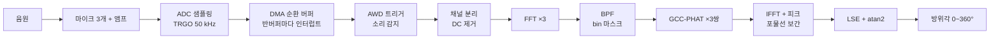

# TDOA_튜닝_배경지식

# TDOA 음원 방위 추정: 튜닝을 위한 배경지식

> **대상**: 복소수와 페이저는 익숙하지만 DSP는 처음인 팀원 (파라미터 튜닝·성능 시험 담당)
**기준 조건**: STM32F446RE, 마이크 3개 정삼각형 배치 d = 7 cm, Fs = 50 kHz, N = 1024, BPF 150~2000 Hz, c = 343 m/s
**문서 상태**: v0.1 | 최종 수정: YYYY-MM-DD
> 

## 0. 이 문서를 읽는 법

- 이 문서는 **페이저를 공용어로** 쓴다. 사인파, 시간 지연, DFT, 교차상관, GCC-PHAT을 모두 “회전하는 화살표”로 설명한다.
- 각 장 끝의 **튜닝 연결**에 그 장의 개념이 어떤 파라미터와 이어지는지 적었다.
- 13장(파라미터 카드)과 14장(실험 절차)만 봐도 튜닝은 시작할 수 있다. 다만 결과를 해석하려면 2~10장이 필요하다.
- 직접 움직여보는 그림은 `TDOA.html`에 있다. 각 장에서 해당 그림 번호를 적어두었다.

| 장 | 내용 | 꼭 가져갈 한 줄 |
| --- | --- | --- |
| 2 | 사인파와 페이저 | 시간 지연은 페이저 회전이고, 회전량은 주파수에 비례한다 |
| 3 | 샘플링과 앨리어싱 | Fs/2는 ADC 핀에 실제로 들어오는 최고 주파수보다 커야 한다 |
| 4 | DFT, bin, FFT | bin 하나 = 48.8 Hz 칸 하나의 페이저 |
| 5 | 주파수 영역 BPF | 필터링 = 쓰지 않을 bin을 0으로 만드는 것 |
| 6 | 상관에서 GCC-PHAT까지 | GCC-PHAT = 단위 페이저 K개의 투표 |
| 7 | 피크와 보간 | 세 점에 포물선을 맞춰 샘플 사이 위치를 찾는다 |
| 8 | 통계 기초 | 독립 측정 K개를 평균하면 흔들림이 1/√K로 준다 |
| 9 | 정밀도와 신뢰도 | σ_τ = σ_φ / (2π·β·√K) |
| 10 | 기하와 각도 | 정삼각형 + 최소제곱 + atan2 |
| 11 | 실시간성 | 처리 시간 < 프레임 시간 T = N/Fs |
| 12~14 | 지표, 파라미터, 실험 | 한 번에 하나씩 바꾸고 히스토그램으로 판독 |

---

## 1. 전체 지도



| 단계 | 하는 일 | 관련 파라미터 | 코드 위치 |
| --- | --- | --- | --- |
| ADC 샘플링 | 타이머 신호(TRGO)마다 3채널을 동시에 측정 | Fs (PSC, ARR), 샘플링 사이클, ADC 모드 | CubeMX, adc.c |
| DMA 버퍼 | 결과를 순환 버퍼에 자동 저장, 절반 찰 때마다 인터럽트 | N (SAMPLES_PER_CH) | adc.h |
| 트리거 | 신호가 임계값을 넘으면 처리 시작 | AWD 임계값, 디바운스 시간 | adc.c |
| 전처리 | 채널 분리, 평균값(DC) 제거 | - | split_adc_data, remove_dc_offset |
| FFT | 마이크별 주파수 성분 계산 | FFT_SIZE | tdoa.c |
| BPF | 대역 밖 bin을 0으로 | BPF_F_LOW, BPF_F_HIGH | apply_bpf_rfft_packed |
| GCC-PHAT | 위상차만 남긴 교차 스펙트럼 | 가중 방식 (현재 PHAT) | gcc_phat_rfft_packed |
| IFFT + 피크 | 상관 곡선에서 최고점 탐색 | MAX_LAG (자동 계산) | find_peak_lag_subsample |
| 각도 | 3쌍의 시간차 → 최소제곱 → atan2 | MIC_DISTANCE, SOUND_SPEED | tdoa_process_3mic |

---

## 2. 사인파와 페이저: 지연은 회전이다

### 2.1 사인파는 회전하는 화살표의 그림자

```
x(t) = A·cos(2πf·t + φ) = Re{ A·e^(jφ) · e^(j2πf·t) }
```

| 기호 | 의미 | 화살표로 보면 |
| --- | --- | --- |
| A | 진폭 | 화살표 길이 |
| f | 주파수 | 1초에 도는 바퀴 수 |
| φ | 위상 | t = 0일 때 화살표 각도 |
| P = A·e^(jφ) | 페이저 | 주파수 f 성분을 완전히 기술하는 복소수 하나 |

### 2.2 시간 지연은 페이저 회전이다

신호가 τ만큼 늦게 도착하면:

```
x(t − τ) = Re{ A·e^(jφ) · e^(−j2πf·τ) · e^(j2πf·t) }
→ 새 페이저 = P · e^(−j2πf·τ)
```

**τ만큼 늦으면 주파수 f 성분의 페이저가 −2πf·τ 라디안 돌아간다.** 회전량이 주파수에 비례한다는 점이 이 프로젝트 전체의 출발점이다.

| τ = 100 µs일 때 | 200 Hz | 1000 Hz | 2000 Hz | 5000 Hz |
| --- | --- | --- | --- | --- |
| 페이저 회전량 | −7.2° | −36° | −72° | −180° |

같은 시간 지연이 저주파에는 작은 회전, 고주파에는 큰 회전으로 나타난다.

### 2.3 실제 소리는 여러 사인파의 합이다

마이크 신호는 수많은 주파수 성분의 합이고, 성분마다 페이저가 하나씩 있다. 마이크 2가 마이크 1보다 τ만큼 늦게 들으면, **모든 성분이 각자 −2πf·τ씩 회전한 것**과 같다.

그래서 주파수별 위상차를 그래프로 그리면 **원점을 지나고 기울기가 −2πτ인 직선**이 된다.

```
위상차 Δφ(f) = −2π·τ · f        ← 기울기 = −2πτ
```

> **핵심 관찰**: TDOA는 “주파수별 위상차 직선의 기울기를 읽는 문제”다. 이후 모든 장은 이 기울기를 얼마나 정확하게, 얼마나 확실하게 읽느냐에 관한 이야기다.
> 

**튜닝 연결**: 기울기를 정확히 읽으려면 (1) 점이 많아야 하고 (2) 원점에서 먼 점(고주파)이 있어야 하고 (3) 점마다 흔들림이 작아야 한다. 각각 K, β, SNR이며 9장에서 식으로 정리한다.

---

## 3. 샘플링과 앨리어싱
### 3.1 샘플링

ADC는 Ts = 1/Fs마다 전압을 한 번씩 찍는다. Fs = 50 kHz면 20 µs마다 한 번이다. 페이저로 보면 **샘플 하나마다 화살표가 2πf·Ts 라디안 돌아간 위치를 찍는 것**이다.

### 3.2 왜 Fs > 2f여야 하나
샘플 사이 회전각은 Δθ = 2πf/Fs다. 그런데 각도는 2π마다 같은 위치로 돌아오므로, 샘플만 보고는 Δθ와 Δθ − 2π를 구분할 수 없다. Δθ가 π를 넘으면 “반대 방향으로 덜 돈 것”과 똑같이 보인다.

```
구분 가능 조건   |Δθ| < π   ⇔   f < Fs/2   (나이퀴스트 주파수)
```

---

## 4. DFT, bin, FFT

### 4.1 DFT는 주파수별 페이저를 뽑아내는 연산이다

```
X[k] = Σ_{n=0}^{N−1} x[n] · e^(−j2π·k·n/N),     k = 0, 1, …, N−1
```

페이저로 읽으면 이렇다. 신호에 **주파수 f_k로 반대 방향으로 도는 화살표**를 곱해서 더한다. 그러면 신호 안의 f_k 성분은 회전이 상쇄되어 멈춘 채로 N번 쌓이고, 다른 주파수 성분은 계속 돌면서 서로 상쇄된다. 남는 것은 **f_k 성분의 페이저다.**

- |X[k]| = 그 주파수 성분의 크기
- ∠X[k] = 그 주파수 성분의 위상

### 4.2 bin

```
bin k의 주파수   f_k = k · Fs / N
bin 간격         Δf = Fs / N = 1 / T          T = N/Fs = 프레임 길이
현재 값          Δf = 50000 / 1024 = 48.83 Hz,   T = 20.48 ms
범위             k = 0 (DC) … 512 (나이퀴스트 25 kHz)
```

- **bin = 48.8 Hz 폭의 주파수 칸, X[k] = 그 칸의 페이저.** 히스토그램의 칸과 같은 뜻이다.
즉, BPF 150 ~ 2000 Hz는 실제로는 **k = 4 ~ 40, 즉, 37개 bin**이다.

- **튜닝 연결**: N을 바꾸면 Δf가 바뀌고, 대역 안 **bin 개수 K = (대역폭)/Δf가 바뀐다.** K는 9장 정밀도 식의 핵심 변수다.


3
### 4.4 FFT

FFT는 DFT와 결과가 똑같고 계산만 빠른 알고리즘이다.

|  | DFT 직접 계산 | FFT |
| --- | --- | --- |
| 연산량 (N = 1024) | N² ≈ 105만 번 곱셈 | (N/2)·log₂N = 5120번 버터플라이 |
| 조건 | 없음 | N은 2의 거듭제곱 |


---

## 5. 주파수 영역 BPF

필터는 특정 주파수만 통과시키는 장치다. 주파수 영역에서는 **쓰지 않을 bin을 0으로 만들기만 하면** 대역통과 필터가 된다. 현재 코드가 이 방식이다.

- 장점: 계산이 거의 없다.
- 단점: 경계가 급격해서(brick-wall) 시간 영역 결과에 출렁임이 생긴다. 상관 곡선 모양에 영향을 준다.

대역을 정하는 근거는 세 가지이고, 각각 뒤에서 자세히 다룬다.

| 경계 | 근거 | 자세히 |
| --- | --- | --- |
| 상한 2000 Hz | 공간 앨리어싱 한계(약 2450 Hz) 아래로 여유 | 9.3절 |
| 하한 150 Hz | DC, 전원 험(60 Hz), 바람, 모터 진동 제거 | 9.4절 |
| 대역 밖 전체 | PHAT은 신호 없는 bin에도 같은 가중치를 주므로 직접 골라내야 함 | 6.6절 |

**튜닝 연결**: BPF_F_LOW, BPF_F_HIGH. 48.8 Hz 단위로만 의미가 있다.

---


### 6.1 출발점: 통계의 상관계수

두 데이터가 같이 움직이는 정도를 재려면, 평균을 뺀 뒤 같은 위치끼리 곱해서 더한다. 같이 오르내리면 곱이 양수로 쌓이고, 반대로 움직이면 음수가 쌓인다.

### 6.2 교차상관: 한쪽을 밀면서 상관을 잰다

```
r[m] = Σ_n x1[n] · x2[n + m]
```

m을 바꿔가며 x2를 밀어서 계산하면, **두 신호가 가장 잘 겹치는 m이 곧 지연**이다.

예시: x1 = [0, 1, 2, 1, 0, 0], x2 = [0, 0, 0, 1, 2, 1] (x2가 2샘플 늦음)

| m | 0 | 1 | 2 | 3 |
| --- | --- | --- | --- | --- |
| r[m] | 1 | 4 | **6** | 4 |

m = 2에서 최대이므로 지연은 2샘플이다.

### 6.3 왜 주파수 영역에서 계산하나: 상관 정리

시간 영역에서 직접 계산하면 시차마다 N번 곱셈이 필요하다. 대신 다음 관계를 쓴다.

```
DFT{ r }[k] = conj(X1[k]) · X2[k]          (상관 정리)
```
페이저로 유도하면 한 줄이다. 성분 k에서 x1의 페이저가 P라면 x2의 페이저는 P·e^(−j2πf_k·τ)다(2.2절).

```
conj(P) · P·e^(−j2πf_k·τ) = |P|² · e^(−j2πf_k·τ)
                            └크기┘   └─── 각도 = 지연 정보 ───┘
```


### 6.4 일반 교차상관의 약점

G[k]의 크기 |P|²는 신호가 강한 주파수에서 크다. 소리 에너지는 대개 저주파에 몰려 있으므로 **저주파가 결과를 지배**한다. 저주파 코사인은 폭이 넓어서 피크가 뭉툭해지고, 실내 반사도 크게 섞인다.

### 6.5 GCC와 PHAT

GCC(Generalized Cross-Correlation)는 IFFT 전에 bin마다 가중치 W[k]를 곱하는 방식의 총칭이다.

```
R[m] = IFFT{ W[k] · G[k] }
PHAT:   W[k] = 1 / |G[k]|     → 모든 bin의 페이저를 길이 1로 만듦
```
 **
이건 **단위 페이저 K개의 투표**로 읽을 수 있다.

- t = τ에서는 모든 페이저가 같은 방향 → 합 = K (최대)
- 다른 t에서는 주파수마다 다른 속도로 돌아서 방향이 흩어짐 → 서로 상쇄

---

## 7. 피크 찾기와 포물선 보간

### 7.1 탐색 범위

시간차는 물리적으로 |τ| ≤ d/c를 넘을 수 없으므로 그 범위만 검색한다.

```
MAX_LAG = floor(d · Fs / c) = floor(0.07 · 50000 / 343) = 10 샘플
```
    
IFFT 결과는 원형(circular)이라, 양의 lag는 배열 앞쪽 인덱스 0~10, 음의 lag는 배열 끝쪽 N−10~N−1에 있다.

### 7.2 포물선 보간 유도

정수 샘플 단위로만 피크를 찾으면 20 µs 눈금에 묶인다. 최고점 m₀와 양옆 값 (y₋₁, y₀, y₊₁)에 포물선 y = a·x² + b·x + c를 맞추면:

```
c = y₀
a = (y₋₁ + y₊₁ − 2y₀) / 2
b = (y₊₁ − y₋₁) / 2
꼭짓점 δ = −b / (2a) = (y₋₁ − y₊₁) / (2·(y₋₁ − 2y₀ + y₊₁)),    |δ| ≤ 0.5
τ̂ = (m₀ + δ) · Ts
```

### 7.3 보간이 정확하려면 피크 위에 샘플이 충분해야 한다

현재 대역(150~2000 Hz)의 피크에 포물선 보간을 했을 때 생기는 최대 편향:

| Fs | 8 kHz | 10 kHz | 20 kHz | 50 kHz | 100 kHz |
| --- | --- | --- | --- | --- | --- |
| 최대 보간 편향 | 3.1 µs | 1.5 µs | 0.19 µs | 0.012 µs | 0.001 µs |
| 각도 환산 (정면) | 0.86° | 0.43° | 0.05° | 0.003° | 0.0003° |  
## 8. 정밀도와 신뢰도의 원리
두 가지 오차를 구분하는 것이 이 장의 목적이다.

- **정밀도**: 올바른 피크를 골랐지만 위치가 조금씩 흔들리는 정도
- **신뢰도**: 엉뚱한 봉우리를 골라 크게 튀는 정도

### 8.1 정밀도 식 유도

2.3절의 위상차 직선으로 돌아가자. bin k마다 점 (f_k, φ_k)가 있고, φ_k = −2πf_k·τ + 잡음(σ_φ)이다. 8.5절의 기울기 공식에 x = f_k, y = φ_k, s = −2πτ를 넣으면:

```
σ_τ = σ_φ / (2π · √(Σ f_k²)) = σ_φ / (2π · β · √K)

K = 대역 안 bin 개수
β = √( Σ f_k² / K )      대역 안 주파수들의 제곱평균제곱근 (RMS 주파수)
```

**β는 “대역 안 주파수들을 제곱해서 평균 낸 뒤 루트”일 뿐이다.** 기여도가 f²에 비례하므로 2000 Hz bin 하나가 200 Hz bin 하나보다 100배 강하게 기울기를 고정한다. 상한이 정밀도를 좌우하는 이유다.

GCC-PHAT의 피크 위치도 잡음이 작으면 정확히 같은 답을 낸다. 피크 근처에서 R(t)를 테일러 전개하면:

```
R'(τ)  ≈ Σ 2πf_k · (잡음 위상_k)
R''(τ) = −Σ (2πf_k)²                  ← 피크의 곡률 = 날카로움
피크 이동 Δ = −R'/R'' = Σ f_k·φ_k / (2π·Σ f_k²)      ← 8.5절 기울기 공식과 같음
```

**이론적 배경**: 추정 이론의 크라메르-라오 하한(CRLB). 레이더·소나에서 시간지연(거리) 정확도를 말할 때 쓰는 “RMS 대역폭(Gabor 대역폭)”이 β다. GCC 기법은 Knapp & Carter(1976)의 시간지연 추정 논문에서 나왔다.

### 8.2 현재 값으로 계산 (σ_φ = 0.3 rad 가정)

| 대역 | K | β | σ_τ | 각도 (한 쌍, 정면) |
| --- | --- | --- | --- | --- |
| 150~800 Hz | 13 | 521 Hz | 25.4 µs | 7.1° |
| **150~2000 Hz (현재)** | **37** | **1194 Hz** | **6.6 µs** | **1.8°** |
| 1500~2000 Hz | 10 | 1739 Hz | 8.7 µs | 2.4° |
| 150~2450 Hz | 47 | 1475 Hz | 4.7 µs | 1.3° |
| 150~5000 Hz | 99 | 2940 Hz | 1.6 µs | 0.5° |

각도 환산은 정면 기준 0.28 °/µs (10.1절).

### 8.3 신뢰도: 공간 앨리어싱

마이크 한 쌍의 위상차는 각도 θ에 따라 다음 범위를 움직인다.

```
Δφ = 2πf · (d/c) · sinθ,   θ: −90° ~ +90°
범위 폭 = 4πf·d/c
각도가 유일하게 정해지려면 폭 < 2π
→  f < c / (2d) = 343 / 0.14 ≈ 2450 Hz          (등가: d < λ/2)
```

이 한계를 넘는 주파수 f는 τ ± 1/f 위치에 **가짜 마루**를 만든다. 1/f가 탐색 범위 폭(408 µs)보다 짧아지면 그 마루가 탐색 범위 안으로 들어온다.

- **광대역이면** 주파수마다 1/f가 달라 가짜 마루 위치가 흩어지고, 합치면 상쇄된다. 예: 2450 ~ 5000 Hz 성분의 가짜 마루는 200~408 µs에 걸쳐 흩어짐.
- **협대역(음조)이면** 가짜 마루가 한곳에 쌓여 살아남는다. 예: 2800 ~ 3300 Hz는 303~357 µs에 모여 있음.

드론 소리는 블레이드 통과 주파수의 고조파가 뚜렷한 **음조 성분**이 많아서 상한을 보수적으로 2000 Hz에 둔다. 광대역 음원이라면 상한을 더 올려 정밀도를 얻을 여지가 있다. 결정은 대상 음원의 스펙트럼을 측정한 뒤에 한다.
### 8.4 대역 하한의 역할

상한을 고정하고 하한을 올리면:

- **K가 줄어든다.** 측정이 줄어드니 흩어짐이 커진다(√K).
- β는 조금 커진다. 저주파는 f² 기여가 원래 작아서 빼도 β 손실이 적다.
- 출렁임이 커진다. 대역이 좁아질수록 포락선 안에 반송파 진동이 많아진다(진동 수 ≈ f_c/B). 하지만 **옆 마루까지의 거리 1/f_c가 탐색 범위(408 µs)보다 길면 그 마루는 탐색 범위 밖**이다. f_H ≤ 2450 Hz인 현재 설계에서는 출렁임이 신뢰도의 직접 원인이 아니다.

하한의 실제 기준은 **“신호의 SNR이 충분해지기 시작하는 주파수”**다. 그 아래 bin은 험, 바람, 모터 진동이 지배해 PHAT의 잡음 bin 문제(6.6절)를 일으킨다.

### 8.5 피크 대 배경

잡음만 있는 위치에서 R은 무작위 단위 페이저 K개의 합이라 √(K/2) 정도 흔들린다. 피크는 K이므로:

```
피크 / 배경 흔들림 ≈ K / √(K/2) = √(2K)
K = 37  →  8.6,     K = 10  →  4.5
```

### 8.6 이 장의 결론: 세 숫자

| 숫자 | 정의 | 좌우하는 것 | 주로 정하는 값 |
| --- | --- | --- | --- |
| β | 대역 주파수의 RMS | 피크 날카로움 → 정밀도 | 대역 상한 |
| K = B·T | 대역 내 bin 수 | √K 평균 효과 → 정밀도, 피크 대 배경 | 대역폭, 프레임 길이 |
| f_H vs c/(2d) | 앨리어싱 한계와의 관계 | 가짜 마루 → 신뢰도 | 대역 상한, 마이크 간격, 음원의 음조 성분 |

---

## 9. 기하: 시간차에서 각도로

> 그림: TDOA.html 그림 1, 4, 9
> 

### 10.1 마이크 한 쌍

소리가 θ 방향(쌍의 정면 기준)에서 오면 먼 쪽 마이크까지 **추가로 d·sinθ만큼** 더 가야 한다.

```
τ        = d · sinθ / c
τ_max    = d / c = 0.07 / 343 = 204 µs           (θ = 90°)
MAX_LAG  = τ_max · Fs = 10.2 샘플
민감도   dθ/dτ = c / (d · cosθ)                  정면에서 0.28 °/µs   (1° ≈ 3.6 µs)
```

sinθ는 0° 근처에서 가파르고 90° 근처에서 평평하다. 그래서 **정면은 각도 변화가 시간차에 크게 드러나고, 측면은 잘 드러나지 않는다.** 정수 lag 하나가 대응하는 각도 칸:

| lag (샘플) | 0 | 1 | 2 | 3 | 4 | 5 | 6 | 7 | 8 | 9 | 10 |
| --- | --- | --- | --- | --- | --- | --- | --- | --- | --- | --- | --- |
| asin(m / 10.2) | 0° | 5.6° | 11.3° | 17.1° | 23.1° | 29.3° | 36.0° | 43.3° | 51.7° | 61.9° | 78.6° |

정면 칸은 5.6° 폭, 마지막 칸(9→10)은 16.7° 폭이다. 보간이 칸 사이를 메우지만, 측면이 불리한 건 그대로다.

### 10.2 원거리장 근사

음원이 가까우면 파면이 평면이 아니라 원호다. 간격 d를 가로지르는 원호가 평면에서 벗어나는 깊이(현의 처짐)는 d²/(8r)이다.

```
r = 1 m   : 0.0049 / 8 = 0.6 mm  →  1.8 µs  →  약 0.5°
r = 10 m  : 0.06 mm              →  0.18 µs →  약 0.05°
```

드론 거리(수 m 이상)에서는 평면파로 봐도 된다. 문헌의 “r > 2d²/λ”(프라운호퍼 거리)는 이 처짐을 파장의 1/16 이하로 제한하는 관례 기준이다.

### 10.3 3마이크와 최소제곱

평면파 가정이면 음원 방향을 단위벡터 u = (cosθ, sinθ) 하나로 쓸 수 있다. 거리는 모르고 방향만 구한다.

```
마이크 위치   p1 = (0, 0),  p2 = (D, 0),  p3 = (D/2, √3·D/2)      (tdoa.c 규약, D = 7 cm)
거리차       d_ij = c · τ_ij = −(p_j − p_i) · u

A · u = b
  A = [  D      0      ]        b = −[ d12 ]
      [  D/2    √3·D/2 ]             [ d13 ]
      [ −D/2    √3·D/2 ]             [ d23 ]

정삼각형이면  AᵀA = (3D²/2) · I       (대각행렬)
→  ux = −(2·d12 + d13 − d23) / (3D)
    uy = −(d13 + d23) / (√3·D)
θ = atan2(uy, ux),  0~360°로 변환
```

- **왜 정삼각형인가**: AᵀA가 단위행렬의 상수배라서 오차가 x, y 방향으로 똑같이 퍼진다. 어느 방향에서 소리가 와도 정밀도가 같다. 한 쌍이 측면을 볼 때 다른 쌍이 정면 쪽을 보기 때문이다.
- **왜 최소제곱인가**: 미지수 2개(ux, uy)에 방정식 3개라 세 쌍의 정보를 모두 써서 잡음을 평균한다.

### 10.4 왜 tan⁻¹이 아니라 atan2인가

- tan⁻¹(uy/ux)는 ±90°만 돌려주므로 반대편 방향을 구분하지 못한다. atan2는 부호를 보고 0~360°를 돌려준다.
- atan2는 ux와 uy의 **비율**만 쓴다. 음속이나 Fs가 틀려서 모든 거리차가 같은 비율로 틀어져도 비율을 취하는 순간 상쇄된다. 그래서 온도에 따른 음속 변화(c ≈ 331.3 + 0.606·T[°C])가 각도에 거의 영향을 주지 않는다.
- 단, 채널 스큐나 마이크 위치 오차 같은 **고정 오프셋**은 비율이 아니라서 상쇄되지 않는다.

### 10.5 각도 정밀도

```
σ_θ ≈ (c / D) · √(2/3) · σ_τ   [rad]       (쌍별 오차가 독립이라는 가정의 근사)
예) σ_τ = 5 µs  →  4900 × 0.816 × 5e-6 = 0.020 rad ≈ 1.15°
```

### 10.6 결과가 믿을 만한지 판정

- **일관성 오차**: τ12 + τ23 = τ13이 성립해야 한다. err = |lag23 − (lag13 − lag12)|가 크면 어느 쌍인가 잘못된 피크를 골랐다는 뜻이다. 현재 코드는 계산만 하고 쓰지 않는다.
- **|û| ≈ 1**: 추정한 방향벡터의 길이가 1에서 크게 벗어나면 반사, 근거리장, 잘못된 피크 선택을 의심한다.

### 10.7 마이크 간격의 최적점

간격 d는 정밀도에 두 번 들어간다.

```
σ_θ ∝ (c/d) · 1/√(Σ f_k²)
       └ d↑면 이득 ┘  └ d↑ → 앨리어싱 한계 c/(2d)↓ → 쓸 수 있는 f_H↓ → 손해 ┘
```

음원의 유용한 에너지가 F_src까지라면:

- d < c/(2F_src): 앨리어싱 한계가 이미 음원 대역보다 위. d를 키우면 c/d 항만 좋아진다 (σ_θ ∝ 1/d).
- d > c/(2F_src): 앨리어싱 한계가 음원 대역을 잘라낸다. σ_θ ∝ √d로 다시 나빠진다.

```
최적 간격  d* ≈ c / (2 · F_src)
F_src = 2.4 kHz  →  d* ≈ 7.1 cm
```

**튜닝 연결**: 간격은 기구라 쉽게 못 바꾸지만, 대상 음원 스펙트럼을 측정하면 7 cm가 적절한지 판단할 수 있다.

### 10.8 부호 규약 주의

좌표계, 마이크 번호, GCC-PHAT lag의 부호가 서로 맞아야 한다. 하나라도 어긋나면 각도가 좌우 반전되거나 180° 틀어진다. **알려진 각도(0°, 90°, 180°, 270°)에 스피커를 두는 기준 시험을 가장 먼저 할 것.**

---

## 11. 실시간성 기초

> 그림: TDOA.html 그림 3
> 

### 11.1 더블 버퍼(핑퐁)

DMA가 버퍼의 한쪽 절반을 채우는 동안 CPU는 다른 절반(직전 프레임)을 처리한다. 절반이 찰 때마다 HT(Half Transfer) 또는 TC(Transfer Complete) 인터럽트가 온다.

```
프레임 시간(마감)   T = N / Fs = 1024 / 50000 = 20.48 ms
처리 조건          T_proc < T           (연속 처리할 때)
CPU 부하          U = T_proc / T
지연              = (트리거 후 다음 반버퍼 완료까지 0 ~ T) + T_proc + 송신 시간
```

### 11.2 ADC 변환 시간은 시간 예산과 별개다

```
t_conv = (샘플링 사이클 + 12) / f_ADC = 27 / 22.5 MHz = 1.2 µs
조건: t_conv ≤ Ts = 20 µs
```

ADC 변환과 DMA 전송은 하드웨어가 CPU와 **동시에** 처리한다. CPU의 시간 예산은 T = N·Ts이지 N·t_conv가 아니다.

### 11.3 Fs, N, SYSCLK가 부하에 주는 영향

FFT 연산량은 N·log₂N에 비례하므로 처리 사이클 C ∝ N·log₂N이다.

```
U = C · Fs / (f_SYSCLK · N)  ∝  Fs · log₂N / f_SYSCLK
```

| 변경 | 부하 U | 비고 |
| --- | --- | --- |
| Fs 절반 | 절반 | 앨리어싱 한계도 절반 → 아날로그 필터 필요 |
| N 두 배 | 약 10% 증가 | 여유는 늘지 않음. 대신 K 두 배로 정밀도 향상, 지연·RAM 두 배 |
| SYSCLK 두 배 | 약 절반 | 플래시 대기 사이클 때문에 정확히 절반은 아님 |

**N을 늘려서 시간 여유를 살 수는 없다.** 여유를 원하면 Fs를 낮추거나 SYSCLK를 올린다.

### 11.4 트리거 직후 프레임 문제

현재 코드는 AWD 트리거 직후 처음 완료되는 반버퍼를 처리한다. 그 반버퍼는 트리거와 무관한 시점에 끝나므로, **프레임 안에 소리가 담긴 비율이 0~100%로 랜덤**이다. 운이 나쁘면 대부분 무음 구간을 처리한다.

### 11.5 측정 방법

| 측정 대상 | 방법 |
| --- | --- |
| 실제 Fs | 같은 타이머의 남는 채널을 PWM 출력으로 핀에 내보내 로직분석기로 측정 |
| 프레임 주기 T | HT/TC 콜백에서 GPIO 펄스 |
| 처리 시간 T_proc | 처리 시작에 GPIO HIGH, 끝에 LOW. **1000회 이상 찍어서 최댓값**으로 판정 |
| 단계별 시간 | DWT 사이클 카운터 (µs = 사이클 / 180) |
| 전체 지연 | AWD 펄스부터 UART 송신 끝까지 |

---

## 12. 성능지표와 측정

| 지표 | 정의 | 계산 | 판독 주의 |
| --- | --- | --- | --- |
| 정밀도 | 정상 추정의 흩어짐 | 튄 값을 뺀 오차의 RMS | 튄 값이 섞이면 RMS가 크게 왜곡됨 (8.2절) |
| 신뢰도 | 엉뚱한 봉우리를 고른 비율 | 히스토그램에서 본 분포와 **떨어진 덩어리**의 비율 | 단순히 “10° 초과”로 세면 넓은 흩어짐의 꼬리도 섞임 |
| 편향 | 한쪽으로 치우친 정도 | 오차의 평균 | 부호 규약, 채널 스큐, 위치 공차의 흔적 |
| 지연 | 소리 시작부터 출력까지 | 로직분석기 | 평균이 아닌 최댓값으로 판정 |
| CPU 부하 | 처리 시간 / 프레임 시간 | 로직분석기, DWT | 최댓값 기준 50% 이하를 목표로 |
| RAM | 버퍼 총량 | DMA 6N B + 연산 20N B | N = 1024에서 약 32 KB |

**히스토그램 판독법**

| 모양 | 의미 | 손볼 곳 |
| --- | --- | --- |
| 좁은 언덕 하나 | 정상 | - |
| 넓은 언덕 하나 | 정밀도 문제 | β, K, SNR (대역 상한, N, 마스크) |
| 본 언덕 + 떨어진 덩어리 | 신뢰도 문제 | 앨리어싱, 잡음 bin, 반사, 트리거 프레임 |
| 언덕 중심이 0에서 벗어남 | 편향 | 부호 규약, 스큐, 위치 공차, 캘리브레이션 |

---

## 13. 파라미터 카드

각 카드는 같은 형식이다: 무엇인가, 코드 위치, 현재 값, 바꾸면 무엇이 변하나, 대가, 시험 방법.

### 13.1 샘플링 주파수 Fs

- **무엇**: ADC가 1초에 측정하는 횟수
- **코드**: 타이머 PSC/ARR (CubeMX), `SAMPLE_RATE` (tdoa.h). **두 곳의 값이 반드시 일치**해야 한다. 가능하면 SAMPLE_RATE를 타이머 설정에서 계산하게 만든다.
- **현재**: 50 kHz (90 MHz / 1800)
- **올리면**: 보간 편향 감소(20 kHz 이상에서는 이미 무시 가능), MAX_LAG 증가
- **대가**: 프레임 시간 T 감소 → CPU 마감 단축(N 고정 시)
- **내리면**: CPU 여유 증가. 단, 앨리어싱 한계 Fs/2 하락 → 아날로그 필터 필수, 잡음 접힘 위험
- **시험**: 같은 녹음 데이터를 PC에서 25 kHz, 12.5 kHz로 데시메이션해 각도 오차 비교. 로직분석기로 실제 Fs 확인

### 13.2 프레임 길이 N

- **무엇**: 한 번에 처리하는 샘플 수 (2의 거듭제곱)
- **코드**: `SAMPLES_PER_CH` (adc.h), `FFT_SIZE` (tdoa.h)
- **현재**: 1024 (T = 20.48 ms)
- **올리면**: K = B·T 증가 → σ_τ ∝ 1/√K로 정밀도 향상. 2048이면 약 1/√2배
- **대가**: 지연 증가(T 두 배), RAM 두 배, CPU 부하 약간 증가
- **시험**: 같은 조건에서 N만 바꿔 정밀도와 지연을 함께 기록

### 13.3 BPF 상한 f_H

- **무엇**: 사용할 최고 주파수
- **코드**: `BPF_F_HIGH` (tdoa.h), 48.8 Hz 단위로만 의미 있음
- **현재**: 2000 Hz (실제 마지막 bin 1953 Hz)
- **올리면**: β와 K 증가 → 정밀도 향상. 2000 → 2450 Hz면 σ_τ 약 28% 감소
- **대가**: c/(2d) ≈ 2450 Hz를 넘고 그 위에 **음조 성분**이 있으면 가짜 마루로 튐. 측면 방향에서 먼저 나타남
- **시험**: 대상 음원 스펙트럼을 먼저 확인. 2450 Hz 위에 뚜렷한 고조파가 있으면 올리지 않는다. 각도 시험은 ±45° 이상 측면 방향을 반드시 포함

### 13.4 BPF 하한 f_L

- **무엇**: 사용할 최저 주파수
- **코드**: `BPF_F_LOW` (tdoa.h)
- **현재**: 150 Hz (실제 첫 bin 195 Hz)
- **올리면**: 저주파 잡음(험, 바람, 모터 진동) 제거
- **대가**: K 감소 → 흩어짐 증가. β는 조금 오름
- **내리면**: K 증가. 단, 그 bin들이 잡음 위주면 PHAT 때문에 오히려 악화
- **시험**: 무음 상태와 신호 상태의 스펙트럼을 비교해 SNR이 충분해지는 주파수를 찾는다. 모터를 켠 상태도 반드시 확인

### 13.5 마이크 간격 d

- **무엇**: 정삼각형 한 변의 길이
- **코드**: `MIC_DISTANCE` (tdoa.h). 실제 기구 치수와 일치해야 함
- **현재**: 7 cm
- **올리면**: c/d 항으로 정밀도 향상
- **대가**: 앨리어싱 한계 하락, 기구 크기 증가
- **기준**: 최적 d* ≈ c/(2·F_src). 위치 공차 1 mm ≈ 0.8° 편향
- **시험**: 대상 음원의 유용 대역 상한 F_src를 측정해 d*와 비교

### 13.6 음속 c

- **코드**: `SOUND_SPEED` (tdoa.h)
- **현재**: 343 m/s (20 °C)
- **영향**: atan2가 공통 비율 오차를 상쇄하므로 각도에는 거의 영향 없음. |û| 값에만 영향
- **시험**: 굳이 튜닝할 필요 없음. |û| 판정 기준을 쓸 때만 온도 보정 고려

### 13.7 가중 방식과 마스크 (신규 후보)

- **무엇**: 어떤 bin을 얼마나 믿을지 정하는 규칙
- **현재**: 고정 BPF + PHAT (W = 1/|G|)
- **후보**: 잡음 바닥 기반 마스크(임계 6 dB부터 시작), 가중 PHAT(ρ = 0.7~0.8)
- **기대 효과**: 잡음 bin 제거 → 피크 대 배경 비 향상 → 신뢰도와 정밀도 동시 개선
- **대가**: 연산 약간 증가, 무음 프레임 확보 로직 필요
- **시험**: 같은 녹음 데이터로 PC에서 방식별 결과 비교 후 MCU에 적용

### 13.8 창함수 (신규 후보)

- **무엇**: FFT 전에 프레임 양 끝을 부드럽게 줄이는 곱셈
- **현재**: 없음 (사각 창)
- **기대 효과**: 스펙트럼 누설 감소
- **대가**: 가장자리 데이터 기여 감소, 연산 약간 증가
- **시험**: Hann 적용 전후로 상관 곡선 모양과 각도 오차 비교

### 13.9 AWD 임계값

- **무엇**: 소리 감지 트리거 기준 (ADC 코드값)
- **코드**: CubeMX ADC Analog Watchdog 설정
- **낮추면**: 작은 소리도 감지 / **대가**: 오탐 증가
- **높이면**: 오탐 감소 / **대가**: 미탐, 감지 시점 지연
- **시험**: 오실로스코프로 무음 잡음 진폭을 재고 그보다 충분히 높게 시작. 로직분석기로 시간당 트리거 횟수 기록

### 13.10 AWD 디바운스 시간

- **무엇**: 한 번 트리거된 뒤 다시 감지하지 않는 시간
- **코드**: 원샷 타이머 주기 (adc.c, CubeMX)
- **짧으면**: 연속 음원에 빠르게 재반응 / **대가**: 같은 소리로 여러 번 트리거
- **시험**: 짧은 클릭음과 지속음 각각에 대해 트리거 횟수 확인

### 13.11 트리거 후 처리 프레임 선택 (신규 후보)

- **현재**: 트리거 직후 처음 완료되는 반버퍼
- **문제**: 프레임 안 소리 비율이 0~100%로 랜덤 (11.4절)
- **후보**: (A) 다음 프레임까지 기다림 → 소리 100%, 지연 +T (B) 트리거 시점 기준으로 순환 버퍼에서 창을 잘라옴 → 소리 비율 고정, 구현 복잡
- **시험**: 로직분석기로 AWD → 반버퍼 완료 간격 분포를 보고, 원시 프레임을 덤프해 실제 소리 비율 확인

### 13.12 일관성 판정 임계값 (신규 후보)

- **무엇**: err = |lag23 − (lag13 − lag12)|가 얼마 이상이면 결과를 버릴지
- **현재**: 계산만 하고 사용 안 함
- **시작값 제안**: 1 샘플. 정상 추정의 err 분포를 먼저 본 뒤 결정
- **대가**: 너무 낮으면 정상 결과도 버림(가용률 하락)
- **시험**: err와 실제 각도 오차의 관계를 산점도로 확인

### 13.13 ADC 샘플링 사이클과 모드

- **샘플링 사이클**: 길수록 앰프 출력 임피던스가 높아도 정확. 변환 시간이 Ts 안에 들어가야 함
- **모드**: F446 triple simultaneous 모드는 채널 간 시간차(스큐) 0. 스캔 모드는 채널당 약 t_conv만큼 스큐가 생겨 각도 편향을 만듦
- **시험**: 신호발생기 출력을 두 채널에 동시에 넣어 lag가 0인지 확인

### 13.14 SYSCLK

- **무엇**: CPU 클럭
- **현재**: 180 MHz
- **영향**: 처리 시간 T_proc ∝ 1/f_SYSCLK. 마감 T에는 영향 없음
- **필요 최소값**: f_SYSCLK,min = C · Fs / (U_목표 · N) (C: 프레임당 사이클, DWT로 측정)
- **시험**: C를 먼저 측정. 여유가 크면 낮춰서 전력 절감 가능

---

## 14. 튜닝 실험 절차

### 14.1 원칙

1. **기준선(baseline)을 먼저 잡는다.** 현재 설정으로 전체 시험을 한 번 돌려 기록한다.
2. **한 번에 하나만 바꾼다.** 두 개를 바꾸면 무엇 때문에 변했는지 알 수 없다.
3. **조건을 고정한다.** 장소, 스피커 위치, 거리, 음원, 배경소음, 모터 상태.
4. **같은 녹음 데이터로 먼저 비교한다.** 가능하면 원시 프레임을 덤프해 PC에서 파라미터만 바꿔 돌린다. 재현성이 가장 좋다.
5. **FW 버전(커밋 해시)을 모든 기록에 남긴다.**

### 14.2 표준 시험 세트

| 항목 | 내용 |
| --- | --- |
| 각도 | 0°~345°, 15° 간격 (24개 지점) |
| 거리 | 3 m (요구사항 기준) |
| 반복 | 지점당 20회 이상 (튐 비율을 보려면 50회 권장) |
| 음원 | (1) 광대역 잡음 (2) 드론 녹음 또는 실제 드론 |
| 조건 | (1) 조용한 실내 (2) 반사 많은 실내 (3) 모터 구동 중 |
| 기록 | 실제 각도, 추정 각도, err, |

### 14.3 진단 표

| 증상 | 의심 원인 | 확인 방법 | 조치 |
| --- | --- | --- | --- |
| 모든 방향에서 넓게 흩어짐 | SNR 부족, β·K 작음 | 스펙트럼 덤프로 대역 내 SNR 확인 | 상한↑(앨리어싱 한계 내), N↑, 마스크 |
| 특정 방향에서만 떨어진 덩어리 | 반사, 앨리어싱(측면) | 해당 방향 상관 곡선 덤프 | 상한↓, 반사면 흡음, 측면 시험 강화 |
| 전체적으로 일정한 오프셋 | 마이크 위치 공차, 채널 스큐 | 같은 신호 2채널 시험, 기준 각도 시험 | 캘리브레이션 오프셋, 동시 샘플링 모드 |
| 좌우 반전 또는 180° 틀어짐 | 부호·좌표 규약 불일치 | 0°, 90° 기준 시험 | lag 부호 또는 좌표 정의 수정 |
| 소리 시작 직후에 튐이 많음 | 트리거 직후 프레임에 소리 부족 | 로직분석기로 AWD → 반버퍼 간격, 원시 프레임 덤프 | 다음 프레임 사용 또는 창 정렬 |
| 모터 구동 중에만 나빠짐 | 모터 소음, PWM 앨리어싱 | 모터 on/off 스펙트럼 비교, 스코프로 25 kHz 이상 성분 | 하한 조정, 아날로그 필터, 배선 분리 |
| 결과가 가끔 완전히 엉뚱함 | 잡음 bin 다수, 오탐 트리거 | err, | û |

### 14.4 기록 템플릿

| 날짜 | FW 버전 | 바꾼 파라미터 | 값 (이전 → 이후) | 조건 | 정밀도 RMS | 튐 비율 | 편향 | 처리 시간 최대 | 판정 | 메모 |
| --- | --- | --- | --- | --- | --- | --- | --- | --- | --- | --- |
|  |  |  |  |  |  |  |  |  |  |  |

### 14.5 추천 실험 순서

1. 기준 각도 시험(0°, 90°, 180°, 270°)으로 부호·좌표 규약 확인
2. 같은 신호 2채널 시험으로 채널 스큐와 시스템 자체 σ_τ 하한 측정
3. 로직분석기로 Fs, T, 처리 시간 실측
4. 무음·신호·모터 구동 상태의 스펙트럼 덤프 → 대역 상한·하한 근거 확보
5. 기준선 각도 시험
6. 대역 상한 → 대역 하한 → 마스크 방식 → N 순서로 하나씩 변경
7. 트리거 프레임 선택과 일관성 판정 적용

---

## 15. 자주 하는 오해

**Fs를 높일수록 각도가 정확해진다?**
보간이 정확해질 만큼(현재 대역 기준 약 20 kHz)만 높으면 된다. 그 이상은 정밀도 이득이 거의 없고 CPU 마감만 짧아진다. 정밀도를 정하는 건 대역 상한(β), bin 수(K), SNR이다.

**디지털 BPF로 앨리어싱을 막을 수 있다?**
없다. 앨리어싱은 샘플링 순간 확정되므로 아날로그 필터나 충분한 Fs로 막아야 한다. 디지털 BPF는 공간 앨리어싱, 저주파 잡음, 잡음 bin 문제를 다룬다.

**대역은 넓을수록 좋다?**
새로 들어오는 bin에 실제 신호가 있을 때만 그렇다. 신호 없는 bin은 PHAT에서 잡음 표가 된다. 앨리어싱 한계 위의 음조 성분은 가짜 마루를 만든다.

**대역 하한을 올리면 출렁임 때문에 튄다?**
현재 설계(f_H ≤ 2450 Hz)에서는 옆 마루가 탐색 범위 밖이라 직접 원인이 아니다. 하한을 올리는 실제 대가는 K 감소로 인한 흩어짐이다.

**N을 키우면 처리할 시간이 늘어나 여유가 생긴다?**
처리할 데이터도 같은 비율로 늘어 부하는 오히려 약 10% 증가한다. 여유를 원하면 Fs를 낮추거나 SYSCLK를 올린다.

**RMS가 작으면 성능이 좋다?**
튐이 한 번만 섞여도 RMS가 크게 뛰고, 반대로 튐을 빼고 계산하면 신뢰도 문제가 숨는다. 정밀도와 튐 비율을 따로 보고, 히스토그램 모양을 함께 확인한다.

**음속을 정확히 넣어야 각도가 맞는다?**
atan2가 공통 비율 오차를 상쇄하므로 각도에는 거의 영향이 없다.

**LSE가 오류를 보정해준다?**
LSE는 세 쌍의 정보로 잡음을 평균할 뿐이다. 잘못된 피크를 골랐을 때 그걸 잡아내는 건 일관성 오차 err과 |û| 판정이다.

---

## 16. 용어집

| 용어 | 뜻 |
| --- | --- |
| 페이저 | 주파수 f 성분의 진폭과 위상을 담은 복소수 A·e^(jφ) |
| 샘플링 주파수 Fs | ADC가 1초에 측정하는 횟수 |
| 나이퀴스트 주파수 | Fs/2. 이보다 높은 성분은 낮은 주파수로 접혀 보임 |
| 앨리어싱 (시간) | 샘플링 때문에 높은 주파수가 낮은 주파수로 둔갑하는 현상 |
| 공간 앨리어싱 | 마이크 간격이 반파장보다 커서 위상차로 방향을 유일하게 정할 수 없는 현상 |
| DFT / FFT | 신호를 주파수별 페이저로 분해하는 연산 / 그 빠른 알고리즘 |
| bin | DFT 결과의 주파수 칸 하나. 간격 Δf = Fs/N |
| 프레임 | 한 번에 처리하는 샘플 묶음 (N개, 길이 T) |
| 스펙트럼 누설 | 주파수가 bin 중앙에 안 맞아 에너지가 이웃 bin으로 퍼지는 현상 |
| 창함수 | 누설을 줄이려고 프레임 양 끝을 줄이는 곱셈 |
| 교차상관 | 한 신호를 밀면서 다른 신호와 얼마나 겹치는지 잰 값 |
| 교차 스펙트럼 | conj(X1)·X2. 크기는 세기, 각도는 위상차 |
| GCC | IFFT 전에 bin별 가중치를 주는 교차상관 계열의 총칭 |
| PHAT | 가중치를 1/ |
| lag | 샘플 단위 시간차 |
| MAX_LAG | 물리적으로 가능한 최대 lag = d·Fs/c |
| 포물선 보간 | 세 점에 포물선을 맞춰 샘플 사이의 피크 위치를 찾는 방법 |
| β (RMS 주파수) | 대역 주파수들의 제곱평균제곱근. 피크 날카로움을 정함 |
| K | 대역 안 bin 개수 = 독립 측정 횟수 |
| SNR | 신호 대 잡음비 |
| RMS | 제곱 평균의 제곱근. RMS² = 편향² + 표준편차² |
| 최소제곱(LSE) | 오차 제곱합을 최소로 하는 해를 구하는 방법 |
| 원거리장 | 음원이 충분히 멀어 파면을 평면으로 볼 수 있는 조건 |
| AWD | Analog Watchdog. ADC 값이 범위를 벗어나면 인터럽트를 거는 기능 |
| TRGO | 타이머가 다른 주변장치(ADC)를 시작시키는 출력 신호 |
| HT / TC | DMA 버퍼가 절반 / 끝까지 찼을 때 오는 인터럽트 |
| 채널 스큐 | 채널마다 실제 샘플 시각이 달라서 생기는 고정 시간차 |

---

## 17. 자가 점검 문제

1. Fs = 50 kHz, N = 1024일 때 bin 간격과 프레임 시간은?
→ Δf = 48.8 Hz, T = 20.48 ms
2. 마이크 2가 100 µs 늦게 들을 때, 1 kHz 성분의 페이저는 몇 도 회전하나?
→ −36°
3. Fs = 50 kHz에서 49 kHz 잡음은 샘플링 후 몇 Hz로 보이나? BPF 150~2000 Hz를 통과하나?
→ 1 kHz. 통과한다.
4. BPF 150~2000 Hz에 해당하는 bin은 몇 개이고, 실제 주파수 범위는?
→ 37개, 195.3~1953.1 Hz (k = 4~40)
5. 교차 스펙트럼 conj(X1)·X2의 크기와 각도는 각각 무엇을 뜻하나?
→ 크기는 그 주파수의 세기, 각도는 −2πf·τ (지연 정보)
6. PHAT이 잡음 bin에 약한 이유는?
→ 크기(신뢰도 정보)를 지우고 모든 bin을 같은 한 표로 세기 때문
7. 하한 150 Hz 고정, 상한을 2000 → 2450 Hz로 올리면 σ_τ는 대략 몇 배가 되나?
→ β·√K가 1194·√37 ≈ 7263에서 1475·√47 ≈ 10112로 커지므로 약 0.72배 (28% 개선)
8. N을 1024 → 2048로 늘리면 CPU 부하는?
→ 약 10% 증가 (log₂N이 10 → 11). 여유는 늘지 않는다.
9. 마이크 간격 7 cm의 공간 앨리어싱 한계는?
→ c/(2d) = 343 / 0.14 ≈ 2450 Hz
10. 각도 오차 히스토그램에서 본 분포와 떨어진 덩어리가 보이면 무엇부터 의심하나?
→ 신뢰도 문제: 앨리어싱 한계 위의 음조 성분, 잡음 bin, 반사, 트리거 직후 프레임

---

## 18. 참고

- Knapp, C. H. & Carter, G. C. (1976). *The generalized correlation method for estimation of time delay.* IEEE Trans. ASSP.
- 인터랙티브 그림: `TDOA.html` (같은 폴더)
- 코드: `tdoa.c`, `tdoa.h`, `adc.c`, `adc.h`, `app.c`

## 개정 이력

| 버전 | 날짜 | 변경 내용 | 작성자 |
| --- | --- | --- | --- |
| v0.1 | YYYY-MM-DD | 최초 작성 |  |