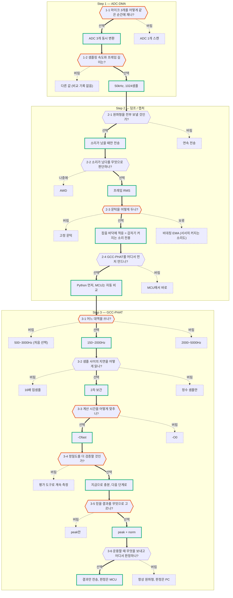

# 설계 결정 기록 — Step 1~3

> 프로젝트의 방향이나 성패를 좌우한 결정만 적음. 구현 세부나 당연한 선택은 Step 문서에 있음.
> 기준선은 git 태그 `baseline-v1`.

- **주황 테두리** = 다시 볼 결정 (근거가 약하거나, 내가 아직 설명하지 못하는 것).
  표시하려면 그림 맨 아래 `class ... todo` 줄에 질문 번호(`q23` 등)를 넣고, 해결되면 뺌.
- **설명할 수 있다의 기준**: 문서를 닫고 AI 없이 네 가지에 답함 — 버린 선택지와 이유, 근거 숫자 하나, 대가, 다시 결정해야 하는 조건.
- **근거 표시**: `실측` 보드에서 잰 값 / `시뮬레이션` PC에서 돌린 값 / `계산` / `논리` 숫자 없이 따진 것 / `기록 없음`.

---

## Step 1 — ADC-DMA

### 1-1 마이크 3개는 ADC 3개로 동시에 잰다

- **선택**: ADC1·2·3 동시 변환. TIM2 트리거 한 번에 세 채널이 같은 순간에 변환됨.
- **버림**: ADC 1개 스캔 — 채널 사이에 변환 시간(1.78µs ≈ 0.09샘플)만큼의 고정 오프셋.
- **근거**: `기록 없음` 두 방식을 비교한 기록은 없음. `실측` 세 쌍의 지연이 서로 맞는 정도(closure) 중앙값 0.02~0.03샘플 → 큰 어긋남이 없다는 간접 확인.
- **대가**: ADC 3개를 모두 사용.
- **다시 볼 조건**: 같은 신호를 세 핀에 넣어 지연이 0인지 직접 재는 검증을 아직 하지 않음.

### 1-2 50kHz, 프레임 1024샘플

- **선택**: 50kHz, 1024샘플 (프레임 하나 = 20.48ms).
- **버림**: 다른 값과 비교한 기록 없음.
- **근거**: `계산` 1샘플 = 20µs = 6.86mm. 마이크 간격 7cm에서 최대 지연은 10.2샘플 → 정수 샘플만으로는 약 5.6° 단위 (→ 3-2). `실측` GCC-PHAT 계산 3.3ms = 프레임 주기의 16%.
- **대가**: 정수 해상도가 거칠어 보간이 필수.
- **다시 볼 조건**: 왜 50kHz인지 기록이 없음. ADC 콜백 주기의 흔들림도 재지 않음.

---

## Step 2 — 덤프 / 캡처

### 2-1 원파형은 소리가 났을 때만 보낸다

- **선택**: 트리거된 프레임과 직전 프레임(40.96ms)만 전송.
- **버림**: 연속 전송 — 300KB/s가 필요한데 UART는 92KB/s.
- **따라온 것**: 가장 빠른 921600bps, CPU를 막지 않는 TX DMA.
- **대가**: 계속 이어지는 소리는 볼 수 없음.

### 2-2 트리거는 프레임 RMS로 판정한다

- **선택**: 프레임마다 AC RMS를 계산해 소프트웨어로 판정.
- **나중에**: AWD — CPU 부담이 없고 샘플 단위로 반응. 하지만 문턱이 고정이고 스파이크 한 점에도 걸림.
- **근거**: `논리` TDOA는 프레임 전체로 계산하므로 샘플 단위 반응은 이점이 아님. 게인을 바꿔 가는 단계라 고정 문턱은 매번 다시 맞춰야 함. 실제로 걸어서 비교한 측정은 없음.
- **대가**: 판정이 최대 20.48ms 늦음.
- **다시 볼 조건**: CPU를 재웠다가 소리로 깨우는 구조가 필요해지면 AWD.

### 2-3 문턱은 잡음 바닥에 적응시킨다 → 갑자기 커지는 소리 전용

- **선택**: 문턱 = max(`k_on` × 잡음 바닥, `min_rms`). 바닥은 조용한 프레임의 EMA (`k_on` 4.0, α 0.05).
- **버림**: 고정 문턱 — 게인이나 환경이 바뀔 때마다 재조정.
- **보류**: 비대칭 EMA (올라갈 때 α 0.001). 시뮬레이션에서 2초에 걸쳐 커지는 소리를 0.68초 시점에 잡음. 대신 환경 잡음이 실제로 커지면 수십 초 동안 계속 트리거.
- **근거**:
  - `계산` 프레임마다 15% 넘게 계속 커져야 트리거 = 약 59dB/s 이상.
  - `시뮬레이션` 0.5초에 걸친 상승(80dB/s)은 걸리고 0.7초(57dB/s)는 안 걸림.
  - `실측` 보드에서 잡음 바닥이 소리를 따라 올라가는 것을 확인 (수치 기록 없음).
  - `기록 없음` `k_on` 4.0, α 0.05를 다른 값과 비교한 수치는 없음.
- **대가**: 계속 나는 소리, 천천히 다가오는 소리에는 반응하지 않음.
- **다시 볼 조건**: 터렛이 반응할 대상 소리를 정할 때. 계속 나는 소리(날개 소리 등)가 대상이면 검출과 분석 구간이 바뀜 → Step2 5.9.

### 2-4 Python에서 먼저 만들고, MCU는 그 결과와 자동으로 비교한다

- **선택**: Python 구현을 정답지로 삼음. MCU는 결과 패킷을 같이 보내고, PC가 같은 원파형으로 다시 계산해 차이를 기록.
- **버림**: MCU에서 바로 구현 — 결과가 이상할 때 알고리즘, 파라미터, 라이브러리 사용법, 인덱스 버그 중 무엇이 원인인지 구분할 수 없음.
- **근거**: `실측` 캡처 63개에서 onset 전부 일치, 지연·피크·각도 차이 0.
- **따라온 것**: 두 쪽이 같은 구간을 자르도록 onset 탐색을 정수 연산으로 통일.
- **대가**: 같은 알고리즘을 두 번 만들고, 상수를 항상 양쪽에서 같이 바꿔야 함.

---

## Step 3 — GCC-PHAT

### 3-1 대역은 150~2000Hz

- **선택**: 150~2000Hz (실제 195~1953Hz). 2026-10-11에 500~3000Hz에서 바꿈.
- **버림**: 500~3000Hz (처음 선택) — 상한이 공간 앨리어싱 한계 c/(2d) ≈ 2450Hz를 넘음. 스냅에서는 문제가 없었지만 날개 소리 같은 음조 성분에서는 가짜 봉우리가 남음. 2000~5000Hz — 스냅에서도 두 번째 봉우리가 중앙값 0.32.
- **근거**:
  - `논리` 최종 대상이 비행체. 음조 성분은 한계 위에서 가짜 봉우리가 지워지지 않음.
  - `실측` 원파형 194개를 대역만 바꿔 다시 계산: 판정 통과 174 대 180, 세 쌍이 맞는 비율 95% 대 97%로 손해 없음. 같은 자리 세션(15개)의 표준편차는 0.77° 대 1.38°.
- **대가**: 이론상 정밀도는 약 1.8배 나빠짐 (합성 신호에서는 실제로 그렇게 나옴). 실제 스냅에서는 반대였음.
- **다시 볼 조건**: 날개 소리로 확인한 것이 아님. 대역마다 각도 평균이 1~3° 달라서, 실제 각도를 아는 측정이 있어야 어느 대역이 정확한지 알 수 있음. 보드에서 MCU와 PC 일치를 다시 확인해야 함 → Step3 5.2.

### 3-2 샘플 사이의 지연은 2차 보간으로 읽는다

- **선택**: 피크와 양옆 두 점으로 포물선을 그려 꼭짓점을 구함.
- **버림**: 16배 업샘플 — 결과 차이가 최대 0.015샘플인데 계산량은 훨씬 큼. 정수 샘플만 — 약 5.6° 단위로 끊김.
- **근거**: `실측` 위의 0.015샘플. `계산` 0.1샘플 ≈ 0.5°.

### 3-3 계산 시간은 `-Ofast`로 맞춘다

- **선택**: `-Ofast` (하드웨어 FPU는 원래 켜져 있었음).
- **버림**: `-O0` — 중앙값 18.6ms, 최대 19.8ms. 프레임 주기 20.48ms에 닿음.
- **근거**: `실측` 18.6ms → 3.3ms (프레임 주기의 16%). 32개 모두 PC와의 차이 0.
- **대가**: 디버깅할 때 한 줄씩 실행이 건너뛰고 지역변수가 안 보일 수 있음.
- **다시 볼 조건**: `-O0`에서 어느 단계가 병목이었는지 측정한 적이 없음 → Step3 8.3.

### 3-4 정밀도는 지금으로 충분하다 — 평가 도구는 만들지 않는다

- **선택**: 평가 도구를 지우고 다음 단계로 감.
- **버림**: 방향별 오차를 계속 측정.
- **근거**: `실측` 같은 자리 반복의 표준편차 1.3°. 목표는 ±15° 구역 판정이고, 어차피 센서 퓨전이 뒤에 붙음.
- **대가**: 표준편차는 흩어짐만 보여 줌. 실제 방향에서 얼마나 치우쳤는지(정확도)는 수치가 없음.
- **다시 볼 조건**: 기준선의 정확도를 `--truth` 세션으로 한 번 기록해야 이후 실험의 비교 대상이 생김.

### 3-5 신뢰 판정은 peak ≥ 0.5 그리고 0.3 ≤ norm ≤ 1.2

- **선택**: 두 조건을 모두 만족한 결과만 사용.
- **버림**: peak만 — norm 0.09(각도 +28.9°)인 결과가 통과함.
- **근거**:
  - `실측` peak ≥ 0.5인 49개는 세 쌍이 서로 맞는 비율 92%, 전체 124개는 50%.
  - `실측` 캡처 235개 중 220개(94%) 통과. 한 세션에서 걸러진 4개는 모두 peak 0.82 ~ 0.95, norm 0.19 ~ 0.29.
  - `계산` norm 하한 0.3은 오차가 1/norm에 비례한다는 계산뿐. 데이터에서 경계가 보여서 정한 값이 아님.
- **대가**: 위쪽에서 난 소리는 방향이 맞더라도 버려짐.
- **다시 볼 조건**: 위쪽에서 낸 소리(낮은 norm)를 모아 각도가 실제로 얼마나 흔들리는지 확인. 세 숫자는 AI가 정한 값이고 내가 확정한 것이 아님 → Step3 4.5.

### 3-6 운용할 때는 결과만 보내고, 판정은 MCU가 한다

- **선택**: `CAPTURE_SEND_RAW 0` — 결과 패킷 62바이트만 전송, holdoff 10프레임. 신뢰 판정은 MCU가 해서 `valid`로 넘김.
- **버림**: 항상 원파형 전송 — 캡처마다 134ms, 초당 1회 이하. 판정을 PC에만 두기 — 터렛을 움직이는 것은 MCU.
- **근거**: `실측` 결과 사이 간격 최소 0.205초, 0.27초 간격의 스냅을 따라감. MCU와 PC의 판정이 15개 중 15개 일치.
- **대가**: 원파형이 남지 않음 → 알고리즘이나 파라미터를 바꾼 뒤에는 원파형 모드로 한 번 검증할 것.
- **남은 의문**: holdoff 직후 소리의 꼬리에서 잡힌 것으로 보이는 결과 2개(peak 0.31, 0.50)는 판정으로 거르기로 함. 표본이 2개뿐.
