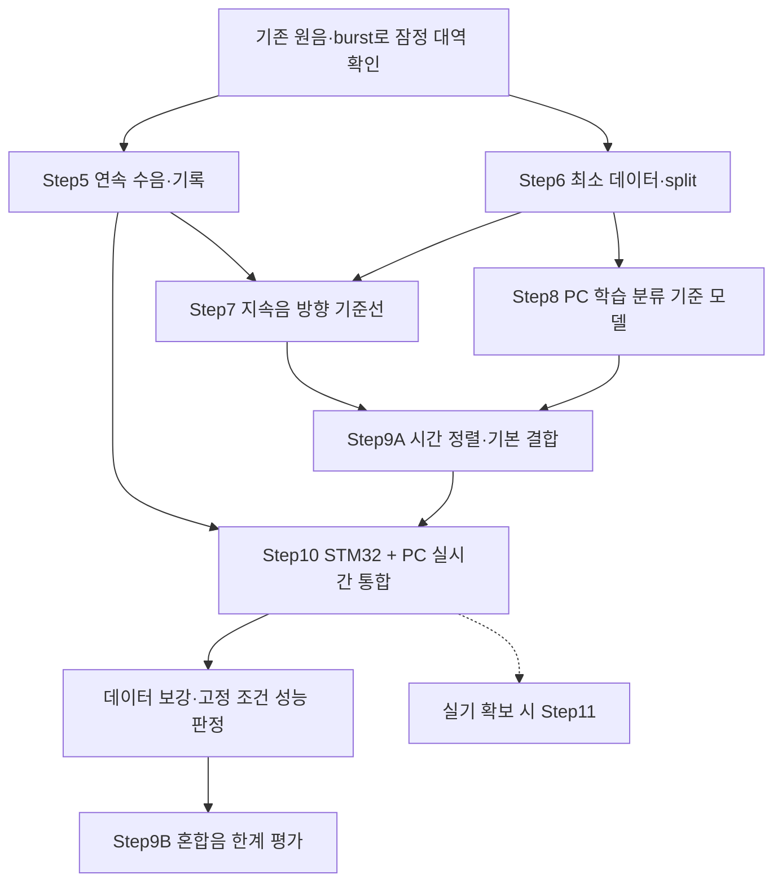

# Step 4.5.2 — Roadmap: STM32 + PC 학습 분류로 첫 완성 범위 축소

> 작성: 2026-10-14, 개정 v0.4: 2026-10-15 | 브랜치: `FPV_Target`
> 상세 시험 기준: [FPV_Step5-14_실험과제_구현목표_통과기준.md](../FPV_Step5-14_실험과제_구현목표_통과기준.md) (이하 "상세 계획")
> 설계 참고: [학습 파이프라인 실행계획](../FPV_MAX4466_3MIC_학습_파이프라인_실행계획.md), [기존 Roadmap 4.5](Step4.5_Roadmap.md), [Step4 설계](Step4_드론음향_탐지추정_설계.md)
> **현재 구현 범위·필수 여부·작업 순서는 이 문서를 우선한다. Step 번호는 상세 계획의 Step5~14와 맞춘다.** 아래는 실행 계획이며, 개정 자체가 구현·시험 완료를 뜻하지 않는다.

**v0.4 변경:** 학습 분류를 주 경로로 복원한다. 고조파 검출기는 PC 비교용 선택 항목으로 내린다. CMSIS-DSP의 FIR·FFT 등을 사용하고 직접 구현은 수집·버퍼·통신·상태 관리·실시간 통합에 집중한다. 첫 구성은 STM32 + 현재 PC이며 SBC, 접근 판별, 카메라, MCU 단독 분류는 필수가 아니다.

## 1. 첫 완성 목표와 범위

> 정해진 재생음 조건에서 STM32가 연속 수음·전처리·방향 추정을 수행하고, PC의 학습 기반 드론 분류 결과를 시간에 맞춰 결합한다. 유실·오래된 관측·오류 복귀를 처리하고, 검출률·오탐·방위 오차·실시간 처리 결과를 제시한다.

- **필수:** Step5~8, Step9A, Step10과 고정 조건의 성능 평가. Step9B 혼합음 시험도 수행해 한계를 기록하되, 혼합음 대응 성능을 첫 완성의 필수 조건으로 강제하지 않는다.
- **조건부 필수:** 실제 FPV 성능을 주장하려면 Step11을 통과해야 한다. 실기 확보 전에는 재생음 조건의 결과로만 표시한다.
- **선택:** 기본 서보 지향, SBC 이식, Step12 접근 판별, Step13 카메라 영상 확보, Step14 MCU 단독 분류.
- **제외:** 고조파만으로 드론 확정, 고조파 검출을 통과해야 학습 모델을 실행하는 게이트, FIR/FFT 손구현, 모든 비교 알고리즘의 의무 구현.

### 번호 변경 안내

v0.3 및 기존 Step 문서와 번호가 다르다. 기존 측정·코드는 재사용하며, 문서 번호가 바뀌었다고 다시 구현하지 않는다.

| 이전 v0.3 항목 | 이번 문서의 위치 |
| --- | --- |
| Step5 burst·재생 녹음 | Step5 사전 측정 및 Step6 데이터 확보 |
| Step6 FIR 연속 스트림 | Step5 |
| Step7 고조파 검출기 | Step8의 선택 비교 기준 B0 |
| Step8 연속음 방향 추정 | Step7 |
| Step9 통합·서보 | Step9A·Step10 및 선택 기본 서보 |

[기존 Step5 문서](Step5_공개원음_재생녹음_고조파구조.md)는 원음·burst·재생 경로 측정 기록으로 사용한다. 그 문서의 후속 Step 번호를 현재 실행 순서로 읽지 않는다.

## 2. 작업 순서

- 공개 원음의 PC 학습 실험은 Step5 완료를 기다리지 않는다. 장치 재녹음과 실시간 성능 검증은 Step5의 정상 데이터를 사용한다.
- Step6은 **개발 시작용 최소 구성**과 **성능 판정용 데이터 보강**으로 나눈다. 20분 양성·2시간 배경·48회 방위 기록을 모두 채우기 전에도 독립적인 개발을 시작할 수 있다.
- Step7·8은 독립적으로 진행한다. 학습 분류의 가능성 확인을 우선하고, 기준 구현이 나오면 Step9A·10에 바로 연결한다.
- 혼합음 알고리즘 해결을 기다리지 않고 메모리·처리 시간·통신 병목을 측정한다. 최종 성능 판정은 필요한 시험 데이터와 통과 조건을 충족한 뒤 수행한다.

## 3. 단계별 구현과 통과 기준

### Step5 — 연속 수음·전처리·기록

**질문:** 이후 알고리즘을 평가할 만큼 믿을 수 있는 연속 데이터를 얻는가?

- **사전 측정:** 기존 원음과 burst로 마이크 좌표·채널 순서·클리핑·채널 이상·재생 경로를 확인한다. 새로운 고조파 검출기를 만드는 단계로 확대하지 않는다.
- **잠정 대역:** `f_use`는 분석에 사용할 주파수 상한이다. 현재 원본 분석의 `f_use = 5 kHz`, `50 → 12.5 kHz(↓4)`를 시작점으로 사용하되 학습 분류의 최적 대역으로 확정하지 않는다. 원본과 대역 제한 입력의 분류 실패를 비교할 수 있게 원본 자료를 보존한다.
- **라이브러리:** `arm_fir_decimate_init_f32()` / `arm_fir_decimate_f32()`로 FIR와 다운샘플링을 수행한다. 세 채널은 같은 계수·데시메이션 위상과 서로 다른 상태 버퍼를 사용한다. 정상 프레임 경계에서 상태를 초기화하지 않는다.
- **직접:** DMA 데이터 안전 인계, 링버퍼·송신 큐, 샘플/프레임 번호, ADC OVR·DMA 유실·큐 유실 구분, CRC·클리핑 로그, DWT 처리 시간 측정.
- **프레임 번호:** 받은 횟수 대신 수집 단계의 번호를 해당 데이터와 함께 반환한다. `adc_get_frame_seq()`라는 별도 함수가 목표는 아니다. 데이터 복사 후 최신 번호를 따로 읽어 다른 프레임과 짝지어지지 않게 한다. DMA 콜백 번호와 하드웨어 OVR 감시는 별개다.
- **전송 규약:** FIR 출력의 부호·스케일·반올림·포화·샘플레이트와 분석 시간축을 명시한다. 기존 `uint16` 원본 ADC 패킷과 구분하고 송수신 버전을 함께 맞춘다. PCM에서는 원본 ADC의 값 범위를 이용한 패킷 동기 가정을 그대로 사용할 수 없으므로 길이·버전·CRC로 검증하고 재동기화한다.
- **유실 처리:** 누락 구간을 정상 연속 신호처럼 이어 붙이지 않는다. 분석 창 폐기, 필터 상태 재설정과 과도 구간 무효화, 정상 창 확보 후 복귀 규칙을 정한다.
- **AI:** 필터 계수 설계·응답 확인, PC 기준 전처리, 수신·비교 스크립트.

**통과:** 지정 정상 입력의 10분 기록에서 유실·OVR·CRC 오류·클리핑 0, 채널 대응 일치, 샘플 번호로 구간과 누락 여부 복원. 동일 디지털 입력·계수·초기 상태를 사용한 PC/MCU 최종 PCM 최대 차이 ≤2 LSB를 초기 제안값으로 삼는다. 스케일·반올림·지연 정렬을 고정하고, 필터 주파수 응답과 프레임 경계 연속성도 확인한다.

**가지치기:** 12비트 패킹은 필수가 아니다. int16 전송은 12.5 kHz × 3ch × 2 B = 75 KB/s이며, UART 921600 bps·8N1의 이론상 약 92 KB/s 안에 있지만 헤더·송신 지연을 포함해 실측한다. FIR의 MAC 수를 CPU 사용률로 단순 환산하지 않는다. 방향용 50 kHz 별도 경로도 필수로 고정하지 않고, 대역·정밀도 비교에서 필요한 경우에만 추가한다.

### Step6 — 데이터·평가 규칙

**질문:** 새로운 녹음에서도 동작하는지 공정하게 평가할 수 있는가?

- **개발 시작:** 소규모 목표음·팬 등 비드론·정답 방위 녹음과 파일 목록을 준비한다. 공개 원음 PC 실험과 장치 녹음을 구분한다.
- **필수:** 세션·원본·재생 여부·게인·배열·거리·방위·높이 메타데이터를 기록한다. 원본/세션 단위로 split한 뒤 창을 자른다. 같은 원본의 다른 마이크·재생 파생본·증강본은 같은 split에 둔다.
- **보강:** 오류 사례를 보고 실제 팬·음성·음악·차량·바람·자기 소음을 추가한다. 목표음과 비드론 모두 같은 재생 경로의 예를 포함한다. 개발용 20분 목표음·2시간 배경은 수집 참고량이며 독립성이나 일반화를 보장하지 않는다.
- **방위:** 처음에는 같은 높이에서 기본 방향과 부호를 확인한다. 정식 판정 전에는 주장할 방위·거리·높이 조건과 반복 수를 고정한다. 8방위 × 2높이 × 3회는 확장 시험안이며 최초 개발 진입 조건은 아니다. 높은 음원 성능을 주장하면 해당 조건도 시험한다.
- **평가 규칙:** 사건 시작·종료, 병합·해제, 검출 지연 기준, 각도 wrap, 정답 불확실성, 유효 출력 분모를 고정한다. 최종 시험셋은 모델·임계값 선택에 사용하지 않는다.

**통과 구분:** 최소 데이터와 누수 없는 split·평가 규칙이 있으면 개발을 시작한다. 성능 판정은 Step7·8·9의 지정 조건과 표본을 확보한 뒤 수행한다. 반복 재생이나 겹친 창을 새로운 독립 비행으로 세지 않는다. 정답 각도 불확실성은 2° 이내를 초기 목표로 두고, 불확실성이 큰 자료로 좁은 오차 기준의 통과를 주장하지 않는다.

**산출물:** 데이터 목록·사건 라벨·split·평가 규칙. 실제 FPV 수집은 실기 확보 전까지 조건부이며, 부족한 자료를 통과로 표시하지 않는다.

### Step7 — 지속음 방향 추정

**질문:** 현재 3마이크에서 필요한 방위 오차와 유효율을 만족하는가?

- **기본:** 기존 GCC-PHAT + LSE를 재사용한다. 스냅의 onset 탐색·5 ms 구간 대신 지속음용 관측 길이·대역·hop을 설정한다. 스냅 경로는 회귀 확인용으로 보존한다.
- **라이브러리:** 현재 사용 중인 CMSIS의 FFT/IFFT, 복소수 연산, 평균·최댓값 연산을 유지한다.
- **직접:** 분석 창 조립, 세 채널 시간 정렬, 갱신 주기, 결과의 샘플 구간·유효성·나이 관리.
- **AI:** 지속음용 계산부 초안, PC 기준 출력, 알려진 지연 입력과 정답 방위 평가 도구. 부호·단위·가정은 직접 확인한다.
- **확장 조건:** 기본 방식이 실패한 원인을 확인한 뒤 주파수 가중 또는 SRP-PHAT을 선택적으로 비교한다. 세 방법 모두의 구현은 요구하지 않는다. 비교 시 관측 길이·대역·hop을 맞춘다.

**통과:** 사전 지정 단일 음원 조건에서 유효 방위 절대오차 중앙값 ≤5°, p95 ≤10°, 전체 평가 구간의 유효율 ≥80%. 좌표·회전 부호·채널 순서를 확인하고 무효 출력도 저장한다. 평면 배열의 위/아래 모호성과 머리 위 음원의 방위 불안정성을 시험 범위에 명시한다.

### Step8 — PC 학습 기반 드론 분류

**질문:** 비드론 소리의 오탐을 억제하면서 독립된 드론 사건을 검출하는가?

- **주 경로:** 대역 내 전체 신호의 시간·주파수 정보를 사용하는 학습 모델을 PC에서 실행한다. 고조파 마스크를 분류 입력에 강제하거나 고조파 점수로 추론 실행을 차단하지 않는다.
- **첫 모델 하나:** log-mel + 작은 CNN 또는 데이터가 부족할 때 사전학습 오디오 특징 + 작은 분류기 중 하나로 시작한다. 학습 환경과 필요한 데이터·실행 비용을 보고 선택한다. MFCC 분류기와 CNN을 모두 구현할 의무는 없다.
- **고조파 B0:** 기존 PC 분석 코드를 선택 비교용으로 재사용한다. B0 성공을 학습의 선행 조건으로 두지 않으며 MCU 이식을 요구하지 않는다.
- **AI:** 특징 추출·학습·평가 스크립트, 모델 구현, 오류 사례 집계. 모델 크기를 늘리기 전에 데이터 누수·수음 분포 차이·헷갈리는 방해음을 확인한다.
- **직접:** MCU/PC 입출력 계약, 분석 구간 번호, 검출 후보·확정·해제 상태, 결과 유효기간. 모델 점수의 의미와 전처리 설정을 이해한다.

**통과:** 고정된 연속 검증 조건에서 독립 드론 사건 ≥30건, 사건 검출률 ≥90%, 비드론 ≥2시간에서 오탐 ≤1회/시간, 검출 성공 사건의 확정 지연 p95 ≤1초를 동시에 만족한다. 같은 임계값·지속 조건을 적용하고 미탐 수를 병기한다. 표본이 부족하면 개발 결과로 기록하고 성능 통과는 보류한다.

**보완 지표:** 거짓 검출 총 지속시간·최장 지속시간을 함께 기록한다. 오래 켜진 오탐 하나를 1회로만 세어 성능을 좋게 보이지 않게 한다. 관측 창·지속 확인·통신·추론을 포함한 지연을 측정하고, 독립 최종 시험에서 고정 설정으로 재평가한다.

### Step9A — 시간 정렬·기본 결합

**질문:** 같은 관측 구간의 검출과 방향을 결합하고 잘못된 관측을 제외하는가?

- 분류와 방향에 분석 시작·끝 샘플 번호를 붙이고, 서로 다른 관측 창 길이와 FIR 지연의 정렬 규칙을 정한다.
- 단일 목표음에서 검출·방향 결합을 확인한다. 오래된 응답·유실된 입력·무효 방향은 정상 관측으로 사용하지 않는다.
- 결과 지연·통신 단절 후 상태 전이와 복귀를 구현한다. 같은 시각의 두 출력이라는 이유만으로 혼합음에서 같은 음원이라고 간주하지 않는다.

**통과:** 지정 단일 음원 조건에서 드론 존재 평가 시점의 ≥80%에 검출과 정답 방위 ±10° 이내 유효 출력을 함께 제공한다. 무효·보류는 공동 성공으로 세지 않는다. 서로 다른 구간·오래된 결과가 잘못 결합되지 않음을 시험한다.

### Step10 — STM32 + PC 실시간 통합 (Step9B보다 먼저)

**질문:** 기본 알고리즘을 연결한 상태에서 수음과 처리 마감을 지키는가?

- **기본 배치:** STM32는 수음·CMSIS 전처리·선정 방향 추정, 현재 PC는 학습 추론을 담당한다. 결과를 구간 번호와 함께 전달해 상태를 결합한다. SBC 이식은 선택이다.
- **직접:** 모듈 연결, 큐·버퍼 수명, 처리 시간·메모리·관측 나이 측정, 검출 상태와 오류 복귀.
- 알고리즘 기준 구현이 나오면 연결한다. 혼합음 분리를 완성할 때까지 기다리지 않는다.

**통과:** 전체 부하에서 30분 정상 운용의 ADC/DMA 유실·OVR 0, 처리 지연 누적 없음. 최대 처리 시간·큐 깊이·스택과 버퍼 사용량·관측 나이를 기록한다. CPU ≤70%는 초기 여유 목표이며 평균 이용률만으로 마감 통과를 판정하지 않는다.

- DMA 원본 반버퍼는 다음 덮어쓰기 전인 20.48 ms 이내 안전하게 확보한다. 모든 DSP·추론을 그 안에서 끝내라는 뜻은 아니다. 인계 후 각 경로의 갱신 주기와 버퍼 한도를 지킨다.
- 방향은 설정한 갱신 주기 내 완료한다. 분류가 100 ms 갱신 구성이라면 특징 처리·추론 경로의 관측 최악 시간 <100 ms와 큐 비누적을 확인한다.
- 동일 저장 입력의 PC 기준과 통합 결과를 비교한다. 유효 방향 차이 ≤1°, 검출 사건 판정 일치 및 출력 갱신 간격 이내 타이밍 차이를 초기 기준으로 삼는다. 임계값 근처 차이는 원인을 검토한다.
- 정상 운용과 별도로 통신 단절·CRC 오류·클리핑을 주입해 감지·관측 무효화·정상 창 확보 후 복귀를 확인한다.

### Step9B — 혼합음 한계 평가

**질문:** 드론을 검출했지만 팬 방향을 출력하는 상황은 언제 발생하는가?

- 기본 통합 후 드론 재생음과 다른 방향의 팬을 함께 시험한다. 처음에는 각도 차 ≥60°에서 목표음 우세·비슷한 레벨·팬 우세 조건을 정하고 기준 마이크의 대역 에너지비를 기록한다.
- 음성·음악 등으로 확장할지는 오류와 목표 환경을 보고 정한다. 같은 평가 시점으로 공동 성공률·방해음 오지향률·보류율을 계산한다.
- **첫 완성에 필요한 결과:** 시험 조건·성공/실패·지원하지 못하는 조건을 남긴다. 실패한 혼합음 성능을 단일 음원 통과로 대체하지 않는다.
- **혼합음 대응을 주장할 때의 통과:** 지정 필수 조건별 공동 성공률 ≥80%, 발행한 유효 출력 중 방해음 오지향률 ≤5%. 무효·보류는 공동 성공에서 실패로 계산한다. 방해음 판정 허용각은 시험 전에 고정한다(초기 ±10°).
- **자동 확장 금지:** 실패 즉시 방향별 빔포밍·분류, SRP-PHAT 또는 배열 변경을 의무화하지 않는다. 해당 운용 조건의 필요성과 비용을 보고 별도 범위로 결정한다.

## 4. 선택·조건부 확장

| 항목 | 진입 조건과 남길 검증 |
| --- | --- |
| 기본 서보 지향 | Step9A·10 이후 재생음으로 PWM·영점·회전 부호·기구 범위·오래된 명령 제외·구동 중 관측 처리·정지 후 복귀를 구현한다. 실제 카메라 영상 확보와 분리한다. 수음은 유지하고 오염 구간의 사용 정책을 정한다. |
| SBC 이식 | PC 구성의 성능이 확인되고 독립 운용이 필요할 때 진행한다. 같은 입력의 출력과 Step10 마감을 다시 검증한다. |
| Step11 실제 FPV | 실기와 독립 정답 자료 확보 시 진행한다. 실제 성능 주장에는 필수다. 상세 계획의 거리·환경별 검출·방위·필요 시 혼합음 기준으로 평가하며, 결과로 튜닝했다면 새 독립 시험을 확보한다. |
| Step12 접근 판별 | 현재 첫 완성 범위에서 제외한다. 실제 거리 변화 정답과 제자리 스로틀 반례가 있어야 별도 시작한다. |
| Step13 카메라 영상 확보 | 기본 서보와 별도 과제다. 실비행·카메라를 확보하고 영상 확보율과 지연을 검증한다. 첫 완성에 실제 영상 20사건 시험을 요구하지 않는다. |
| Step14 MCU 단독 분류 | 모델 성능·RAM·Flash·처리 예산을 확인한 뒤 결정한다. INT8은 필요할 때 선택하며 변환 자체가 목표는 아니다. PC 대비 성능·수음 안정성·메모리와 실제 운용 조건을 재검증한다. |

## 5. 개발 지침
1. 사용자 : 하드웨어가 필요한 실험 및 문제 상황에서 설계 결정
2.  신호처리 문제를 해결함에 있어서 CMSIS-DSP 라이브러리를 적극적으로 사용. 
3. 모든 코드 구현을 AI가 맡음 (바이브 코딩을 기본 원칙으로 함). 단, AI는 어떤 문제를 해결하려고 해당 코드 블럭 또는 함수를 도입한 것인지, 도입 근거를 매 Step의 MarkDown 파일에 Mermaid 도표와 함께 명시해야함.
## 6. 판정·기록 원칙과 바로 할 일

- 상세 계획의 **미착수 / 진행 중 / 실험 완료·미통과 / 통과 / 범위 변경**을 사용한다. 측정하지 않은 항목은 미측정으로 둔다.
- 수치는 초기 제안값이다. 각 판정 시험 전에 조건·분모·수치를 고정한다. 변경하면 이유·버전을 기록하고 같은 조건의 기준선부터 재평가한다.
- 재생음의 소수 사건에서 얻은 통과를 새로운 기체·환경·실제 비행으로 확대하지 않는다. 짧은 무오탐 기록으로 장기 신뢰성을 주장하지 않는다.
- 단계 문서는 질문·구현/실험·수치·결정·실패와 재검토 조건을 중심으로 작성한다. 필수 시험 조건은 시험 전에 정하고 결과 문서는 측정 뒤에 작성한다.

**바로 할 일:** (1) 현재 배열·게인·burst 결과와 잠정 대역 확인 → (2) 데이터와 생성 번호의 일관된 인계 및 전처리·전송 규약 정의 → (3) CMSIS 기반 연속 수음 구현. 공개 원음에서는 별도로 (4) 최소 split 구성 → (5) PC 학습 모델 하나의 초기 평가를 진행한다.
