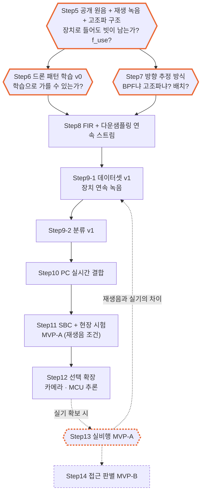

# Step 4.5 — Roadmap: Step5 이후의 분할과 방향 결정

> 작성: 2026-10-14, 개정 v0.2: 2026-10-14 | 브랜치: `FPV_Target`
> 원본 계획: [FPV_MAX4466_3MIC_학습_파이프라인_실행계획.md](../FPV_MAX4466_3MIC_학습_파이프라인_실행계획.md) (이하 "계획서", P0~P9)
> 설계 근거: [Step4_드론음향_탐지추정_설계.md](Step4_드론음향_탐지추정_설계.md)

계획서의 P0~P9를 **실물 데이터가 다음 설계를 정하는 분기점**마다 끊어 Step5~14로 나눈다.

- **분할 원칙**: 각 Step은 실물 데이터 하나로 끝나고, 그 데이터가 다음 Step의 설계를 바꿔야 한다. 바꾸지 않는 점검은 Step으로 세우지 않는다.
- **전제**: 실제 FPV 녹음은 프로젝트 막바지에나 가능하다. 그 전까지 드론 소리는 **공개 원음, 그리고 그것을 스피커로 재생해 MAX4466으로 녹음한 것**뿐이다.
- **기준선은 드론 소리로 새로 잡는다.** 스냅 경로와 그 대역(150~2000 Hz)은 이전 대상의 설계값이고, 비교 기준으로 쓰지 않는다.
- **주황 테두리** = 실측 결과에 따라 갈라지는 결정.

**v0.2에서 바뀐 것**: 하드웨어 기준선 Step을 없앴다. 그리고 고조파 검출기와 학습을 앞으로 당겼다. FIR 연속 스트림은 그 결과로 대역을 정한 뒤에 만든다.

---

## 1. 전체 흐름

| Step | 내용 | 끝나는 근거 (실물 데이터) | 정해지는 것 |
| --- | --- | --- | --- |
| 5 | 공개 원음 선정 + 재생 녹음 + 고조파 구조 | 원본과 장치 녹음 각각의 f0 범위, 고조파 수, 선 폭, 에너지 상한 | f_use, ↓4 / ↓2, 재생 조건, 원음 목록 |
| 6 | 드론 패턴 학습 v0 | 공개 원음으로 학습한 B0(고조파 점수)·B1·B2를 장치 녹음에 돌린 결과 | 학습으로 가를 수 있는가, 부족한 데이터 |
| 7 | 방향 추정 방식 결정 | 같은 소리를 몇 개 방위에서 녹음해 BPF와 고조파 마스크의 오차·튐 비교 | **BPF냐 고조파냐**, 대역, 마이크 배치 |
| 8 | FIR + 다운샘플링 연속 스트림 | 10분 무결 수신, 무음에서 빗 모양 없음, MCU = PC | 연속 수집 시작 |
| 9-1 | 데이터셋 v1 | 이 장치로 녹음한 배경 2시간 이상 + 재생 양성·음성 | split, 부족한 조건 |
| 9-2 | 분류 v1 | 연속 validation 녹음에서 검출률·오탐/시간·지연 | 실시간에 올릴 모델 |
| 10 | PC 실시간 결합 | 30분 연속 실행, 팬+드론 동시 재생 오지향 시험 | 시스템 구성 |
| 11 | SBC + 현장 시험 | PC = SBC, 현장 배경 + 재생음 | MVP-A 판정 (재생음 조건) |
| 12 | 선택 확장 (P9) | 스피커 방향으로 카메라 회전 | — |
| 13 | *(조건부)* 실비행 MVP-A | 실기 거리별 검출률·각도 오차 | 9-1로 돌아가 보강 |
| 14 | *(조건부)* 접근 판별 MVP-B | 접근·이탈·제자리 스로틀 사건 | 접근 출력 사용 여부 |

Step6과 Step7은 모두 Step5의 녹음을 쓰고 서로의 결과에 의존하지 않는다. 그래서 순서를 바꾸거나 병행할 수 있다.

---

## 2. 결정

### 2-1 실제 FPV는 없다고 보고 진행한다

- **선택**: 드론 양성은 공개 원음과 그 재생 녹음. 실비행 Step(13, 14)은 조건부.
- **대가**: Step11까지의 성능은 모두 "재생음 조건"이다. 이동·고도·도플러·실기 스로틀 변화는 검증하지 못한다.
- **다시 볼 조건**: 실기를 한 번이라도 녹음할 수 있으면 Step5의 f_use부터 다시 확인한다.

### 2-2 하드웨어 점검 Step을 따로 두지 않는다

- **선택**: 실제 마이크 간격 측정과 클리핑 확인만 Step5에 넣는다.
- **버림**: 계획서 P0·P1의 OVR, 프레임 주기, 전기 동시성, 8방위 스냅 정답 시험.
- **근거**: `논리` 이 점검들의 결과는 고조파 검출기, 학습, 방향 방식 중 어느 설계도 바꾸지 않는다. 연속 동작에 필요한 OVR 처리는 연속 스트림(8)에서 다룬다.
- **대가**: 채널 간 미세 편차는 모른 채 진행한다. Step7의 방위 오차가 설명되지 않으면 그때 잰다.

### 2-3 FIR 전에 burst 캡처로 결정부터 내린다

- **선택**: 50 kHz 3채널을 RAM에 연속 8192샘플(164 ms, 48 KB)씩 담아 천천히 보낸다. Step5~7은 이것으로 한다.
- **버림**: 계획서 P2처럼 12.5 kHz FIR을 먼저 구현.
- **근거**: `계산` 164 ms면 Δf가 6.1 Hz라 f0와 선 폭을 읽을 수 있고, 같은 녹음으로 두 방향 방식을 PC에서 비교할 수 있다. `논리` FIR의 f_use는 Step5의 결과로 정해진다. ↓2가 되면 3채널 전송량이 150 KB/s로 UART 한계 92 KB/s를 넘어 통신 구조가 바뀐다.
- **대가**: 0.5초 단위의 시간 패턴은 Step8 전까지 원본 파일에서만 볼 수 있다.

### 2-4 방향 방식(7)을 대량 수집(9-1)보다 앞에 둔다

- **근거**: `논리` 방향 결과 때문에 마이크 간격을 바꾸면 그 전의 3채널 녹음은 방위 정답 데이터로 쓸 수 없다.

### 2-5 비드론 소리도 같은 스피커로 재생해 음성 데이터에 넣는다

- **근거**: `논리` 양성만 스피커를 거치면 분류기가 "드론"이 아니라 "스피커를 거친 소리"를 배울 수 있다.
- **확인 방법**: 실물 팬과 재생 팬의 점수 분포가 같은지 Step6에서 비교한다.

---

## 3. 원음 선정 기준

후보 목록과 등급은 [Step5](Step5_공개원음_재생녹음_고조파구조.md) 1절에 있다.

| 기준 | 탈락 | 이유 |
| --- | --- | --- |
| 무편집 원본 | 해설, 배경음악, 노이즈 제거 같은 편집 | 위키미디어 영상 4개에서 고조파 점수 1위가 음성·음악이었음 (Step4 7.2) |
| 샘플레이트·코덱 | 16 kHz 이하, 손실 압축 | f_use가 6 kHz를 넘는지 판단할 대역이 없음 |
| 수음 위치 | 기체 탑재 마이크, 25~50 cm 근접 | 지상 원거리 수음과 스펙트럼이 다름 |
| 기체 정보 | 기종·프롭 불명 | FPV인지 촬영 드론인지 가를 수 없음 |
| 독립성 | 한 비행을 잘라 만든 여러 파일 | split 단위가 원음이므로 서로 다른 원음의 수가 곧 검증의 크기 |
| 라이선스 | 불명확, ML 사용 금지 | — |

### 재생 경로가 원음을 바꾸는 세 가지

| 종류 | 영향 | 재는 방법 |
| --- | --- | --- |
| 크기 응답 | 깎인 고조파는 마이크 잡음 아래로 내려가 복구할 수 없음. 음색이 바뀌어 분류기가 스피커를 학습 | 스윕 녹음, 원본 대 재생 스펙트럼 |
| 위상 응답 | 음원이 하나라 세 마이크에 공통 → 교차 스펙트럼에서 상쇄. 방위와 거의 무관 | 재지 않음 |
| 비선형 왜곡 | 크게 틀면 정수배 성분이 새로 생김 = 고조파 검출기가 찾는 빗 | 음량을 바꿔 가며 단일음 재생 |

---

## 4. 남은 위험

- **FPV 원음이 매우 적다.** 지상 원거리에서 녹음한 공개 FPV는 DJI FPV 한 기종(Salford, 통과 비행 3회)뿐이다. 우크라이나형 7~10인치 자작 FPV는 공개 자료에 없다. 상용 라이브러리(Sound Ex Machina)는 쓰지 않기로 했다 (2026-10-14).
- **재생음과 실기의 차이.** 실기가 없는 동안은 측정할 수 없다. 모든 결과에 "재생음 조건"을 붙인다.
