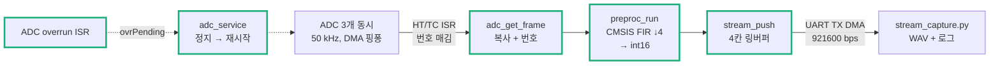
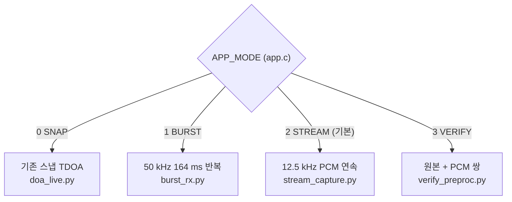

# Step 5 — 연속 수음·전처리·기록

> 작성: 2026-10-15 | 브랜치: `FPV_Target` | 기준: [Step4.5.2_Roadmap_축소.md](Step4.5.2_Roadmap_축소.md) Step5
> 이전 기록: [Step5_공개원음_재생녹음_고조파구조.md](Step5_공개원음_재생녹음_고조파구조.md) (원음 분석, burst, 재생 경로. 사전 측정으로 사용)
> 상태: **통과 (2026-10-16).** 보드 시험 4개 모두 통과. 남은 위험(HSI 클럭 +1.7%, 프레임 동기 빗, ch3 고역 잡음)은 5절에 적음

## 0. 질문

**이후 알고리즘을 평가할 만큼 믿을 수 있는 연속 데이터를 얻는가?**

통과 기준 (Roadmap Step5):

- 정상 입력 10분 기록에서 유실·OVR·CRC 오류·클리핑 0
- 채널 대응 일치
- 샘플 번호로 구간과 누락 복원
- 동일 입력에서 PC/MCU 최종 PCM 최대 차이 ≤ 2 LSB

## 1. 확정한 규약 (A2, 2026-10-15)

| 항목 | 값 |
| --- | --- |
| 프레임 번호 | ISR(DMA 반버퍼 콜백)이 매기고 `adc_get_frame(out, &seq)`가 데이터와 함께 반환 |
| 유실 구분 | ADC/DMA 유실(`drop`), ADC overrun(`ovr`), 송신 큐 유실(`qdrop`). 셋 다 PCM 패킷 헤더에 누계로 실림 |
| FIR | CMSIS `arm_fir_decimate_f32`, M = 4, 블록 1024 → 256. Kaiser β 5.65, **75탭**, 통과 5 kHz(리플 0.016 dB) / 저지 7.5 kHz(−60.4 dB), 군지연 37샘플 @ 50 kHz |
| 출력 위상 | `y[k] = Σ b[j]·x[4k − j]` (호스트에서 CMSIS 코드로 실측. 블록의 첫 샘플 시점) |
| PCM | `x = adc − 2048` → FIR·↓4 → `×16` → 반올림(nearest-even) → int16 포화 |
| 패킷 | v3, type 0x03, 헤더 24 B + 3 × 256 × 2 B + CRC = 1562 B / 20.48 ms = **76.3 KB/s** (921600 bps의 약 83%) |
| 시간축 | 블록의 첫 샘플 번호 = (frame_seq − 1) × 256 (12.5 kHz) |
| 끊김 처리 | 번호가 건너뜀 또는 overrun → FIR 상태 0 + `RESYNC`·`GAP`. 첫 19샘플(= ⌈75/4⌉)은 과도 구간. 큐 유실 → `GAP`만 (MCU 필터는 연속) |
| 검증 | 검증 모드: 같은 8프레임의 원본과 PCM을 같이 보내고 PC가 비교 |

## 2. 구조와 도입 이유

### 2.1 데이터 흐름

### 2.2 코드 블록별 도입 이유

| 코드 | 해결하려는 문제 | 도입 근거 |
| --- | --- | --- |
| `adc.c` `readySeq`, `adc_get_frame(out, &seq)` | 이전에는 main이 받은 횟수를 셌다. 그래서 놓친 프레임이 번호에 드러나지 않았다 | 번호를 ISR에서 매기고 데이터와 같은 임계 구역에서 꺼내므로, 다른 프레임과 짝지어질 수 없다 |
| `adc.c` `frameSeq != my_seq` 검사 | 복사하는 동안 반대쪽 반버퍼가 끝나면 DMA가 복사 중인 영역을 덮어쓴다 | 복사가 끝난 뒤 번호가 바뀌었으면 폐기하고 `drop` 증가 |
| `adc.c` `ADC_IRQHandler`, `HAL_ADC_ErrorCallback`, `adc_service` | OVR이 나면 DMA가 조용히 멈췄다 (Step1 미해결 항목) | ISR은 횟수만 세고, main에서 타이머 → ADC → DMA를 멈춘 뒤 원래 순서(슬레이브 → 마스터 → 타이머)로 재시작. 이 순서가 buffer[0] = ADC1을 보장한다 |
| `preproc.c` CMSIS `arm_fir_decimate_f32` ×3 | 50 kHz → 12.5 kHz에서 7.5 kHz 위가 0~5 kHz로 접힌다 (Step4 4.2) | 버리기 전에 저역 FIR. 계수는 하나, 상태는 채널마다 따로 (세 채널의 위상 응답이 같아야 방위가 안 틀어짐, Step4 4.4). 직접 구현하지 않음 (Roadmap 개발 지침 2) |
| `preproc.c` 상태를 프레임 사이에서 유지 | 경계마다 상태를 지우면 20.48 ms마다 과도 응답 → 48.8 Hz 빗 → 고조파·분류가 드론으로 오인 | `preproc_reset()`은 부팅과 끊김 뒤에만 |
| `preproc.c` `×16`, `lrintf`, `__SSAT` | 전송·저장 형식을 int16으로 고정해야 PC와 비트 단위로 비교할 수 있다 | 12비트 범위를 16비트로. 반올림 규칙은 Python `np.rint`와 같음 |
| `stream.c` 링버퍼 4칸 + `kick_locked` | UART 송신(약 17 ms/패킷) 중에도 다음 프레임이 20.48 ms마다 온다 | main이 쓰고 송신 완료 ISR이 비우는 생산자 1·소비자 1 구조. 넘치면 버리고 `qdrop`. 버려도 패킷 번호는 소비해 PC가 빈 번호로 알 수 있음 |
| `stream.c` 헤더 24 B (drop·ovr·qdrop·cpu) | PCM에는 FF FF FF FF가 나올 수 있어 sync만으로는 동기를 믿을 수 없다. 유실 원인도 PC에서 알아야 한다 | ver·type·len·CRC가 모두 맞아야 수신. 유실 카운터와 처리 시간(%)을 매 패킷에 실음 |
| `app.c` `on_stream_frame` | 끊긴 입력을 필터에 이어 넣으면 정상처럼 보이는 가짜 파형이 나온다 | 번호가 건너뛰거나 OVR이면 필터 재시작 + `RESYNC`·`GAP`, 큐 유실은 `GAP`만 |
| `verify.c` 검증 모드 | "같은 디지털 입력"으로 PC와 MCU를 비교해야 한다 (서로 다른 시각의 녹음끼리는 비교 불가) | 8프레임을 원본(burst)과 PCM으로 같이 보내고, PC가 같은 계수로 계산 |

### 2.3 모드

모드를 바꾸려면 `app.c`의 `#define APP_MODE APP_MODE_STREAM`을 고치거나 컴파일 옵션 `-DAPP_MODE=1`을 준다.

| 모드 | 텍스트 | data + bss |
| --- | --- | --- |
| STREAM | 14.8 KB | 46.8 KB |
| VERIFY | 15.3 KB | 106.8 KB |
| BURST | 14.3 KB | 89.4 KB |
| SNAP | 146.1 KB | 106.8 KB |

모든 모드가 경고 없이 빌드된다 (명령줄 빌드, 2026-10-15).

## 3. PC에서 확인한 것 (보드 없이)

| 확인 | 방법 | 결과 |
| --- | --- | --- |
| FIR 응답 | `Tools/preproc/fir_design.py` → `reports/step5/fir_response.png` | 75탭, 통과 리플 0.016 dB, 저지 −60.4 dB |
| MCU 코드 = PC 기준 | `Tools/preproc/test_preproc_host.py`: preproc.c와 CMSIS 소스를 PC용 gcc로 빌드해 32프레임 연속 처리 → `frontend.py`와 비교 | 랜덤·550 Hz+11 kHz·0/4095 극단·임펄스 **모두 최대 1 LSB** (기준 ≤ 2) |
| 출력 위상 | 같은 시험에서 위상 0~3 대조 | 위상 0만 일치 → 규약을 `x[4k − j]`로 확정 (처음 가정한 `4k + 3`은 틀렸음) |
| 패킷 파서 | 합성 v2·v3 혼합 스트림, payload 안 FF FF FF FF, 777 B 단위로 쪼개 넣기 | 7/7 수신, CRC 실패 0 |
| 수신기 | `stream_capture.py --replay`로 유실 1, 클리핑 1, 검증 패킷 1이 섞인 합성 스트림 | 파일 분리 위치, 과도 19샘플 제외, 시작 샘플 번호, 판정 모두 계산값과 일치 |

## 4. 보드에서 할 일

| 순서 | 모드 | 명령 | 통과 |
| --- | --- | --- | --- |
| 1 | BURST | 이전 Step5 문서 5-3 (quiet, pink, tone, 드론 재생) + 마이크 간격·채널 순서 실측 | 채널 순서 확인, 클리핑 없는 재생 음량, `geometry.json` — **완료 2026-10-16**, [playback.md](../../reports/step5/playback.md) |
| 2 | VERIFY | `python Tools/board/verify_preproc.py --port COMx --pairs 20` (조용히 / 말소리 / 재생음 섞어서) | 모든 쌍 최대 차이 ≤ 2 LSB — **통과 2026-10-16** (20쌍, 입력 −55 ~ −28 dBFS, 최대 1 LSB, 차이 있는 샘플 ≤ 0.05%, CRC 오류 0) |
| 3 | STREAM | `python Tools/board/stream_capture.py --port COMx --label quiet_10min --minutes 10` | `summary.json`의 `passed: true` — **통과 2026-10-16** (유실·OVR·qdrop·CRC·클리핑 0) |
| 4 | STREAM | 같은 명령으로 스피커 재생 10분, 선풍기 10분 | 같음. 클리핑이 나면 게인이나 음량 조정 후 재시험. 스피커(`20_drones_10min.wav`): **통과 2026-10-16** (유실·OVR·qdrop·CRC·클리핑 0, CPU 20%, RMS 세 채널 −30.5~−30.9 dBFS, 피크 −11.4 dBFS). 선풍기: **통과 2026-10-16** (유실 0, 수신 간격 최대 54 ms). 선풍기는 455 s에 꺼져 실제 선풍기 구간은 약 7.6분이다. ch2에 바람이 닿아 20–100 Hz에서 +16 dB (채널 간 일치도 0.52 → 기류 잡음) |

- 3, 4번 실행 중 화면에 2초마다 KB/s, 채널 레벨, CPU 최대, 유실 수가 나온다. KB/s는 약 76이어야 한다.
- `cpu`는 프레임마다 전처리와 큐 적재에 걸린 시간을 프레임 주기 대비 %로 나타낸 값이다. 보드에서 처음 재는 값이다.
- 실패하면 `summary.json`의 `delta_drop_ovr_qdrop`로 원인을 가른다.
  - drop: main이 늦음
  - ovr: ADC DMA
  - qdrop: UART 대역폭

## 5. 남은 위험·다시 볼 조건

- **실제 샘플레이트가 50 kHz가 아니라 약 50.86 kHz다 (+1.7%).** STREAM 10분에서 PC 시계 600 s 동안 610.3 s 분량의 샘플이 왔다. 원인은 클럭원: 내부 RC 발진기 HSI(16 MHz)를 쓰고 있고, HSI는 온도에 따라 수 % 흔들린다. 영향: 주파수 축 1.7% 어긋남, TDoA 지연→각도 환산 오차 (60°에서 약 1.7°, 80° 근처는 계산 범위를 벗어날 수 있음), 카메라 등 다른 장치와의 시간 정렬이 10분에 약 10 s 어긋남. **해결 (2026-10-16):** HSE BYPASS 8 MHz, PLLM 4 → ADC 49,999.6 Hz (−0.001%). 처음에는 HSE 입력을 16 MHz·크리스털 모드로 잡아 보드가 절반 속도로 돌았다 (UART가 깨져 패킷 0개). 확인 녹음(`hse_check`)의 유실 11곳은 PC 쪽이었다: 2초마다 화면을 출력하는 순간 수신이 0.3–0.6 s 멈추고 OS 수신 버퍼(4 KB)가 넘쳤다. 보드 유실 카운터는 0이었다. `stream_capture.py`에 수신 스레드와 1 MB 버퍼를 넣었다.
- **UART 여유가 17%뿐이다.** 10분 시험에서 qdrop이 생기면 다음 중 하나로 간다.
  - 보율 상향 (ST-LINK 가상 COM이 지원하는 값으로 실측)
  - 2프레임 묶음 패킷 (헤더 몫 감소)
- **CubeMX 재생성 주의.** CubeMX에서 ADC 전역 인터럽트를 켜면 `stm32f4xx_it.c`에 `ADC_IRQHandler`가 생겨 `adc.c`의 것과 링크 충돌이 난다. 그때는 `adc.c`의 핸들러를 지운다.
- **명령줄 빌드용 makefile.** 명령줄 빌드를 위해 `Debug/`의 생성 makefile에 새 파일을 추가했다. CubeIDE 빌드에서는 자동으로 다시 만들어진다.
- **프레임 동기 간섭 (2026-10-16 burst quiet에서 발견).** 매 프레임 시작 0.4 ms에 약 −27 LSB 펄스가 들어온다. ch1·ch2가 크고 ch3은 약 절반이며, 방금 받은 프레임을 처리하지 않은 burst 첫 프레임에는 없다. 그래서 48.8 Hz 배수 빗(조용할 때 바닥 위 4–7 dB)이 생긴다. 프레임 처리 전류가 전원·접지를 통해 마이크나 ADC로 들어가는 것으로 추정한다. 대응: 마이크 VCC 레일에 RC 필터를 달았다 (Nucleo 3.3V → 220 Ω → 레일, 레일–GND 100 µF, f_c 7.2 Hz). `board/frame_sync_noise.py` 결과 (게인이 그대로인 ch1 기준):
  - 펄스: 35 → 9 LSB p-p
  - 빗: 바닥 위 5.0 → 1.2 dB
  - 잡음 바닥: 200–1600 Hz에서 14–16 dB 내려감 (조용할 때 바닥의 대부분이 전원 잡음이었음)
  - pink SNR: 10–16 → 25–30 dB
  - ADC 중심: 2048 → 1974로 이동 (여유 충분)
  - 남은 것: ch3은 바닥이 3–6 dB만 내려갔고, 1.6–5 kHz SNR이 다른 채널보다 약 10 dB 낮다. 모듈 고유 잡음인지 배선 문제인지는 아직 가리지 않았다. ch3 모듈은 과거에 쇼트가 난 적이 있어서 예비 모듈로 바꿨다 (2026-10-16). 결과:
  - 게인 균형: 200–5000 Hz에서 ±1.1 dB
  - 200–1600 Hz 자체 잡음: ch1과 같음
  - 1.6–5 kHz 자체 잡음: ch1·ch2보다 약 5 dB 높음 (기존 모듈은 약 8–9 dB). 5–10 kHz는 약 9 dB 높음
  - 결론: 모듈이 일부 원인이었고, 나머지 고역 잡음은 ch3 배선이나 ADC 핀 쪽으로 추정한다. 이 비교는 주변 소음이 있던 녹음에서 세 채널 공통 성분을 빼고 추정한 값이라 ±2 dB 오차가 있다.
  - STREAM quiet 10분 (2026-10-16): 프레임 동기 펄스 p-p 약 3 ADC LSB (BURST의 1/3). 프레임에 묶인 빗은 평균 1.4–1.9 dB이고, 340–490 Hz(k = 7–10, FPV 기본음 대역)에서 2.5–4.3 dB까지 남는다. 48.8 Hz 선(7 dB)은 프레임과 무관한 주변 소리다. 대응: 이 녹음을 장치 비드론 데이터에 넣어 분류기가 배경으로 배우게 하고, Step7 조용한 상태 방향 시험에서 0° 쏠림이 있는지 본다.
- **overrun 재시작 구간의 시간.** 재시작에 걸린 시간은 프레임 번호에 나타나지 않는다. 그 구간은 `RESYNC`·`GAP`으로만 표시된다.
