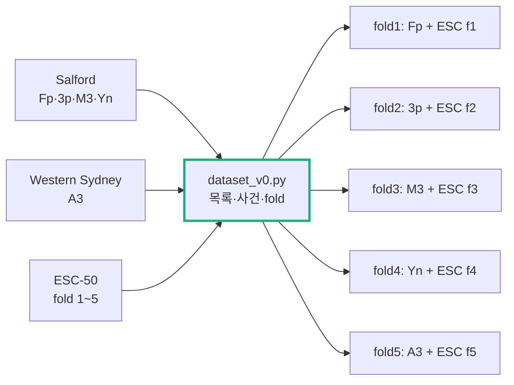

# Step 6 — 데이터·split·평가 규칙 (최소판, 공개 원음)

> 작성: 2026-10-15 | 브랜치: `FPV_Target` | 기준: [Step4.5.2_Roadmap_축소.md](Step4.5.2_Roadmap_축소.md) Step6
> 상태: **공개 원음 PC 실험용 최소판.** 장치 녹음(세션·게인·배열·방위 메타데이터)은 Step5 보드 시험 뒤에 추가한다.

## 0. 질문

**새로운 녹음에서도 동작하는지 공정하게 평가할 수 있는가?**

최소판의 범위는 Step8 첫 모델을 누수 없이 평가할 목록과 split이다.

## 1. 데이터 v0

| 출처 | 라벨 | 쓰는 부분 | 양 |
| --- | --- | --- | --- |
| Salford DroneNoise (CC BY 4.0) | 드론 | 4기종 × 호버·통과 비행, 사건마다 마이크 9개 중 M1·M5·M9 | 18사건 |
| Western Sydney DJI Air 3 (CC BY-SA 4.0) | 드론 | `device_1_nosync.wav` 5채널, 82–112 s와 200–240 s | 2사건 |
| ESC-50 (CC BY-NC 3.0) | 비드론 | 50범주 2000클립 중 1996개 | 약 2.3시간 (무음 창 제외) |

- 드론 사건은 모두 21개. 창 수는 드론 2116, 비드론 16822, 불확실 899이다 (1 s 창, 0.5 s 이동).
- 산출물: `data/dataset_manifest.csv` (항목 2056), `data/splits.json`. 원본 오디오는 `DataSet/`에 있고 git에서 제외된다.

## 2. 규칙과 도입 이유

| 규칙 | 해결하려는 문제 | 근거 |
| --- | --- | --- |
| **기체 하나씩 빼는 5-fold** (`FOLD_OF`) | 드론 기체가 5종뿐이다. 고정된 train/test로 나누면 시험 기체가 1~2종이 된다 | 매 fold의 시험 기체는 학습에서 한 번도 보지 않은 기체다. 기체 일반화를 직접 잰다 |
| split 단위 = 사건 (`event`) | 같은 비행을 9개 마이크가 동시에 녹음했다. 마이크가 갈리면 같은 소리가 학습과 시험에 동시에 들어간다 | 사건의 모든 마이크·창을 같은 fold에 둔다. 스크립트가 `assert`로 확인한다 |
| ESC-50 원본 4개 제외 | `src_file`이 같은 클립 4개(시계·닭)가 두 fold에 걸쳐 있다 | 누수 방지 |
| Salford 마이크 3개만 | 9개를 다 쓰면 계산량이 3배인데 정보는 겹친다 | 같은 사건 안의 중복이라 독립 표본이 늘지 않는다 |
| 통과 비행·WS는 `near_only` | 멀리 있는 앞뒤 구간은 드론 소리가 배경에 묻혀 정답이 불확실하다 | 500 Hz 위 대역 레벨이 파일 최대치 −20 dB 이내인 창만 양성으로 둔다. 나머지는 −1이며 학습·평가에서 뺀다 |
| Western Sydney를 별도 fold로 | Salford는 측정용 마이크, ESC-50은 Freesound 잡음이다. 모델이 "녹음기 차이"를 드론으로 배울 수 있다 | fold5는 처음 보는 녹음기에서의 성능이다 |

## 3. 평가 규칙 (Step8 v0에서 사용)

- 문턱은 학습 데이터 안의 사건 단위 교차검증 점수로 정한다. 비드론 창 오탐률 1%가 기준이다. 시험 fold는 문턱 선택에 쓰지 않는다.
- 지속 확인은 연속 3창 중 2창 이상이다 (1.0~1.5 s).
- 사건 검출은 드론 사건의 창 중 지속 확인이 한 번이라도 켜지면 1건이다. 비드론 오탐은 클립 단위로 센다.

## 4. 한계 (부족한 것을 통과로 표시하지 않음)

- **드론 사건 21개.** Roadmap Step8 통과 표본(독립 사건 ≥30)보다 적다. 지금 결과는 개발 결과다.
- **비드론이 5 s 단편이다.** ESC-50은 연속 녹음이 아니다. "오탐/시간"은 연속 배경 2시간으로 다시 재야 한다.
- **같은 녹음기의 비드론이 없다.** Salford·WS 녹음기의 드론 없는 배경이 없어서 녹음기 지름길을 완전히 막지 못한다. WS 추가 세션(드론 없는 구간)은 서버가 자동 내려받기를 막아 브라우저로 직접 받아야 한다.
- 장치 녹음 메타데이터(세션·재생 여부·게인·배열·거리·방위·높이)는 Step5 보드 시험 뒤에 추가한다.
