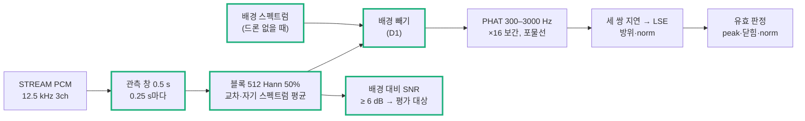
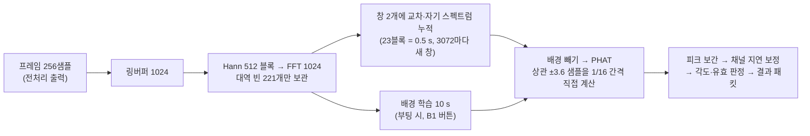

# Step 7 — 지속음 방향 추정

> 작성: 2026-10-16 | 브랜치: `FPV_Target` | 기준: [Step4.5.2_Roadmap_축소.md](Step4.5.2_Roadmap_축소.md) Step7
> 상태: **실제 각도 시험 통과, MCU 이식 보드 시험 통과 (2026-10-18).** 채널 지연 보정 조건. 6절 참고.

## 0. 질문

**현재 3마이크에서 필요한 방위 오차와 유효율을 만족하는가?**

통과 기준 (사전 지정한 단일 음원 조건):

- 유효 출력의 방위 절대오차: 중앙값 ≤ 5°, p95 ≤ 10°
- 평가 구간 유효율 ≥ 80%
- 알려진 방향에서 회전 부호·채널 순서가 맞을 것

## 1. 방식

- **D0:** 스냅 방식(Step3)과 같은 GCC-PHAT + LSE에서, onset 탐색 대신 고정 관측 창을 쓴다.
- **D1:** D0에 배경 교차 스펙트럼 빼기를 더한 것. **채택.**

D0가 실패한 원인을 먼저 확인했고(2절), 그 원인을 겨냥한 방식이 D1이다 (Roadmap 확장 조건). SRP-PHAT(D2)은 D1이 실제 각도 시험에서 실패할 때 비교한다.

## 2. 코드 블록별 도입 이유

| 코드 (`Tools/doa/`) | 해결하려는 문제 | 근거 |
| --- | --- | --- |
| `doa_stream.py` 고정 관측 창 | 스냅의 onset 탐색은 시작이 뚜렷한 소리용이다. 드론은 시작이 없다 | 0.5 s 창을 0.25 s마다 민다. 결과마다 STREAM 샘플 번호(s0, s1)를 붙여 Step9A에서 분류 결과와 같은 구간끼리 묶는다 |
| `cross_spectra` 블록 평균 | 창 하나로 한 번 FFT하면 잡음이 그대로 남는다 | 512샘플 블록 약 23개의 교차 스펙트럼을 평균한 뒤 PHAT. 지속음이라 평균할수록 음원 성분만 남는다 |
| `gcc_phat.phat_peak` 분리 | 스냅과 지속음이 같은 PHAT·보간 코드를 써야 비교가 공정하다 | 스냅 경로의 동작은 그대로다 (자체 시험 0.026 샘플, 이전과 같음) |
| `background` + 배경 빼기 | **D0 실패 원인.** 7 cm 배열에서는 방 전체에 퍼진 소음과 보드 간섭이 1 kHz 아래에서 세 마이크에 거의 같이 들어온다. 그래서 지연이 0 쪽으로 끌려 norm이 무너진다 (합성 SNR 0 dB에서 norm 중앙값 0.33) | 드론이 없을 때의 교차 스펙트럼을 평균해 두고 매 창에서 뺀다. 계속 깔린 배경은 빠지고 새 음원만 남는다. 실시간에서는 "드론 없음" 동안 천천히 갱신한다 |
| `snr` / `present` | 음원이 안 들리는 창까지 유효율 분모에 넣으면, 방향 성능이 아니라 재생 파일의 조용한 구간을 재게 된다 | 배경 대비 대역 전력 ≥ 6 dB인 창만 평가한다. 이 규칙을 시험 전에 정해 둔다 |
| 유효 판정 (peak ≥ 0.15, 닫힘 ≤ 0.3샘플, norm 0.5–1.3) | 틀린 방위를 내보내면 카메라가 엉뚱한 곳을 본다 | 세 쌍 지연이 서로 맞고(닫힘), 평면파 크기(norm)가 맞을 때만 낸다. norm 0.5는 고도 60°에 해당한다 |
| `effective_fs` | 보드 클럭(HSI)이 1.7% 빨라서 지연 → 각도 환산이 틀어진다 | `packets.csv`의 수신 시각으로 실제 샘플레이트를 추정해 쓴다. HSE로 바꾸면 자동으로 12.5 kHz에 가까워진다 |
| `positions` | 배열 좌표가 코드마다 따로 있으면 어긋난다 | `config/geometry.json`의 실측 간격과 번호 방향을 읽는다 |
| `eval_doa_synth.py` | 보드 없이 정답이 있는 시험이 필요하다 | 드론 원음 → 장치 FIR → 방위별 분수 지연 → **실제 장치 잡음**(quiet_10min, 공통 주변음·보드 간섭 포함)을 SNR에 맞춰 더한다 |

## 3. 합성 시험 결과 (`reports/step7/synth_eval.txt`)

원음 5개 × 방위 12개 × 8 s. 잡음은 장치 quiet_10min이다. 배경은 그 앞 절반으로 만들고, 시험 잡음은 뒤 절반에서 뽑았다.

| SNR | D0 오차 (중앙 / p95) | D0 유효 | D1 오차 (중앙 / p95) | D1 유효 |
| --- | --- | --- | --- | --- |
| +20 dB | 0.1° / 0.9° | 87% | 0.1° / 0.5° | **99%** |
| +10 dB | 0.2° / 1.2° | 62% | 0.2° / 1.9° | **91%** |
| +5 dB | 0.5° / 2.4° | 35% | 0.3° / 2.7° | 78% |
| 0 dB | 0.7° / 2.7° | 12% | 0.5° / 2.3° | 63% |
| −5 dB | 0.4° / 1.9° | 2% | 1.0° / 3.8° | 44% |

- 유효한 출력의 오차는 모든 조건에서 기준(5° / 10°)보다 훨씬 작다. 문제는 유효율이다.
- D1은 SNR 약 +7 dB까지 통과한다.
- 설정을 하나씩 바꿔 봤다 (D1, SNR 5 dB). 관측 1.0 s만 유효율을 84%로 올렸고, 대역과 블록은 기본값보다 낫지 않았다. 기본 0.5 s를 유지한다 (지연 우선). 1.0 s는 먼 거리용 선택지로 둔다.
- 고도: 30°, 45°는 유효 90% 이상이다. 60°에서는 54%로 떨어진다 (norm 0.5 경계). 평면 배열이라 위/아래는 구분하지 못한다.

## 4. 실제 녹음 (정답 방위 없음, 2026-10-16)

`python doa/doa_stream.py "dumps/stream/*_10min" --bg dumps/stream/quiet_10min`

| 녹음 | 평가 창 | 유효 | 평균 방위 | 퍼짐 p95 |
| --- | --- | --- | --- | --- |
| 선풍기 (켜진 450 s) | 1799 | **100%** | 147.9° | 0.9° |
| 스피커 (드론 5종) | 2391 | 72% | 137.6° | 2.8° |
| quiet | 9 | 0% | — | — |

- 방위는 아주 안정적이다. 조용할 때는 거짓 방위를 내지 않는다.
- 스피커 유효율은 원음마다 다르다: FPV 55–66%, Mini 3 Pro·Air 3 89%. FPV의 무효 창은 SNR 20 dB 이상에서도 나온다. 원인은 잡음이 아니라 낮은 피크와 큰 닫힘 오차다.
  - 추정 원인: 노트북 스피커 두 개(좌우 약 30 cm)가 같은 소리를 내서 음원이 둘이 됐다. 고조파가 뚜렷한 FPV에서 특히 방향이 흐려진다.
  - 그래서 실제 각도 시험은 **왼쪽 채널에만 소리가 있는 파일**(`21_doa_left_100s.wav`)로 한다.
  - 주파수별 SNR 가중을 더하면 FPV 유효율이 59%에서 68%로 오른다. 하지만 스피커 문제를 먼저 가린 뒤 결정한다.

## 5. 실제 각도 시험 (보드에서 할 일)

**배치** — 노트북은 고정하고 배열을 돌린다

- 각도 정의: 위에서 볼 때 배열 중심에서 **MIC1 쪽이 0°**, **반시계 방향이 +**다 (MIC2 = 120°, MIC3 = 240°).
- 소리는 노트북 **왼쪽 스피커** 하나로 낸다 (`21_doa_left_100s.wav`, 원음 5개 × 20 s, 왼쪽 채널만). 스피커는 배열 중심에서 1 m, 마이크와 같은 높이.
- 책상에 종이 각도판을 고정한다. 중심에서 왼쪽 스피커로 향하는 선을 **0**으로 하고, 거기서 **시계 방향으로** 30°마다 0, 30, 60, … 330을 적는다.
- 브레드보드에 배열 중심(삼각형 무게중심)과 MIC1 방향 화살표를 표시한다. 배열 중심을 각도판 중심에 맞춘다.
- 배열을 시계 방향으로 돌려 **MIC1 화살표가 가리키는 눈금 = 그 녹음의 각도**가 되게 한다. 배열을 시계 방향으로 θ 돌리면 음원은 배열 기준 +θ에 온다.
- 정확도: 눈금은 ±2° 안 (1 m에서 3.5 cm). 볼륨은 시험 내내 고정. 사람은 스피커와 배열 사이에 서지 않는다.
- 펌웨어는 STREAM 모드 그대로 둔다.

**녹음** (`Tools/`에서) — 12방향 × 1회, 배경 2회

| 순서 | 할 일 | 명령 |
| --- | --- | --- |
| 0 | 재생 없이 배경 1분 | `.\.venv\Scripts\python.exe board\stream_capture.py --port COM8 --label doa_bg --minutes 1` |
| 1–12 | 배열을 θ에 맞춤 → 명령 실행 → 바로 `21_doa_left_100s.wav` 한 번 재생 → 끝날 때까지 조용히 | `.\.venv\Scripts\python.exe board\stream_capture.py --port COM8 --label doa_az000 --minutes 2` (`az030`, `az060`, … `az330`) |
| 13 | 재생 없이 배경 1분 (배경이 바뀌었는지 확인) | `--label doa_bg2 --minutes 1` |

- 각도는 0, 30, 60, 90, 120, 150, 180, 210, 240, 270, 300, 330. 녹음 이름은 세 자리(`az000`, `az030`)로 쓴다.
- 터미널 상태 줄의 `clip` 숫자가 0보다 커지면 볼륨을 낮추고 **0번부터 다시** 한다 (각도마다 볼륨이 달라지면 안 된다).
- 0°, 120°, 240°는 마이크 쪽, 60°, 180°, 300°는 두 마이크 사이다. 정삼각형이라 배열 입장에서는 0·30·60° 세 경우가 네 번씩 반복되고, 반복 사이의 차이는 보드 비대칭(ch3 등)과 방 반사를 보여 준다.

**분석:** `.\.venv\Scripts\python.exe doa\doa_stream.py "dumps/stream/doa_az*" --bg dumps/stream/doa_bg` (배경 변화 확인: `--bg dumps/stream/doa_bg2`로 한 번 더)

각도마다 오차 중앙값, p95, 편향, 유효율이 나오고, 마지막 줄에 Step7 기준 판정이 나온다.

- **편향이 모든 각도에서 같은 값**이면 0° 기준이 돌아간 것이다 (배치 오차).
- **편향의 부호가 각도에 따라 뒤집히면** 회전 방향이나 채널 순서가 틀린 것이다.

**결과 (2026-10-18, 12방향, 에어컨 켜짐, D1): 채널 지연 보정 + 공통 회전 제거 후 통과.** 오차 중앙값 최대 2.7°, p95 최대 6.8°, 유효율 최소 93%.

| 단계 | 오차 중앙값 최대 | p95 최대 | 남은 편향 |
| --- | --- | --- | --- |
| 보정 없음 | 24.5° | 26.4° | 모든 각도 +, +2.4° ~ +24.3° |
| 공통 회전만 제거 (+11.9°) | 12.6° | 14.6° | 한 바퀴 주기 ±10° |
| **채널 지연 보정 + 공통 회전 제거 (+11.4°)** | **2.7°** | **6.8°** | ±3° 안 |

- **공통 회전:** 노트북을 0° 선과 대략 평행하게 놓아 왼쪽 스피커의 정확한 위치를 모른다. 12방향 편향의 원형 평균 하나를 빼는 것은 이 미지수만 없앤다 (`--global-offset`).
- **채널 지연: ch2가 ch1보다 23 µs, ch3보다 27 µs 먼저 들어온다 (0.3 샘플).** 캡슐을 한 점에 모아 0°·180° 두 번 녹음하고 평균해 잰 값이다 (`cal_d0`, `cal_d180`). 12방향 녹음 평균에서 추정한 값(−24 µs)과 같다. 300–1000 Hz와 1–3 kHz에서 비슷하다. 마이크 모듈의 게인(대역폭) 차이로 추정한다. 값은 `config/geometry.json`의 `channel_delay_us`에 있고 `doa_stream.py`가 자동 적용한다 (`--no-delay-cal`로 끔).
- 보정값은 12방향 녹음과 따로 잰 것이라 12방향은 시험셋으로 남는다. 공통 회전 하나만 시험셋에서 맞췄다.
- 마이크 위치·지향 각도의 어긋남은 방향에 따라 부호가 바뀌어 12방향 평균에서 0이 된다. 그래서 일정한 채널 지연과는 구분되고, 남은 ±3°의 일부일 수 있다.
- 지연 크기는 70 mm 기대보다 약 22% 작다 (고도 중앙 24–49°로 나옴). 방위에는 영향이 없고 고도·norm 판정에만 영향이 있다. 캡슐 간 거리 실측으로 가린다.

## 6. MCU 이식 (2026-10-18)

> 상태: **보드 시험 통과 (2026-10-18, 2차).** PC와 결과 일치, CPU 최대 48%. 코드: `Core/app/src/doa.c`, `doa.h`. STREAM 모드에서 PCM과 함께 약 0.25 s마다 결과 패킷(type 0x04)을 보낸다.

| 결정 | PC와 다른 점 | 이유 |
| --- | --- | --- |
| 블록이 준비될 때마다 누적 | 0.5 s 창을 저장하지 않는다 | 창 저장은 37 KB. 링버퍼 6 KB면 된다. 프레임마다 블록 하나씩이라 계산이 고르게 나뉜다 |
| 창 이동 3072 샘플 (0.246 s) | PC 기본 3125 (0.25 s) | 블록 간격 256의 배수라 겹치는 두 창과 배경이 같은 블록 FFT를 함께 쓴다 (프레임당 FFT 3개) |
| 상관을 지연 범위만 직접 계산 | 16배 제로패딩 IFFT(16384점) 대신 115개 지연 × 221빈 합 | 같은 값이고, IFFT용 64 KB가 필요 없다. 회전 인자는 부팅 때 표로, 세 쌍이 공유, ±지연 대칭으로 절반만 계산 |
| 배경 10 s, 부팅 시 자동 + B1 버튼 | PC 시험은 60 s 녹음 | 켠 뒤 빨리 쓰기 위함. 12방향 결과가 같았다 (아래) |
| 배경을 다시 배우는 동안 기존 배경 사용 | — | 학습 중에도 D1 유지. 처음 배우는 10 s만 D0로 표시 |
| 입력이 끊기면(ADC 유실·overrun) 창을 버리고 다음 프레임부터 | 송신 큐 유실은 무시 | 큐 유실은 PC만 못 받은 것이고 MCU 입력은 연속이다 |

**호스트 시험** (`Tools/doa/test_doa_host.py`, 같은 C 코드를 PC용 gcc로 빌드해 녹음을 넣음): az000·az120·az240에서 PC 기준과 지연 차이 최대 0.0002 샘플, 각도 차이 최대 0.004°, 유효·present 판정 일치 100%. 12방향 전체를 배경 10 s로 돌리면 공통 회전 +11.3°, 오차 중앙값 최대 2.7°, p95 최대 6.8° (PC 60 s 배경과 같음).

**빌드:** 경고 0. RAM 108 KB / 128 KB (doa 약 64 KB: 배경 2벌 16 KB, 창 2개 16 KB, 링버퍼·FFT·블록 스펙트럼·PHAT 버퍼). Flash 148 KB (CMSIS FFT 표 포함). 스택 최대 112 B. 처리 시간은 보드에서 잰다 (결과 패킷 `proc_us`, PCM 패킷 `cpu`).

**보드 시험 1차 (2026-10-18, `mcu_doa`): 결과 일치, 처리 시간 초과.**

| 항목 | 결과 | 기준 |
| --- | --- | --- |
| MCU 대 PC (431창, 양쪽 유효 307창) | 지연 차이 최대 0.0001 샘플, 각도 차이 최대 0.003°, 판정 일치 100% | 통과 |
| 유실 | 0 (CRC 0, 큐 유실 0) | 통과 |
| CPU (프레임 20.48 ms 대비) | 평상시 40%, 창이 끝나는 프레임 97–98%, 배경 학습과 겹치면 107–108% | < 80% 실패 |
| 창 마무리 시간 | 11.6 ms | — |

원인: 상관 계산이 지연마다 `cosf`·`sinf`를 불러 창당 약 2000번, 세 쌍을 따로 계산. 창 이동 3125가 블록 간격의 배수가 아니라 겹치는 창이 같은 구간 FFT를 따로 계산 (평상시 +20%). → 위 표의 두 줄(창 이동 3072, 회전 인자 표·공유·대칭)로 고쳤다. 호스트 시험은 다시 통과 (지연 차이 최대 0.0002 샘플, 12방향 중앙 최대 2.8°, p95 최대 7.0°). RAM 108 KB.

**보드 시험 2차 (2026-10-18, `mcu_doa2`): 통과.**

| 항목 | 1차 | 2차 |
| --- | --- | --- |
| MCU 대 PC | 지연 차이 최대 0.0001 샘플, 판정 일치 100% | 같음 (483창, 양쪽 유효 331창, 각도 차이 최대 0.003°) |
| CPU 평상시 / 창이 끝나는 프레임 | 40% / 97–108% | **31–34% / 47–48%** |
| 창 마무리 시간 | 11.6 ms | **3.2 ms** |
| 보드 쪽 유실 (drop·OVR·큐) | 0 | 0 |

2차에서 PC 수신 CRC 오류 1회로 프레임 1개를 PC가 받지 못했다 (보드 카운터는 0). 같은 일이 doa_bg, az090, az240 녹음에도 1회씩 있었다. 방위 추정과는 무관하고 compare_mcu는 끊긴 구간을 건너뛴다. 10분 연속 녹음 기준(Step5)을 다시 볼 때 따로 확인한다.

**보드 시험 절차** (`Tools/`에서)

1. STM32CubeIDE에서 빌드·다운로드 (새 파일 `doa.c`가 안 잡히면 프로젝트 새로 고침 F5).
2. `.\.venv\Scripts\python.exe board\stream_capture.py --port COM8 --label mcu_doa --minutes 2` 실행 직후 **B1(파란 버튼)을 한 번** 누르고 10 s 조용히 → `21_doa_left_100s.wav` 재생. 상태 줄에 `방위 … 유효 D1`이 나온다.
3. `.\.venv\Scripts\python.exe doa\compare_mcu.py dumps/stream/mcu_doa`

B1을 녹음 중에 누르는 이유: 부팅 때 배운 배경은 PC가 받지 못한 구간이라 같은 계산을 재현할 수 없다.

**통과:** compare_mcu에서 양쪽 유효 창의 지연 차이 ≤ 0.02 샘플, 각도 차이 ≤ 0.2°, 판정 일치 ≥ 99%. `summary.json`의 `cpu_max_pct` < 80%, 유실 0.

## 7. 다음

- Step9A(분류 결과와 시간 정렬)로 간다. 결과 패킷의 `s0`가 PCM 시간축이라 PC 분류 창과 바로 맞출 수 있다.
- 마이크 모듈이나 게인 트리머를 바꾸면 `cal_d0`·`cal_d180`을 다시 잰다.
- 실제 각도 시험이 다시 실패하면: 각도별 편향과 원음별 유효율을 보고 다음 중 하나로 간다.
  - SNR 가중
  - 관측 1.0 s
  - SRP-PHAT(D2) 비교
