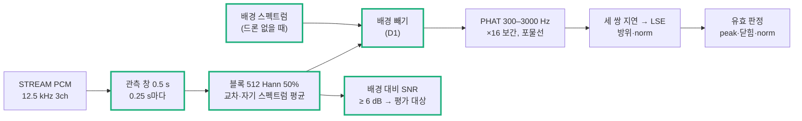

# Step 7 — 지속음 방향 추정

> 작성: 2026-10-16 | 브랜치: `FPV_Target` | 기준: [Step4.5.2_Roadmap_축소.md](Step4.5.2_Roadmap_축소.md) Step7
> 상태: **PC 기준 구현·합성 시험 완료, 실제 각도 시험 전.** MCU 이식은 실제 각도 시험을 통과한 설정으로 한다.

## 0. 질문

**현재 3마이크에서 필요한 방위 오차와 유효율을 만족하는가?**

통과 기준 (사전 지정한 단일 음원 조건):

- 유효 출력의 방위 절대오차: 중앙값 ≤ 5°, p95 ≤ 10°
- 평가 구간 유효율 ≥ 80%
- 알려진 방향에서 회전 부호·채널 순서가 맞을 것

## 1. 방식

- **D0:** 스냅 방식(Step3)과 같은 GCC-PHAT + LSE에서, onset 탐색 대신 고정 관측 창을 쓴다.
- **D1:** D0에 배경 교차 스펙트럼 빼기를 더한 것. **채택.**

D0가 실패한 원인을 먼저 확인했고(2절), 그 원인을 겨냥한 방식이 D1이다 (Roadmap 확장 조건). SRP-PHAT(D2)은 D1이 실제 각도 시험에서 실패할 때 비교한다.

## 2. 코드 블록별 도입 이유

| 코드 (`Tools/doa/`) | 해결하려는 문제 | 근거 |
| --- | --- | --- |
| `doa_stream.py` 고정 관측 창 | 스냅의 onset 탐색은 시작이 뚜렷한 소리용이다. 드론은 시작이 없다 | 0.5 s 창을 0.25 s마다 민다. 결과마다 STREAM 샘플 번호(s0, s1)를 붙여 Step9A에서 분류 결과와 같은 구간끼리 묶는다 |
| `cross_spectra` 블록 평균 | 창 하나로 한 번 FFT하면 잡음이 그대로 남는다 | 512샘플 블록 약 23개의 교차 스펙트럼을 평균한 뒤 PHAT. 지속음이라 평균할수록 음원 성분만 남는다 |
| `gcc_phat.phat_peak` 분리 | 스냅과 지속음이 같은 PHAT·보간 코드를 써야 비교가 공정하다 | 스냅 경로의 동작은 그대로다 (자체 시험 0.026 샘플, 이전과 같음) |
| `background` + 배경 빼기 | **D0 실패 원인.** 7 cm 배열에서는 방 전체에 퍼진 소음과 보드 간섭이 1 kHz 아래에서 세 마이크에 거의 같이 들어온다. 그래서 지연이 0 쪽으로 끌려 norm이 무너진다 (합성 SNR 0 dB에서 norm 중앙값 0.33) | 드론이 없을 때의 교차 스펙트럼을 평균해 두고 매 창에서 뺀다. 계속 깔린 배경은 빠지고 새 음원만 남는다. 실시간에서는 "드론 없음" 동안 천천히 갱신한다 |
| `snr` / `present` | 음원이 안 들리는 창까지 유효율 분모에 넣으면, 방향 성능이 아니라 재생 파일의 조용한 구간을 재게 된다 | 배경 대비 대역 전력 ≥ 6 dB인 창만 평가한다. 이 규칙을 시험 전에 정해 둔다 |
| 유효 판정 (peak ≥ 0.15, 닫힘 ≤ 0.3샘플, norm 0.5–1.3) | 틀린 방위를 내보내면 카메라가 엉뚱한 곳을 본다 | 세 쌍 지연이 서로 맞고(닫힘), 평면파 크기(norm)가 맞을 때만 낸다. norm 0.5는 고도 60°에 해당한다 |
| `effective_fs` | 보드 클럭(HSI)이 1.7% 빨라서 지연 → 각도 환산이 틀어진다 | `packets.csv`의 수신 시각으로 실제 샘플레이트를 추정해 쓴다. HSE로 바꾸면 자동으로 12.5 kHz에 가까워진다 |
| `positions` | 배열 좌표가 코드마다 따로 있으면 어긋난다 | `config/geometry.json`의 실측 간격과 번호 방향을 읽는다 |
| `eval_doa_synth.py` | 보드 없이 정답이 있는 시험이 필요하다 | 드론 원음 → 장치 FIR → 방위별 분수 지연 → **실제 장치 잡음**(quiet_10min, 공통 주변음·보드 간섭 포함)을 SNR에 맞춰 더한다 |

## 3. 합성 시험 결과 (`reports/step7/synth_eval.txt`)

원음 5개 × 방위 12개 × 8 s. 잡음은 장치 quiet_10min이다. 배경은 그 앞 절반으로 만들고, 시험 잡음은 뒤 절반에서 뽑았다.

| SNR | D0 오차 (중앙 / p95) | D0 유효 | D1 오차 (중앙 / p95) | D1 유효 |
| --- | --- | --- | --- | --- |
| +20 dB | 0.1° / 0.9° | 87% | 0.1° / 0.5° | **99%** |
| +10 dB | 0.2° / 1.2° | 62% | 0.2° / 1.9° | **91%** |
| +5 dB | 0.5° / 2.4° | 35% | 0.3° / 2.7° | 78% |
| 0 dB | 0.7° / 2.7° | 12% | 0.5° / 2.3° | 63% |
| −5 dB | 0.4° / 1.9° | 2% | 1.0° / 3.8° | 44% |

- 유효한 출력의 오차는 모든 조건에서 기준(5° / 10°)보다 훨씬 작다. 문제는 유효율이다.
- D1은 SNR 약 +7 dB까지 통과한다.
- 설정을 하나씩 바꿔 봤다 (D1, SNR 5 dB). 관측 1.0 s만 유효율을 84%로 올렸고, 대역과 블록은 기본값보다 낫지 않았다. 기본 0.5 s를 유지한다 (지연 우선). 1.0 s는 먼 거리용 선택지로 둔다.
- 고도: 30°, 45°는 유효 90% 이상이다. 60°에서는 54%로 떨어진다 (norm 0.5 경계). 평면 배열이라 위/아래는 구분하지 못한다.

## 4. 실제 녹음 (정답 방위 없음, 2026-10-16)

`python doa/doa_stream.py "dumps/stream/*_10min" --bg dumps/stream/quiet_10min`

| 녹음 | 평가 창 | 유효 | 평균 방위 | 퍼짐 p95 |
| --- | --- | --- | --- | --- |
| 선풍기 (켜진 450 s) | 1799 | **100%** | 147.9° | 0.9° |
| 스피커 (드론 5종) | 2391 | 72% | 137.6° | 2.8° |
| quiet | 9 | 0% | — | — |

- 방위는 아주 안정적이다. 조용할 때는 거짓 방위를 내지 않는다.
- 스피커 유효율은 원음마다 다르다: FPV 55–66%, Mini 3 Pro·Air 3 89%. FPV의 무효 창은 SNR 20 dB 이상에서도 나온다. 원인은 잡음이 아니라 낮은 피크와 큰 닫힘 오차다.
  - 추정 원인: 노트북 스피커 두 개(좌우 약 30 cm)가 같은 소리를 내서 음원이 둘이 됐다. 고조파가 뚜렷한 FPV에서 특히 방향이 흐려진다.
  - 그래서 실제 각도 시험은 **왼쪽 채널에만 소리가 있는 파일**(`21_doa_left_100s.wav`)로 한다.
  - 주파수별 SNR 가중을 더하면 FPV 유효율이 59%에서 68%로 오른다. 하지만 스피커 문제를 먼저 가린 뒤 결정한다.

## 5. 실제 각도 시험 (보드에서 할 일)

**배치**

- 배열을 책상에 평평하게 둔다. 배열 중심에서 **MIC1 쪽이 0°**, 위에서 볼 때 **반시계 방향이 +**다 (MIC2 = 120°, MIC3 = 240°).
- 소리를 내는 것은 노트북 **왼쪽 스피커** 하나다. 그 스피커를 배열 중심에서 1 m, 마이크와 같은 높이에 둔다. 각도는 종이에 그린 각도기로 맞춘다.
- 펌웨어는 STREAM 모드 그대로 둔다. HSE로 바꾸기 전에도 해도 된다 (샘플레이트는 `packets.csv`로 보정).

**녹음** (`Tools/`에서)

| 순서 | 할 일 | 명령 |
| --- | --- | --- |
| 0 | 재생 없이 배경 1분 | `.\.venv\Scripts\python.exe board\stream_capture.py --port COM8 --label doa_bg --minutes 1` |
| 1–8 | 각도마다: 명령 실행 → `21_doa_left_100s.wav` 한 번 재생 | `.\.venv\Scripts\python.exe board\stream_capture.py --port COM8 --label doa_az000 --minutes 1.7` (`az045`, `az090`, … `az315`) |

**분석:** `.\.venv\Scripts\python.exe doa\doa_stream.py "dumps/stream/doa_az*" --bg dumps/stream/doa_bg`

각도마다 오차 중앙값, p95, 편향, 유효율이 나오고, 마지막 줄에 Step7 기준 판정이 나온다.

- **편향이 모든 각도에서 같은 값**이면 0° 기준이 돌아간 것이다 (배치 오차).
- **편향의 부호가 각도에 따라 뒤집히면** 회전 방향이나 채널 순서가 틀린 것이다.

## 6. 다음

- 실제 각도 시험이 통과하면: D1을 MCU로 옮긴다 (CMSIS `arm_rfft_fast_f32`, 기존 `tdoa.c` 구조 재사용). 그다음 PC와 같은 입력으로 결과를 비교한다.
- 실패하면: 각도별 편향과 원음별 유효율을 보고 다음 중 하나로 간다.
  - SNR 가중
  - 관측 1.0 s
  - SRP-PHAT(D2) 비교
