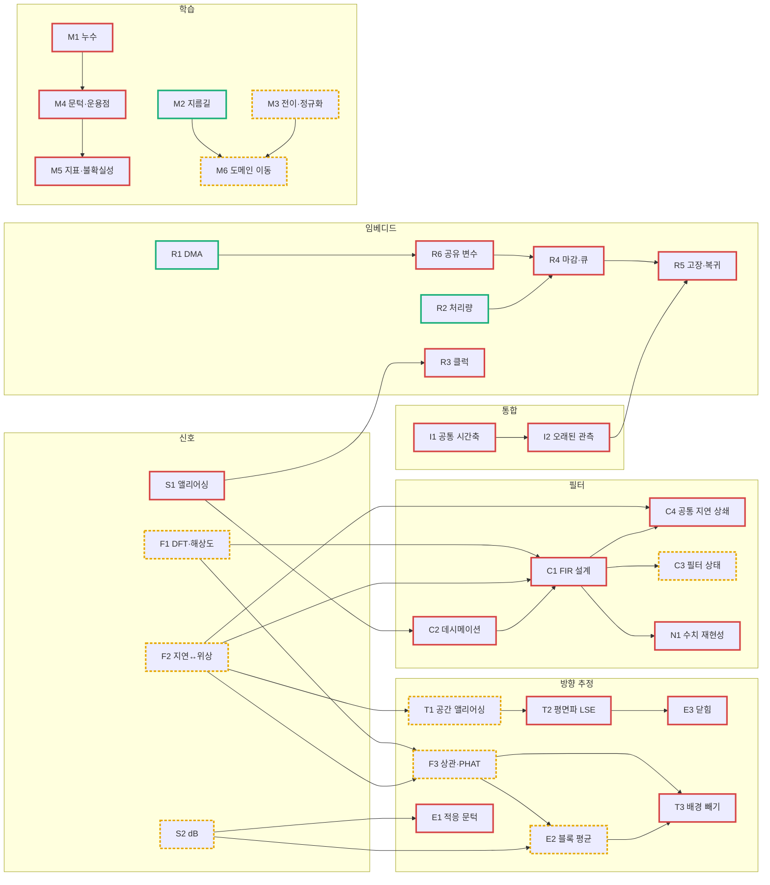

# 선수 지식 지도 — 각 Step이 어떤 개념에 기대는가

> 작성: 2026-10-21 · 근거: [background_quiz.md](background_quiz.md) 28문항 (문서·AI 없이 풂)
> 이 문서는 지식을 설명하지 않는다. **어느 Step이 어느 개념 위에 서 있는지**, 그 개념을 지금 내가 설명할 수 있는지(Pass/Fail), 무엇부터 메우는지를 적는다.

**판정 기준**
- ✅ **Pass**: 핵심 이유를 맞게 설명했다. 계산이 틀려도 이유가 맞으면 Pass다.
- ❌ **Fail**: 핵심 이유가 빠졌거나 틀렸다.
- △ **근접**: Fail이지만 절반 이상 맞았다. 짧게 보완하면 Pass가 된다.
- ⚠ **확신 오류**: 확신 "상"이나 "중"으로 틀렸다. 모르는 것보다 위험하므로 가장 먼저 고친다.

---

## 1. 진단 요약

| | 개수 |
|---|---|
| 개념 | 30 |
| ✅ Pass | **3** (R1 DMA 타이밍, R2 처리량, M2 지름길 학습) |
| △ 근접 | 10 |
| ❌ Fail (모름 또는 오답) | 17 |
| ⚠ 확신 오류 | 5 (Q1, Q2c, Q6a, Q15, Q16) |

**해석**
- **차이의 대부분은 "대학원 수준"이 아니다.** Fail의 절반 이상은 학부 *신호 및 시스템 / DSP 기초*(샘플링과 접힘, 푸리에 변환의 성질, FIR 필터)와 학부 *머신러닝 평가 기초*(누수, 문턱, AUC)다.
- 대학원에 가까운 것은 배열 신호처리 쪽(T1~T3, E2)뿐이다. 그런데 이것도 위 기초 위에 올라가 있다. **기초 한 과목을 메우면 대부분이 풀린다.**
- **Step3가 병목이다.** 스냅 파이프라인을 "돌릴 수 있는" 상태지만 "설명할 수 있는" 상태는 아니다. Step3의 개념 6개가 모두 Fail이다. Step4·5·7이 같은 개념을 다시 쓰므로 여기가 막히면 뒤가 전부 막힌다.
- **Step9A·10은 수학이 거의 필요 없는데 전부 "모름"이다.** 다음 작업이 바로 이 단계라서 따로 빠르게 메운다 (4절의 트랙 A).

---

## 2. Step별 의존 개념

각 Step을 문서를 닫고 설명하려면 아래 개념이 필요하다. 오른쪽 숫자는 그중 Pass한 개수다.

| Step | 의존 개념 | 설명 가능도 |
|---|---|---|
| **1** ADC·DMA 핑퐁 | S1 ❌⚠ · R1 ✅ · R6 ❌⚠ | 1 / 3 |
| **2** 덤프·소리 트리거 | R2 ✅ · S2 ❌△ · E1 ❌ | 1 / 3 |
| **3** GCC-PHAT·방향 | F1 ❌△ · F2 ❌△⚠ · F3 ❌△ · T1 ❌△ · T2 ❌ · E3 ❌ | **0 / 6** |
| **4** FIR·데시메이션 설계 | S1 ❌⚠ · F1 ❌△ · F2 ❌△⚠ · C2 ❌ · C1 ❌ · C4 ❌ | **0 / 6** |
| **5** 연속 수음·전처리 | R1 ✅ · R2 ✅ · R6 ❌⚠ · C1 ❌ · C2 ❌ · C3 ❌△ · N1 ❌ · R3 ❌⚠ | 2 / 8 |
| **6** split·평가 규칙 | M1 ❌⚠ · M2 ✅ | 1 / 2 |
| **7** 지속음 방향 | F3 ❌△ · T1 ❌△ · T2 ❌ · T3 ❌ · E2 ❌△ · E3 ❌ · C4 ❌ · S2 ❌△ · R3 ❌⚠ | **0 / 9** |
| **8** PC 학습 분류 | M1 ❌⚠ · M2 ✅ · M3 ❌△ · M4 ❌ · M5 ❌ · M6 ❌△ · C2 ❌ · S2 ❌△ | 1 / 8 |
| **9A** 판정·방위 결합 | I1 ❌ · I2 ❌ · M4 ❌ | 0 / 3 |
| **10** 실시간 통합 | R2 ✅ · R6 ❌⚠ · R4 ❌ · R5 ❌ · I1 ❌ · I2 ❌ · N1 ❌ | 1 / 7 |

참고로 이후 단계(문제는 내지 않음)는 이렇게 기댄다.
- Step11 실비행: M1, M5, M6
- Step13 카메라: I2, R5
- Step14 MCU 단독 분류: M3, N1, R4

---

## 3. 개념 목록과 판정

| ID | 개념 | 판정 | 근거 (문항) | 쓰이는 Step |
|---|---|---|---|---|
| **S1** | 샘플링과 앨리어싱(접힘 위치) | ❌ ⚠ | Q1: 나이퀴스트 조건은 알지만 32 kHz가 어디로 접히는지 모름 | 1, 3, 4 |
| **S2** | dB, RMS, 전력 | ❌ △ | Q4a: 전력 16배는 맞음, dB 환산 없음 | 2, 7, 8 |
| **F1** | DFT bin, 주파수 해상도, zero-padding | ❌ △ | Q5: Δf와 bin 수는 맞음, zero-padding 모름 | 3, 4, 7 |
| **F2** | 시간 지연 ↔ 위상 (이동 성질, 선형 위상) | ❌ △ ⚠ | Q6: 위상 −2πfτ는 맞음, X₂와 X₁의 관계식 틀림 | 3, 4, 7 |
| **F3** | 상관 정리, GCC-PHAT | ❌ △ | Q7: "델타처럼 나온다"는 직관은 있음. 상관 정리와 PHAT의 약점 모름 | 3, 7 |
| **T1** | 배열 기하, 최대 지연, 공간 앨리어싱 | ❌ △ | Q8: 방향은 맞지만 2π 감김 설명 없음, d/c 계산 안 함 | 3, 7, 9B |
| **T2** | 평면파 가정과 최소제곱, norm | ❌ | Q9: "높이 무시"로 오해. 과잉결정과 norm 모름 | 3, 7 |
| **T3** | 공통(확산) 잡음과 배경 빼기 | ❌ | Q19 모름 | 7, 9B |
| **E1** | EMA, 적응 문턱 | ❌ | Q4b·c: 시간상수와 바닥이 따라 오르는 원리 없음 | 2, 7 |
| **E2** | 블록 평균과 SNR (코히어런트 평균) | ❌ △ | Q18: "잡음은 평균하면 준다"까지. 신호가 왜 남는지, 정상성 조건 없음 | 7 |
| **E3** | 닫힘(closure) 일관성 | ❌ | Q20 모름 | 3, 7 |
| **C1** | FIR 설계 (전이대역, 탭 수, 선형 위상, 군지연) | ❌ | Q11 모름 | 4, 5, 7, 8 |
| **C2** | 데시메이션 앨리어싱 | ❌ | Q10 모름 | 4, 5, 8 |
| **C3** | 블록 처리와 필터 상태 | ❌ △ | Q13: 1/T = 48.8 Hz는 앎, 과도 응답과 고조파 오인 연결 없음 | 5, 7 |
| **C4** | 공통 필터의 지연 상쇄, 채널 위상 일치 | ❌ | Q12 모름 | 4, 5, 7 |
| **N1** | 수치 표현, 반올림, 비트 재현성 | ❌ | Q14: "정밀도?"만 있음 | 5, 10, 14 |
| **R1** | DMA 핑퐁 타이밍과 덮어쓰기 | ✅ | Q2a·b | 1, 5 |
| **R2** | 통신 처리량 예산 | ✅ | Q3 | 2, 5, 10 |
| **R3** | 클럭원과 정확도 | ❌ ⚠ | Q15: "HSI는 소프트웨어 클럭"이라는 오해 | 5, 7 |
| **R4** | 실시간 마감, 최악 시간, 큐 | ❌ | Q27 모름 | 10, 14 |
| **R5** | 고장 감지·무효화·복귀 | ❌ | Q28 모름 | 10, 13 |
| **R6** | ISR과 main의 공유 변수 (임계 구역) | ❌ ⚠ | Q2c: 포인터와 번호의 짝이 어긋나는 문제를 짚지 못함 | 1, 5, 10 |
| **M1** | 데이터 누수와 그룹 split | ❌ ⚠ | Q16: 누수를 "다양성 부족"으로 오해 | 6, 8, 11 |
| **M2** | 지름길 학습 | ✅ | Q17 | 6, 8 |
| **M3** | 전이학습과 정규화 | ❌ △ | Q21: 과적합은 맞음. 임베딩의 역할과 C 모름 | 8, 14 |
| **M4** | 문턱, 운용점, 오탐/시간 | ❌ | Q22 모름 | 8, 9A, 11 |
| **M5** | 불균형 지표, AUC, 소표본 불확실성 | ❌ | Q23 모름 | 8, 11 |
| **M6** | 도메인 이동 (장치 경로) | ❌ △ | Q24: "분포 이동"이라는 이름만 있음. 원인과 대책 없음 | 8, 11 |
| **I1** | 공통 시간축 (샘플 번호) | ❌ | Q25 모름 | 9A, 10 |
| **I2** | 오래된 관측, 상태 기계 | ❌ | Q26 모름 | 9A, 10, 13 |

### 개념 사이의 선후

화살표는 "앞의 것을 알아야 뒤를 이해할 수 있다"는 뜻이다.

초록 = Pass, 노랑 점선 = 근접, 빨강 = Fail.

---

## 4. 보완 순서

트랙 두 개를 나란히 진행한다.
- **트랙 A**는 바로 다음 작업(Step9A·10)을 막고 있는 개념이다. 수학이 거의 없어서 빨리 끝난다.
- **트랙 B**는 Step3~8 전체의 기초다. 선후 그림의 순서대로 간다.

### 0단계 — ⚠ 확신 오류부터 고친다 (30분)

자신 있게 틀린 개념은 새 지식이 들어올 자리를 막는다. 아래 한 줄을 읽고, 해당 문항을 다시 풀어 본다.

| 문항 | 고칠 점 |
|---|---|
| Q1 S1 | 나이퀴스트를 넘는 주파수는 "사라지는" 것이 아니라 **다른 주파수로 둔갑**한다. 32 kHz는 50 − 32 = 18 kHz와 샘플이 완전히 같다. 그래서 둘을 구분할 수 없다 |
| Q2c R6 | 문제는 앞쪽이냐 뒤쪽이냐가 아니다. 두 변수를 따로 읽는 사이에 ISR이 끼어들면 **새 포인터 + 옛 번호**처럼 서로 다른 프레임의 값이 짝지어진다 |
| Q6a F2 | `X₁·conj(X₂)`는 교차 스펙트럼이지 둘의 관계식이 아니다. 관계식은 **X₂(f) = X₁(f)·e^(−j2πfτ)** 다 (시간 이동 = 위상 회전) |
| Q15 R3 | HSI는 소프트웨어가 아니라 칩 안의 **RC 발진기(하드웨어)**다. 공정 편차와 온도로 수 % 틀어진다. HSE는 외부 수정(또는 ST-LINK의 정확한 클럭)이라 오차가 ppm 수준이다 |
| Q16 M1 | 마이크 단위 split의 문제는 다양성이 아니라 **누수**다. 같은 비행의 같은 소리가 학습과 시험에 동시에 들어가 성적이 부풀려진다 |

### 트랙 A — 다음 작업(Step9A·10)용 (반나절)

| 순서 | 개념 | 볼 곳 | 다시 풀 문항 |
|---|---|---|---|
| A1 | I1 공통 시간축 | [Step5](step/Step5_연속수음_전처리_기록.md) 1절 "시간축"·"프레임 번호" 줄, [Roadmap](step/Step4.5.2_Roadmap_축소.md) Step9A | Q25 |
| A2 | I2 오래된 관측, 상태 | [Roadmap](step/Step4.5.2_Roadmap_축소.md) Step9A의 "왜 필요한가" 세 가지 | Q26 |
| A3 | R6 공유 변수 | [adc.c](../Core/app/src/adc.c) `adc_get_frame`, [Step5](step/Step5_연속수음_전처리_기록.md) 2.2절 adc.c 줄 | Q2c |
| A4 | R4 마감과 큐 | [Step7](step/Step7_지속음_방향추정.md) 6절 CPU 표, [stream.c](../Core/app/src/stream.c) 링버퍼, [Roadmap](step/Step4.5.2_Roadmap_축소.md) Step10 통과 조건 | Q27 |
| A5 | R5 고장·복귀 | [app.c](../Core/app/src/app.c) `on_stream_frame`의 `RESYNC`/`GAP`, Roadmap Step10 마지막 항목 | Q28 |

### 트랙 B — 신호처리 기초 → 방향 추정 → 학습

**B1. 신호 기초 (Step3·4를 여는 열쇠)**

| 순서 | 개념 | 저장소 안 | 바깥 자료 | 다시 풀 문항 |
|---|---|---|---|---|
| 1 | S1 앨리어싱 | [TDOA 배경지식](helper/TDOA_튜닝_배경지식.md) 3절 | *The Scientist and Engineer's Guide to DSP* (S. W. Smith, dspguide.com 무료) 3장 | Q1 |
| 2 | F2 지연 ↔ 위상 | TDOA 배경지식 2절 (페이저), [Step4](step/Step4_드론음향_탐지추정_설계.md) 2.1절 | 같은 책 10장 "Characteristics of the Phase" | Q6 |
| 3 | F1 DFT·해상도 | TDOA 배경지식 4절 | 같은 책 8~9장 (9장의 frequency resolution과 zero padding) | Q5 |
| 4 | C2 데시메이션 | Step4 4.2~4.3절 | 같은 책 10장 "Multirate" 부분 | Q10 |
| 5 | C1 FIR 설계 | Step4 4.3절의 탭 수 표, [fir_design.py](../Tools/preproc/fir_design.py) 주석 | 같은 책 14장, 16장 (windowed-sinc) | Q11 |
| 6 | C4 공통 지연 상쇄 | Step4 4.4절 | — | Q12 |
| 7 | C3 필터 상태 | [Step5](step/Step5_연속수음_전처리_기록.md) 2.2절 preproc 줄, [preproc.h](../Core/app/inc/preproc.h) 주석 | — | Q13 |
| 8 | N1 수치 재현성 | Step5 2.2절 `×16` 줄, [test_preproc_host.py](../Tools/preproc/test_preproc_host.py) | — | Q14 |

**B2. 방향 추정 (Step3 → Step7)**

| 순서 | 개념 | 저장소 안 | 다시 풀 문항 |
|---|---|---|---|
| 9 | F3 상관 정리·PHAT | TDOA 배경지식 6절 (6.3 상관 정리, 6.5 GCC와 PHAT), [Step3](step/Step3_GCC_PHAT_Python_MCU_DOA.md) 4.2절 | Q7 |
| 10 | T1 공간 앨리어싱 | TDOA 배경지식 8.3절, 10.1절 | Q8 |
| 11 | T2 평면파 LSE | TDOA 배경지식 10.2~10.3절, 10.6절, Step3 4.4절 | Q9 |
| 12 | E3 닫힘 | Step3 4.5절 (품질 지표) | Q20 |
| 13 | S2 dB · E1 적응 문턱 | [Step2](step/Step2_UART_Dump_Capture_SignalCheck.md) 5.5절, 5.9절, [decisions.md](decisions.md) 2-3 | Q4 |
| 14 | E2 블록 평균 | Step7 2절 `cross_spectra` 줄 | Q18 |
| 15 | T3 배경 빼기 | Step7 2절 `background` 줄 (D0 실패 원인) | Q19 |
| 16 | R3 클럭 | Step5 5절 (HSI +1.7%) | Q15 |

**B3. 학습과 평가 (Step6 → Step8)**

| 순서 | 개념 | 저장소 안 | 바깥 자료 | 다시 풀 문항 |
|---|---|---|---|---|
| 17 | M1 누수 | [Step6](step/Step6_데이터_split_평가규칙.md) 2절 표 | scikit-learn 문서 `GroupKFold` | Q16 |
| 18 | M3 전이·정규화 | [Step8](step/Step8_PC_학습_드론분류.md) 1절 | scikit-learn 문서 `LogisticRegression`의 `C` | Q21 |
| 19 | M4 문턱·운용점 | Step6 3절, Step8 2절 `two_of_three`·문턱 줄, Step8 9절 | Google *Machine Learning Crash Course* 분류 단원 (threshold, ROC/AUC) | Q22 |
| 20 | M5 지표·불확실성 | Step8 9절 (시드 흔들림, 사건 수) | 같은 과정의 분류 단원 (precision/recall) | Q23 |
| 21 | M6 도메인 이동 | Step8 10절 (v5 장치 경로) | — | Q24 |

---

## 5. 다시 진단하는 법

1. 위 표의 "다시 풀 문항"을 [background_quiz.md](background_quiz.md)에 `재답:`으로 이어 쓴다. 처음 답은 지우지 않는다.
2. 재채점을 요청하면 3절의 판정을 갱신한다. ⚠는 다시 풀어 맞으면 지운다.
3. 같은 문항을 외워서 맞히는 것을 막으려고, Pass로 바뀐 개념에는 처음 보는 응용 문제를 하나 더 낸다. 그것까지 맞으면 Pass로 확정한다.

**Step 완료의 기준:** 2절 표에서 그 Step의 의존 개념이 전부 ✅가 되면, 그 Step은 "문서를 닫고 설명할 수 있음"으로 본다. [decisions.md](decisions.md)의 "설명할 수 있다" 기준(버린 선택지, 근거 숫자, 대가, 다시 결정할 조건)과 같은 뜻이다.

---

## 부록 — 문항별 채점

| 문항 | 개념 | 판정 | 맞은 것 | 빠진 것 |
|---|---|---|---|---|
| Q1 | S1 | ❌⚠ | 나이퀴스트 조건 | 32 kHz는 18 kHz와 같은 샘플이 된다 (fs − f). 그래서 둘을 구분할 수 없다 |
| Q2 | R1 / R6 | ✅ / ❌⚠ | (a) 50 kHz, 20.48 ms (b) 덮어쓰기 | (c) 두 변수를 따로 읽는 사이 ISR이 끼면 서로 다른 프레임의 포인터와 번호가 짝지어진다 |
| Q3 | R2 | ✅ | 10비트/바이트, 92 KB/s, 결론 | — |
| Q4 | S2 / E1 | ❌△ / ❌ | 전력 16배 | 12 dB. 시간상수 ≈ 1/α = 20프레임 ≈ 0.4 s. 천천히 커지면 바닥이 같이 올라가 비율 4를 못 넘는다 |
| Q5 | F1 | ❌△ | 97.7 Hz, 19개 | zero-padding은 해상도를 바꾸지 못한다. 해상도는 실제 구간 길이(5 ms → 약 200 Hz)가 정하고, 0 채우기는 촘촘하게 보간할 뿐이다 |
| Q6 | F2 | ❌△⚠ | 위상이 2πfτ 꼴 | 관계식 X₂ = X₁·e^(−j2πfτ). 위상은 f에 대한 직선이고, 기울기가 −2πτ다 |
| Q7 | F3 | ❌△ | PHAT 후 IFFT가 델타처럼 나옴, 크기를 버림 | 상관 정리 (교차상관의 FT = X_j·X_i*). 모든 bin을 같은 무게로 쳐서 피크가 날카로워진다. 약점은 신호 없는 bin의 잡음도 같은 무게를 받는 것이고, eps 바닥과 대역 제한으로 완화한다 |
| Q8 | T1 | ❌△ | "고주파는 위상 구분 불가"라는 방향 | 0.07 / 343 = 204 µs = 10.2샘플. c/(2d) 위에서는 위상차가 π를 넘어 2π만큼 감기므로 여러 지연이 같은 위상을 낸다 |
| Q9 | T2 | ❌ | — | 원거리면 파면이 평면이라 지연이 방향에만 의존한다. 식 3개에 미지수 2개이고 잡음이 있으므로 최소제곱. norm < 1은 고도각(cos), > 1은 지연끼리 안 맞음 |
| Q10 | C2 | ❌ | — | 11.5, 13.5, 24 kHz 등 (12.5k ± 1k …). 같은 샘플로 합쳐져 분리할 정보가 없다 |
| Q11 | C1 | ❌ | — | 6.25~7.5 kHz는 5~6.25 kHz(안 쓰는 대역)로만 접힌다. 전이대역이 좁을수록 탭이 늘어난다. 선형 위상은 모든 주파수를 같은 시간만큼 늦춘다는 뜻이고, (75 − 1) / 2 = 37 |
| Q12 | C4 | ❌ | — | 교차 스펙트럼에서 H·H* = \|H\|²이라 공통 위상이 상쇄된다. 채널마다 다르면 가짜 지연이 생긴다 (남기는 샘플이 1개 어긋나면 20 µs) |
| Q13 | C3 | ❌△ | 1/20.48 ms = 48.8 Hz | 매 프레임 시작의 과도 응답이 주기적으로 반복되어 48.8 Hz 고조파 열이 된다. 드론 소리처럼 보인다 |
| Q14 | N1 | ❌ | — | 1 LSB 미만의 정밀도 (×16 = 4비트 여유). 연산 순서(SIMD, 결합법칙, -Ofast)와 FMA 때문에 비트가 다를 수 있다 |
| Q15 | R3 | ❌⚠ | 방향 오차가 생긴다는 것 | HSI는 하드웨어 RC 발진기다. 초당 샘플이 더 많아서 50 kHz로 환산하면 시간이 길어진다. 각도 환산과 주파수 축이 모두 1.7% 틀어진다 |
| Q16 | M1 | ❌⚠ | — | 같은 소리가 학습과 시험에 동시에 들어가는 누수. 기체 fold는 처음 보는 기체에 대한 일반화를 잰다 |
| Q17 | M2 | ✅ | 녹음기 특성 학습, 같은 녹음기로 비드론 확보 | (보너스) 레벨 정규화, 같은 FIR 통과 |
| Q18 | E2 | ❌△ | 잡음은 평균하면 줄어든다 | 음원은 블록마다 위상이 같아 쌓이고, 잡음 교차항은 위상이 무작위라 0으로 간다. 창 안에서 방향과 음원이 변하지 않아야 한다 |
| Q19 | T3 | ❌ | — | 저주파 파장(1 kHz에서 34 cm) ≫ 7 cm이고 간섭은 동시에 들어온다 → 지연 0의 공통 성분이 생긴다. 배경이 정상이고 음원과 무관해야 뺄 수 있다 (팬이 켜지면 깨진다) |
| Q20 | E3 | ❌ | — | (t₂ − t₁) + (t₃ − t₂) = (t₃ − t₁). 크면 한 쌍이 잘못된 피크를 골랐다 |
| Q21 | M3 | ❌△ | 과적합 위험 | 임베딩은 큰 데이터에서 배운 일반 오디오 특징을 준다 (비드론 다양성과는 무관). C는 정규화 세기의 역수이고, 작을수록 가중치를 강하게 누른다 |
| Q22 | M4 | ❌ | — | 7200창 × 1% = 72. 오탐은 시간적으로 붙어 나오므로 독립 계산보다 덜 줄어든다. 시험으로 문턱을 고르면 낙관적으로 편향된다 |
| Q23 | M5 | ❌ | — | 전부 "비드론"이라 해도 89%. AUC 0.45는 무작위보다 못한, 순서가 뒤집힌 상태. 3/3과 ±0.1은 표본이 작아 결론을 낼 수 없다 |
| Q24 | M6 | ❌△ | "분포 이동"이라는 이름 | 스피커와 방의 착색, MAX4466 응답과 잡음, 낮은 SNR 등. 대책은 장치 경로 녹음을 학습에 넣는 것(v5)과 증강 |
| Q25 | I1 | ❌ | — | 공통 시계는 ADC 샘플 번호뿐이다. PC 수신 시각에는 UART, OS, 추론 지연과 흔들림이 섞인다 |
| Q26 | I2 | ❌ | — | 지난 판정 + 지금 다른 소리의 방향, 무효 방위 사용, PC가 멈춰도 남는 판정. 대책은 구간 겹침 확인, 나이 한도, 무효면 "판단 불가" |
| Q27 | R4 | ❌ | — | 마감은 매 프레임 지켜야 한다. 107%면 다음 반버퍼를 제때 못 가져가 유실된다. 큐 깊이, qdrop, 최대 처리 시간을 장시간 기록해 확인한다 |
| Q28 | R5 | ❌ | — | 고장 경로는 정상 운용에서 실행되지 않는다. 감지 → 관측 무효화 → 안전 상태 → 정상 창 확보 후 복귀 |
