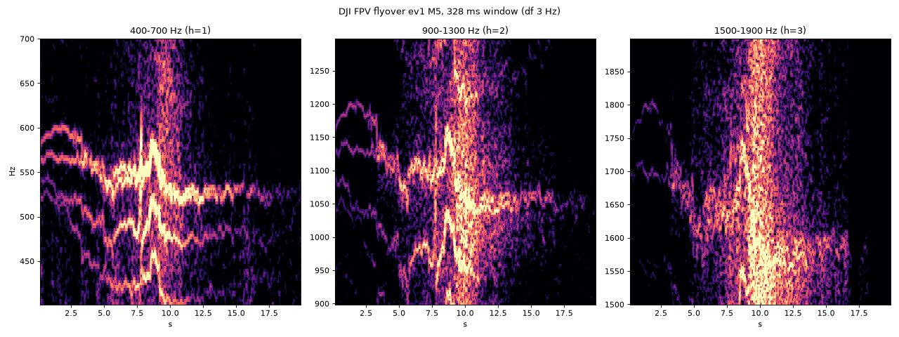

# Step5-1 결과 — 공개 원음의 고조파 구조

> 2026-10-14 | 도구: `Tools/audio/harmonic_survey.py` (프레임 8192점 @ 50 kHz = 164 ms, Δf 6.1 Hz)
> 데이터: Salford DroneNoise (지상 마이크 9개, 고도 10 m, 통과 15 m/s / 호버), Western Sydney DJI Air 3 (ch1~5)

## 1. 요약

| 그룹 | 파일 | f0 (5% / 중앙 / 95%) | 연속으로 쓸 만한 고조파 | 선 에너지 95% / 99% |
| --- | --- | --- | --- | --- |
| **DJI FPV 통과** | 27 | 411 / 518 / 569 Hz | **4개 (~2.1 kHz)** | 2.6 / 4.7 kHz |
| Mini 3 Pro 통과 | 27 | 113 / 243 / 268 Hz | 6개 (~1.5 kHz) | 0.7 / 1.2 kHz |
| Mini 3 Pro 호버 | 10 | 108 / 175 / 254 Hz | 8개 (~1.4 kHz) | 2.8 / 5.8 kHz |
| Matrice 300 통과 | 45 | 46 / 92 / 108 Hz | 8개 (~0.7 kHz) | 1.3 / 2.8 kHz |
| Matrice 300 호버 | 18 | 40 / 82 / 100 Hz | 2개 (~0.2 kHz) | 2.2 / 3.7 kHz |
| Yuneec H520E 통과 | 27 | 44 / 81 / 171 Hz | 8개 (~0.6 kHz) | 1.5 / 3.3 kHz |
| Yuneec H520E 호버 | 9 | 144 / 150 / 156 Hz | 8개 (~1.2 kHz) | 2.0 / 4.3 kHz |
| Air 3 (WS) | 10 | 86 / 165 / 217 Hz | 9개 (~1.5 kHz) | 3.8 / 8.4 kHz * |

- "쓸 만한 고조파" = 고조파 자리의 SNR 중앙값이 고조파 사이 자리보다 6 dB 이상 높은 차수. 중간에 둘 이상 연속으로 빠지면 거기서 끊는다.
- 선 에너지 = 고조파 자리(±1칸)에서 잡음 바닥 위로 올라온 에너지의 누적. 높은 차수에서는 광대역 요동도 섞이므로 99% 값은 위쪽 한계로 읽는다.
- \* Air 3 녹음은 디지털 레벨이 −80 dBFS라 녹음기 잡음의 영향이 클 수 있다.
- 선 폭은 모든 그룹이 12~18 Hz(2~3칸)였다. Hann 창의 해상도 한계라서, 164 ms 안에서는 선이 칸보다 좁다는 뜻이다.

## 2. 근접할 때의 광대역 성분

통과 비행에서 머리 위 2초와 처음·끝 2초(멀리)를 대역별로 비교했다. 단위는 dB, 파일 중앙값이다.

| 기체 | 0.15–0.5k | 0.5–1k | 1–2k | 2–3k | 3–4k | 4–5k | 5–6.25k | 6.25–8k | 8–10k | 10–12.5k | 12.5–16k |
| --- | --- | --- | --- | --- | --- | --- | --- | --- | --- | --- | --- |
| DJI FPV | +13 | +25 | +30 | +38 | +38 | +37 | +37 | +36 | +33 | +28 | +21 |
| Mini 3 Pro | +23 | +18 | +19 | +25 | +22 | +20 | +20 | +18 | +15 | +12 | +7 |
| Matrice 300 | +28 | +32 | +35 | +39 | +39 | +40 | +41 | +41 | +37 | +32 | +26 |
| Yuneec H520E | +21 | +26 | +31 | +34 | +35 | +36 | +37 | +36 | +32 | +27 | +19 |

가까이 오면 2~8 kHz 광대역이 가장 크게 올라온다. 하지만 높은 주파수일수록 공기 흡수로 먼저 사라지므로, 멀리 있는 드론에서는 남지 않는 대역이다.

## 3. FPV에서 본 것: 로터마다 회전수가 다르다

- 접근 중(0~3 s): 첫 고조파 근처에 선이 4개쯤(약 520~600 Hz) 따로 움직인다. 2·3번째 고조파에서는 그 간격이 2배, 3배로 벌어져 빗이 흐트러진다.
- f0 분포가 420~440 Hz와 515~570 Hz 두 묶음으로 갈린다. 전진 비행에서 앞뒤 로터의 회전수가 다르다는 해석과 맞는다.
- 머리 위(8~11 s): 0.6~1.9 kHz가 광대역 소음으로 덮이고 선은 묻힌다.
- 통과 뒤 정속 구간: 선이 약 525 Hz 하나로 모인다.
- 다가올 때 약 591 Hz, 멀어질 때 약 530 Hz. 비율 1.12는 15 m/s 도플러 계산값 1.09에 가깝다.

**"f0 하나와 그 정수배"라는 빗 모델은 FPV에서 4번째 고조파 정도까지만 맞는다.**

## 4. 결정과 다음 Step에 주는 것

- **f_use = 5 kHz, ↓4 (12.5 kHz) 유지.**
  - 고조파 선은 모든 기체에서 약 2 kHz 아래에 있다.
  - 선 에너지 99%도 Air 3를 빼면 6 kHz 아래다.
  - 6 kHz 위에 남는 것은 가까울 때의 광대역뿐이고, 탐지 거리를 늘리지는 못한다.
  - ↓2(25 kHz)는 필요 없다. FIR은 Step4 4.3절의 75탭(5 kHz 통과 / 7.5 kHz 저지)부터 시작한다.
- **고조파 검출기** (Step6 B0):
  - 빗살 수 H = 4~8. 지금의 10은 많다.
  - f0 후보는 40~700 Hz. FPV는 400~600 Hz, 대형기는 40~270 Hz.
  - 날개 2개짜리 프롭은 축 회전 주파수(날개 통과의 절반)에도 선이 있다. 그래서 f0를 절반으로 읽는 경우가 많았다 (Mini 3 Pro: 약 110 Hz와 약 230 Hz). 탐지에는 문제가 없지만, f0 값을 특징으로 쓸 때는 주의한다.
- **분류** (Step6): FPV는 빗 하나로 설명되지 않는다. 로터별로 선이 갈라지고, 가까이 오면 광대역이 커진다. 0~6 kHz 전체 모양을 보는 학습 모델(log-mel)이 필요할 근거다.
- **방향** (Step7):
  - 쓸 만한 선이 모두 2.1 kHz 아래다. 지금 간격 7 cm의 c/2d(2450 Hz)보다 낮으므로, 공간 앨리어싱은 고조파 마스크에서 문제가 되지 않는다.
  - 14 cm로 넓히면 c/2d가 1225 Hz가 되어 FPV는 첫 두 고조파만 그 아래에 든다.
  - 가까이 오면 광대역(2~6 kHz)이 크므로, 고조파 마스크와 함께 BPF / SNR 가중 방식도 비교할 이유가 있다.

## 5. 한계

- FPV 기체는 DJI FPV 하나, 비행 방식은 통과 비행뿐이다(호버 없음). 독립 사건은 3회다.
- 모든 녹음이 고도 10 m의 근거리다. 먼 거리에서는 높은 차수가 더 빨리 사라지므로, 위 "쓸 만한 고조파"는 거리가 멀수록 줄어든다고 봐야 한다.
- 아직 이 장치(스피커 → MAX4466)를 거친 녹음이 아니다 → Step5-2, 5-3.
